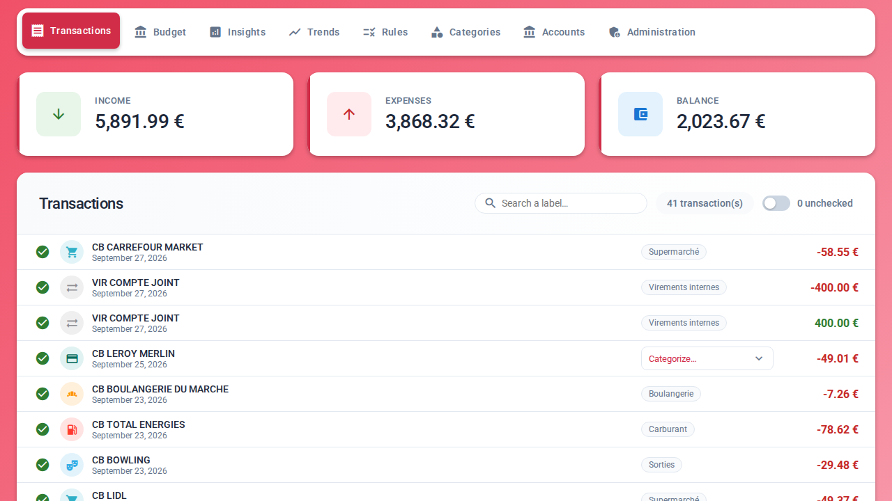
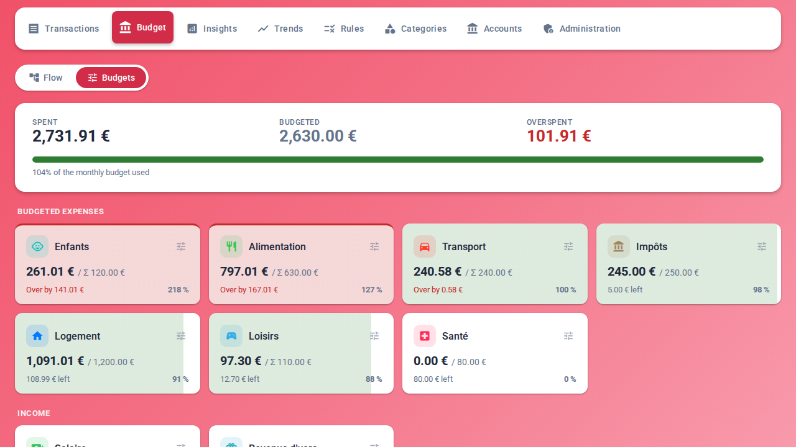
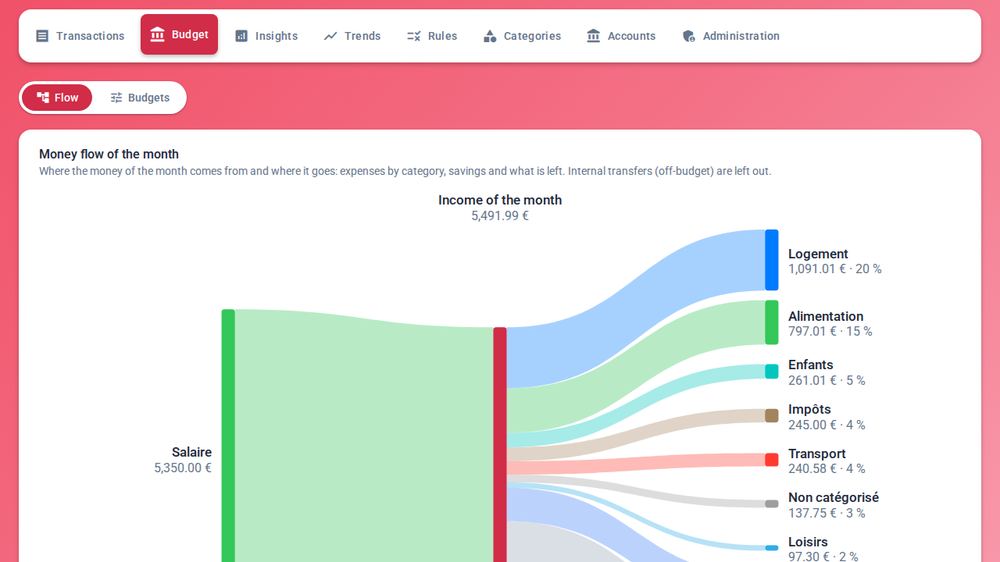
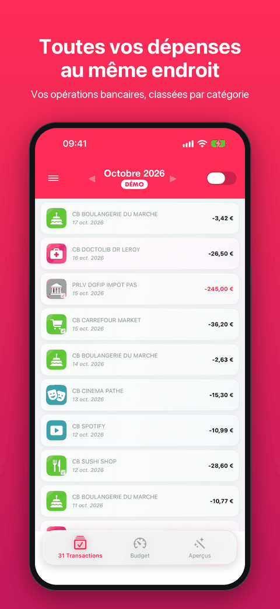
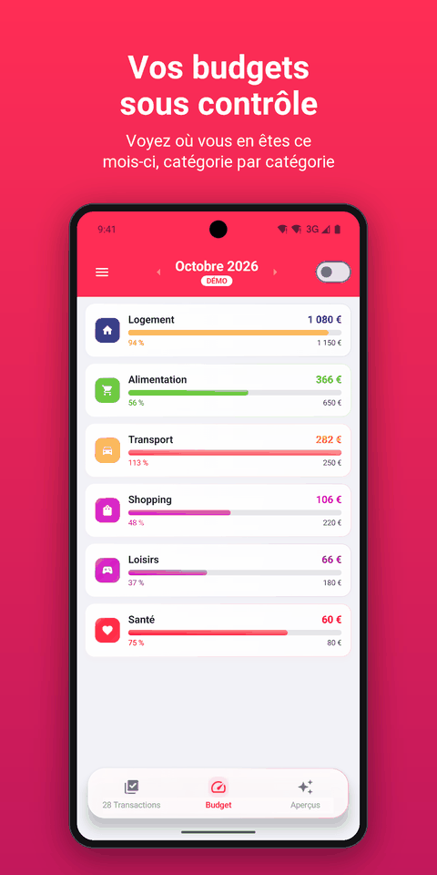
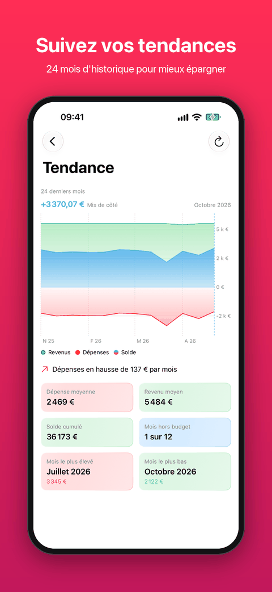
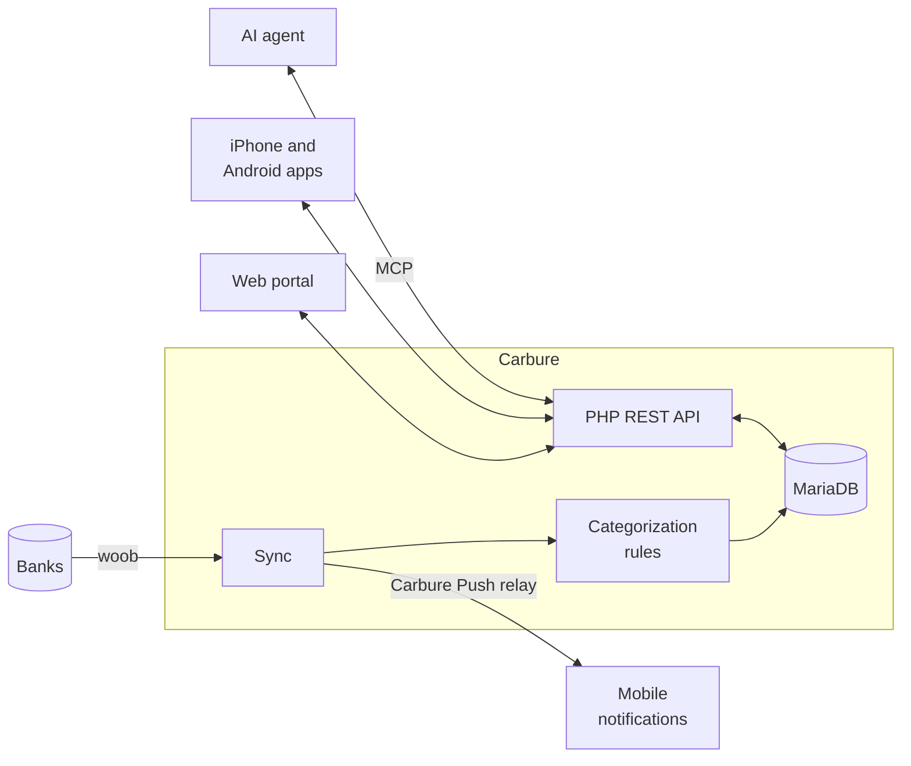

<p align="center">
  
</p>

<h1 align="center">Carbure</h1>

<p align="center">
  <a href="README.md">Français</a> · <strong>English</strong>
</p>

<p align="center">
  <strong>Take back control of your budget.</strong><br>
  Bank accounts synced automatically, expenses categorized, budgets tracked day by day —<br>
  on the web, on iPhone and on Android. Self-hosted, free and open source.
</p>

<p align="center">
  <strong>💸 Free, no subscription · 🏠 100% self-hosted · 🙅 No third-party cloud</strong>
</p>

<p align="center">
  <a href="https://demo.carbure.org/"><strong>▶ Try the online demo</strong></a> (log in as <code>demo</code> / <code>carbure</code>)
</p>

<p align="center">
  <a href="https://apps.apple.com/fr/app/carbure/id6824057363"></a>
  <a href="https://play.google.com/store/apps/details?id=org.carbure.app"></a><br>
  <sub>📱 Free mobile apps, no ads nor data collection, connected to <strong>your</strong> server</sub>
</p>

<p align="center">
  <a href="https://github.com/ltoinel/Carbure/actions/workflows/ci.yml"></a>
  <a href="https://github.com/ltoinel/Carbure/actions/workflows/security.yml"></a>
  <a href="https://github.com/ltoinel/Carbure/releases"></a>
  <a href="https://hub.docker.com/r/ltoinel/carbure"></a>
  <a href="https://github.com/ltoinel/Carbure/actions/workflows/ci.yml"></a>
  <a href="https://www.php.net/"></a>
  <a href="https://mariadb.org/"></a>
  <a href="https://carbure.org/en/"></a>
  <a href="https://discord.gg/QsxYw4Rx9D"></a>
  <a href="LICENSE"></a>
</p>

<p align="center">
  <a href="https://www.youtube.com/watch?v=PUCd27oJkig"></a>
</p>

<p align="center">
  
</p>

<table>
  <tr>
    <td width="50%" valign="top">
      
      <br><sub><b>Budgets</b> — spent, remaining and overspent per category</sub>
    </td>
    <td width="50%" valign="top">
      
      <br><sub><b>Money flow</b> — where the month's income goes</sub>
    </td>
  </tr>
</table>

<p align="center">👉 <a href="https://carbure.org/en/fonctionnalites/"><b>All the features</b></a>, with every screen</p>

## Why Carbure?

- 🔄 **No manual entry**: transactions arrive on their own from your bank every day, through
  [woob](https://woob.tech/) — a direct connection, no third-party aggregator. Or import the
  statements of your bank (OFX, QIF, CSV, CAMT.053): Carbure spots the duplicates first.
- 🏷️ **Automatic categorization**: simple rules ("CARREFOUR → Groceries") sort every
  transaction. A new one? Pick its category and Carbure suggests the rule.
- 🎯 **Monthly budgets**: spent, remaining and overspent, category by category, at a glance.
  Budget the sub-categories and their parent adds them up — or set its own amount. The
  **monthly flow** shows where the money comes from and where it goes: click a category to
  see its transactions.
- 📈 **Trends**: income, spending and savings over 3, 6 or 12 months, compared with the
  previous period or the same period last year.
- ✅ **Check-off**: verify transactions in one click and filter those still to review.
- 🔁 **Recurring transactions**: salary, rent, subscriptions and bills are spotted on their
  own; see at a glance those still expected this month.
- 🔔 **Alerts on your phone and by email**: after each sync, as soon as an expense exceeds the
  threshold you set, when a rule you chose matches, or when the spending of a budget
  reaches the percentage you chose; each user picks push, email or both for each kind of
  alert.
- 📊 **Insights**: your own monthly indicators (groceries, fuel, subscriptions…).
- 🌗 **Light or dark, accessible**: the portal follows the theme of your system or switches
  in one click, respects its high contrast settings and aims at WCAG 2.2 AA.
- 👨‍👩‍👧 **Built for households**: several users, shared accounts and data, each with their own
  language and devices; an administrator manages accounts, categories, rules, users and the
  configuration, copies the ready-made command that schedules the sync, and backs up or
  restores the data (categories, rules, budgets, transactions…) in a ZIP.
- 🤖 **Ask your AI agent about your money**: a built-in, read-only MCP server — which you can
  turn off — answers questions like "how much did we spend on restaurants this year?" or
  "which budgets are we over?". Claude (web, Desktop, mobile) connects from the server URL
  alone, after your approval in the portal; Claude Code, ChatGPT, Cursor, Copilot and Gemini
  with an access token.
- 🔒 **Everything stays with you**: Carbure runs on your own server (a NAS is enough). No
  account to create, no aggregator, no cloud: your bank credentials and data stay in your
  local database. The only outbound connections are to your bank (woob), once a day to the
  public API of GitHub to tell the administrators about a new release (nothing about your
  instance is sent; `update_check` setting to turn it off) and, if you enable them, the
  Carbure Push relay (notifications of the iPhone and Android apps) and your SMTP server.

> 🌍 **Bank coverage**: Carbure relies on [woob](https://woob.tech/) modules, which mainly
> cover French banks. The portal is available in French, English, Spanish,
> Italian, German and Portuguese; amounts are in euros by default, or in the currency of the
> instance (`currency` setting, display only).

> 📱 **Mobile apps**: the Carbure apps are available on the
> [**App Store**](https://apps.apple.com/fr/app/carbure/id6824057363) (iPhone, iOS 26 or later) and on
> [**Google Play**](https://play.google.com/store/apps/details?id=org.carbure.app) (Android 8.0 or later):
> transactions, check-off, budgets, insights, trends, sync, Face ID or fingerprint login and
> push notifications ([features](https://carbure.org/en/applications-mobiles/)).
> Free, no ads nor subscription, no data collected; available in France for now. They connect
> to **your** Carbure server. The web portal also installs as an app on a computer or a phone
> (Chrome/Edge "Install", Safari "Add to Dock" or "Add to Home Screen"), over HTTPS.

<p align="center">
  
  
  
</p>

## How does it compare?

| | **Carbure** | **Firefly III** | **Actual Budget** | **Kresus** |
|---|---|---|---|---|
| Bank connection | Direct, via woob | Third-party aggregators | Third-party aggregators | Direct, via woob |
| Sub-categories adding up to their parent | ✅ | ➖ | ⚠️ | ➖ |
| Several users sharing the same data | ✅ | ⚠️ | ✅ | ➖ |
| Native iPhone and Android apps, push notifications | ✅ | ➖ | ➖ | ➖ |
| Built-in MCP server for AI agents | ✅ | ➖ | ➖ | ➖ |
| File import (OFX, QIF, CSV, CAMT.053) | ✅ | ✅ | ✅ | ⚠️ |
| Several currencies | ➖ | ✅ | ➖ | ⚠️ |

✅ yes · ⚠️ partly · ➖ no — 👉 **[Full comparison](https://carbure.org/en/comparatif/)**:
23 criteria (hosting, bank data, budget, household and devices, API), with the strengths of
each tool.

## How it works



## Quick start

Three ways to run Carbure, depending on what you want to do:

| | For | In short |
|---|---|---|
| [**1. Demo**](#1-try-the-demo) | trying Carbure with a sample household | `docker run --rm -p 8080:80 ltoinel/carbure:demo` |
| [**2. Production**](#2-install-it-for-real) | managing your household's real budget | `docker compose pull && docker compose up -d` (image `ltoinel/carbure`), then the setup wizard |
| [**3. Development**](#3-run-it-locally-to-develop) | changing the code | `./start.sh` |

### 1. Try the demo

Nothing to install: open the online demo at **[demo.carbure.org](https://demo.carbure.org/)**
(fictitious data). Or run it at home: the demo image runs
Carbure with its database and a sample household, wiped at each start (never for real data):

```bash
docker run --rm -p 8080:80 ltoinel/carbure:demo
```

Then open `http://localhost:8080/portal/`: the login page shows the demo account (the
password of the `admin` administrator is printed in the container logs).

### 2. Install it for real

With Docker, the production image [`ltoinel/carbure`](https://hub.docker.com/r/ltoinel/carbure)
(nginx, PHP and woob included, no sample data, not to be confused with `:demo`) and
MariaDB. The repository only provides `docker/docker-compose.yml`; `docker compose pull`
downloads the published image of the latest release (without it, Compose would build the
image from the code of the repository):

```bash
git clone https://github.com/ltoinel/Carbure.git && cd Carbure/docker
docker compose pull && docker compose up -d
```

To control upgrades, replace `latest` with a version
(`image: ltoinel/carbure:1.9.1`, see the [tags](https://carbure.org/en/installation/#recuperer-limage)).

Open `http://localhost:8080/`: **the setup wizard** handles everything (database,
administrator account, and optional starter categories, rules and insights) in three
clicks, with no command to run. Database upgrades are automatic too. On a Synology NAS,
follow the [tutorial](https://carbure.org/en/synology/); to reach it from your phone, put it
behind an HTTPS reverse proxy ([installation](https://carbure.org/en/installation/)).

> 🚧 **YunoHost**: a [`carbure_ynh`](https://github.com/ltoinel/carbure_ynh) package is in
> preparation, to install Carbure in a few clicks on a [YunoHost](https://yunohost.org)
> server. It is not in the catalog nor tested on a real server yet; it installs Carbure
> 1.10.0 ([follow-up and tests](https://github.com/ltoinel/Carbure/issues/45),
> [installation](https://carbure.org/en/installation/#avec-yunohost-en-preparation)).

### 3. Run it locally to develop

With Git and Docker, from a clone of the repository:

```bash
git clone https://github.com/ltoinel/Carbure.git && cd Carbure
./start.sh
```

`./start.sh` starts the production image and MariaDB with the code of the repository
mounted live (a change is taken at the next request) and a sample household: open
`http://localhost:8000/portal/` and log in as `admin` / `admin-password`. Useful options:
`--reset` (fresh sample data), `--fresh` (empty install, setup wizard), `--fake-woob`
(simulated banks), `--build` (rebuild the image), `--stop`, `--clean`; `./start.sh --help`
lists them. The tests (PHPUnit, portal unit tests, Playwright end-to-end tests) are
described in the [developer documentation](https://carbure.org/en/developpement/).

👉 **Detailed installation, configuration, API reference, data model and security:
[the documentation](https://carbure.org/en/)**.

## Support

<p>
  <a href="https://discord.gg/QsxYw4Rx9D"></a>
  <a href="https://www.youtube.com/@carbure-org"></a>
</p>

- **Discord**: help, questions, ideas and chat with the community, on the Carbure server
  (invitation: <https://discord.gg/QsxYw4Rx9D>).
- **Videos**: Carbure in action on the [YouTube channel](https://www.youtube.com/@carbure-org)
  (in French).
- **Found a bug?** [Open an issue](https://github.com/ltoinel/Carbure/issues); report a
  security vulnerability privately (see [SECURITY.md](SECURITY.md)).

All the ways to get help, and the FAQ: [Support](https://carbure.org/en/assistance/).

## Contributing

Contributions are welcome:

- read [CONTRIBUTING.md](CONTRIBUTING.md): workflow (issue, branch, pull request),
  conventions and tests; the rules of the code are detailed in [AGENTS.md](AGENTS.md);
- pick a task among the open ones in [TODO.md](TODO.md);
- set up the development environment:
  [Run it locally to develop](#3-run-it-locally-to-develop);
- if Carbure is useful to you, a ⭐ helps others find it.

## License

[MIT](LICENSE) © Ludovic Toinel

The bundled third-party software (woob, curl_cffi, PHP, nginx, portal libraries…), its
licenses and the credits are listed in [THIRD-PARTY-NOTICES.md](THIRD-PARTY-NOTICES.md).
