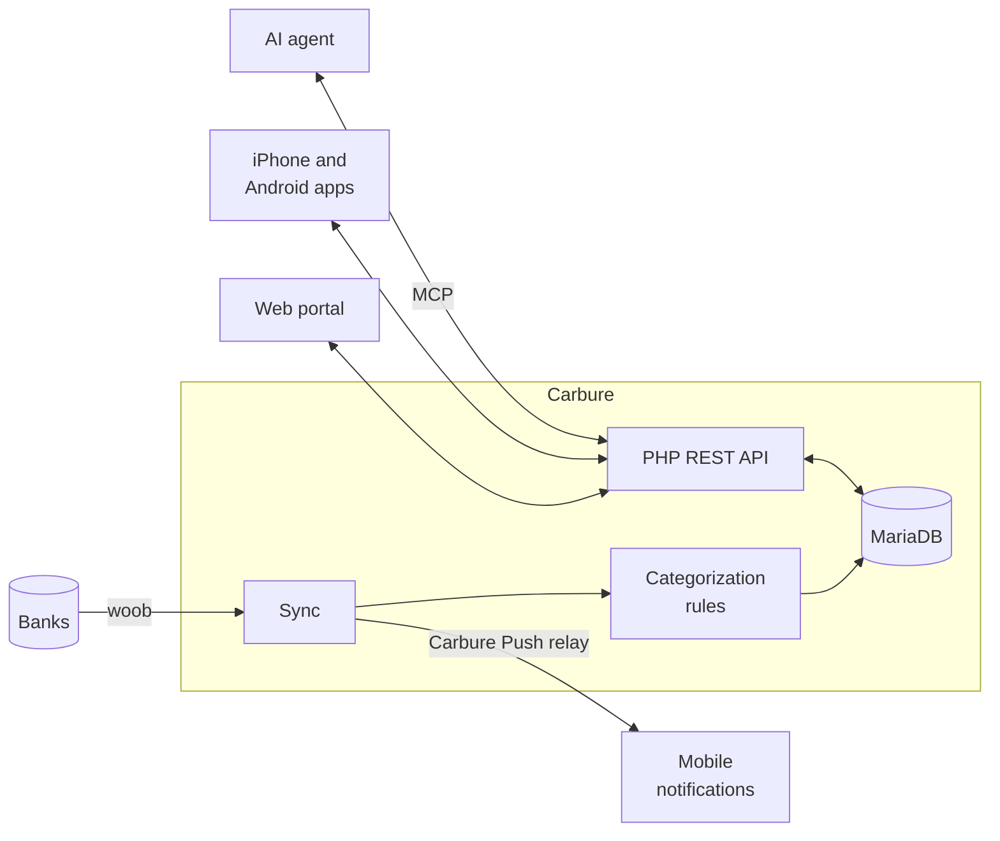

<p align="center">
  
</p>

<h1 align="center">Carbure</h1>

<p align="center">
  <a href="README.md">Français</a> · <strong>English</strong>
</p>

<p align="center">
  <strong>Take back control of your budget.</strong><br>
  Bank accounts synced automatically, expenses categorized, budgets tracked day by day —<br>
  on the web, on iPhone and on Android. Self-hosted, free and open source.
</p>

<p align="center">
  <strong>💸 Free, no subscription · 🏠 100% self-hosted · 🙅 No third-party cloud</strong>
</p>

<p align="center">
  <a href="https://demo.carbure.org/"><strong>▶ Try the online demo</strong></a> (log in as <code>demo</code> / <code>carbure</code>)
</p>

<p align="center">
  <a href="https://apps.apple.com/fr/app/carbure/id6824057363"></a>
  <a href="https://play.google.com/store/apps/details?id=org.carbure.app"></a><br>
  <sub>📱 Free mobile apps, no ads nor data collection, connected to <strong>your</strong> server</sub>
</p>

<p align="center">
  <a href="https://github.com/ltoinel/Carbure/actions/workflows/ci.yml"></a>
  <a href="https://github.com/ltoinel/Carbure/actions/workflows/security.yml"></a>
  <a href="https://github.com/ltoinel/Carbure/releases"></a>
  <a href="https://hub.docker.com/r/ltoinel/carbure"></a>
  <a href="https://carbure.org/en/"></a>
  <a href="LICENSE"></a>
</p>

<p align="center">
  <a href="https://www.youtube.com/watch?v=PUCd27oJkig"></a>
</p>

<p align="center">
  
</p>

<table>
  <tr>
    <td width="50%" valign="top">
      
      <br><sub><b>Budgets</b> — spent, remaining and overspent per category</sub>
    </td>
    <td width="50%" valign="top">
      
      <br><sub><b>Money flow</b> — where the month's income goes</sub>
    </td>
  </tr>
</table>

<p align="center">👉 <a href="https://carbure.org/en/fonctionnalites/"><b>All the features</b></a>, with every screen</p>

## Features

- 🔄 **No typing**: transactions arrive every day from your bank, directly through
  [woob](https://woob.tech/), with no aggregator; or import your statements (OFX, QIF, CSV,
  CAMT.053).
- 🏷️ **Automatic categorization** by simple rules ("CARREFOUR → Groceries"), suggested when
  you categorize a new transaction.
- 🎯 **Monthly budgets** per category, subcategories adding up in their parent, and the
  **monthly flow**: where the money comes from and where it goes.
- 📈 **Trends** over 3, 6 or 12 months, compared with the previous period or last year.
- ✅ **Check-off** of the transactions and 🔁 **recurring transactions** found on their own
  (salary, rent, subscriptions).
- 🔔 **Alerts** by push notification or email: large expense, chosen rule, budget nearly
  reached.
- 📊 **Insights**: your own monthly indicators (groceries, fuel, subscriptions…).
- 👨‍👩‍👧 **Built for the household**: several users on the same accounts, each with their
  language and devices; backup and restore in one ZIP.
- 🤖 **Your AI agent queries your accounts** ("how much on restaurants this year?") through a
  built-in, read-only MCP server: Claude, ChatGPT, Cursor, Copilot, Gemini…
- 🌗 **Light or dark, accessible** (WCAG 2.2 AA), in French, English, Spanish, Italian, German
  and Portuguese.

Carbure relies on the woob modules, which mainly cover **French banks**.

## Mobile apps

The [**iPhone**](https://apps.apple.com/fr/app/carbure/id6824057363) (iOS 26) and
[**Android**](https://play.google.com/store/apps/details?id=org.carbure.app) (Android 8.0) apps
connect to **your** server: transactions, check-off, budgets, trends, sync, Face ID or
fingerprint and push notifications. Free, no ads nor data collection, available in France for
now ([details](https://carbure.org/en/applications-mobiles/)).

<p align="center">
  
  
  
</p>

## Your data stays with you

Carbure runs on your own server (a NAS is enough): no account to create, no aggregator, no
cloud. Your credentials and banking data stay in your database. Carbure only contacts your
bank (woob), the public GitHub API once a day to report a new version (can be turned off),
and, if you turn them on, the relay of the mobile notifications and your email server.



## Comparison

| | **Carbure** | **Firefly III** | **Actual Budget** | **Kresus** | **Sure** | **ezBookkeeping** |
|---|---|---|---|---|---|---|
| Bank connection | Direct, via woob | Third-party aggregators | Third-party aggregators | Direct, via woob | Third-party aggregators | File import |
| Sub-categories adding up to their parent | ✅ | ➖ | ⚠️ | ➖ | ✅ | ⚠️ |
| Several users sharing the same data | ✅ | ⚠️ | ✅ | ➖ | ✅ | ⚠️ |
| Native iPhone and Android apps, push notifications | ✅ | ⚠️ | ➖ | ➖ | ⚠️ | ➖ |
| Built-in MCP server for AI agents | ✅ | ➖ | ➖ | ➖ | ✅ | ✅ |
| File import (OFX, QIF, CSV, CAMT.053) | ✅ | ⚠️ | ✅ | ⚠️ | ⚠️ | ✅ |
| Several currencies | ➖ | ✅ | ➖ | ⚠️ | ✅ | ✅ |

✅ yes · ⚠️ partly · ➖ no — 👉 **[Full comparison](https://carbure.org/en/comparatif/)**:
24 criteria (hosting, bank data, budget, household and devices, API), with the strengths of
each tool.

## Installation

| | For | How |
|---|---|---|
| **Online demo** | see Carbure without installing anything | [demo.carbure.org](https://demo.carbure.org/) (`demo` / `carbure`) |
| **Demo at home** | try it with a sample household | `docker run --rm -p 8080:80 ltoinel/carbure:demo` |
| **Docker** (recommended) | manage the real household budget | see below |
| **Synology NAS** | a NAS at home | [step-by-step tutorial](https://carbure.org/en/synology/) |
| **YunoHost** | a YunoHost server | [`carbure_ynh` package](https://carbure.org/en/installation/#avec-yunohost) |
| **Web server** | PHP 8.2 and MariaDB/MySQL already in place | [installation without Docker](https://carbure.org/en/installation/#sur-un-serveur-web-existant) |

With Docker, the [`ltoinel/carbure`](https://hub.docker.com/r/ltoinel/carbure) image holds
nginx, PHP and woob; `docker/docker-compose.yml` adds MariaDB:

```bash
git clone https://github.com/ltoinel/Carbure.git && cd Carbure/docker
docker compose pull && docker compose up -d
```

Open `http://localhost:8080/`: the **setup wizard** creates the database and the
administrator account in three clicks. For the mobile apps, put Carbure behind an HTTPS
reverse proxy.

👉 **Detailed installation, upgrades, configuration, API and security:
[the documentation](https://carbure.org/en/installation/).**

## Development

```bash
git clone https://github.com/ltoinel/Carbure.git && cd Carbure
./start.sh
```

`./start.sh` runs Carbure with the code of the repository mounted live and a sample household
on `http://localhost:8000/portal/` (`admin` / `admin-password`); `./start.sh --help` lists its
options. Tests and architecture: [developer documentation](https://carbure.org/en/developpement/).

## Support

<p>
  <a href="https://discord.gg/QsxYw4Rx9D"></a>
  <a href="https://www.youtube.com/@carbure-org"></a>
</p>


Questions and help on [Discord](https://discord.gg/QsxYw4Rx9D), FAQ in
[support](https://carbure.org/en/assistance/). A bug?
[Open an issue](https://github.com/ltoinel/Carbure/issues); report a security flaw privately
([SECURITY.md](SECURITY.md)).

## Contributing

Contributions are welcome: read [CONTRIBUTING.md](CONTRIBUTING.md) (workflow, conventions,
tests) and [AGENTS.md](AGENTS.md) (code rules), and pick a task in [TODO.md](TODO.md). If
Carbure is useful to you, a ⭐ helps other people find it.

## License

[MIT](LICENSE) © Ludovic Toinel. Bundled third-party software and their licenses:
[THIRD-PARTY-NOTICES.md](THIRD-PARTY-NOTICES.md).
