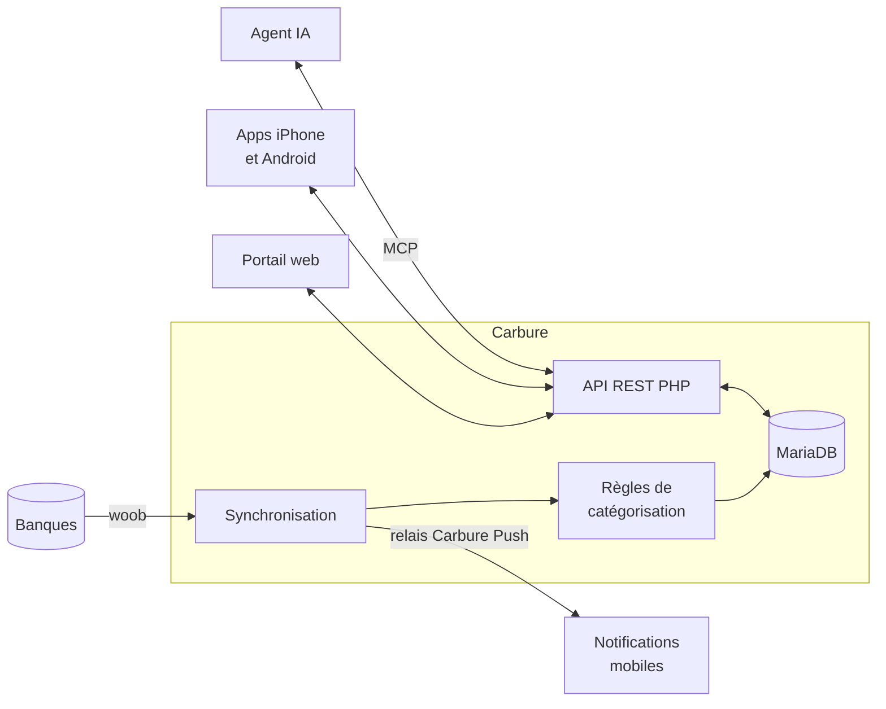

<p align="center">
  
</p>

<h1 align="center">Carbure</h1>

<p align="center">
  <strong>Français</strong> · <a href="README.en.md">English</a>
</p>

<p align="center">
  <strong>Reprenez le contrôle de votre budget.</strong><br>
  Vos comptes bancaires synchronisés automatiquement, vos dépenses catégorisées,<br>
  vos budgets suivis au jour le jour — sur le web, sur iPhone et sur Android. Hébergé chez vous, gratuit et open source.
</p>

<p align="center">
  <strong>💸 Gratuit, sans abonnement · 🏠 100 % hébergé chez vous · 🙅 Aucun service cloud tiers</strong>
</p>

<p align="center">
  <a href="https://demo.carbure.org/"><strong>▶ Essayer la démo en ligne</strong></a> (compte <code>demo</code> / <code>carbure</code>)
</p>

<p align="center">
  <a href="https://apps.apple.com/fr/app/carbure/id6824057363"></a>
  <a href="https://play.google.com/store/apps/details?id=org.carbure.app"></a><br>
  <sub>📱 Applications mobiles gratuites, sans publicité ni collecte de données, connectées à <strong>votre</strong> serveur</sub>
</p>

<p align="center">
  <a href="https://github.com/ltoinel/Carbure/actions/workflows/ci.yml"></a>
  <a href="https://github.com/ltoinel/Carbure/actions/workflows/security.yml"></a>
  <a href="https://github.com/ltoinel/Carbure/releases"></a>
  <a href="https://hub.docker.com/r/ltoinel/carbure"></a>
  <a href="https://carbure.org/"></a>
  <a href="LICENSE"></a>
</p>

<p align="center">
  <a href="https://www.youtube.com/watch?v=PUCd27oJkig"></a>
</p>

<p align="center">
  
</p>

<table>
  <tr>
    <td width="50%" valign="top">
      
      <br><sub><b>Budgets</b> — dépensé, restant et dépassement par catégorie</sub>
    </td>
    <td width="50%" valign="top">
      
      <br><sub><b>Flux du mois</b> — où partent les revenus du mois</sub>
    </td>
  </tr>
</table>

<p align="center">👉 <a href="https://carbure.org/fonctionnalites/"><b>Toutes les fonctionnalités</b></a>, avec chaque écran</p>

## Fonctionnalités

- 🔄 **Zéro saisie** : les opérations arrivent chaque jour de votre banque, en direct avec
  [woob](https://woob.tech/), sans agrégateur ; ou importez vos relevés (OFX, QIF, CSV, CAMT.053).
- 🏷️ **Catégorisation automatique** par des règles simples (« CARREFOUR → Supermarché »),
  proposées quand vous classez une nouvelle transaction.
- 🎯 **Budgets mensuels** par catégorie, les sous-catégories s'additionnant dans leur parent,
  et le **flux du mois** : d'où vient l'argent, où il part.
- 📈 **Tendances** sur 3, 6 ou 12 mois, comparées à la période précédente ou à l'an dernier.
- ✅ **Pointage** des transactions et 🔁 **opérations récurrentes** repérées toutes seules
  (salaire, loyer, abonnements).
- 🔔 **Alertes** par notification push ou email : grosse dépense, règle choisie, budget presque
  atteint.
- 📊 **Insights** : vos propres indicateurs du mois (courses, carburant, abonnements…).
- 👨‍👩‍👧 **Pensé pour le foyer** : plusieurs utilisateurs sur les mêmes comptes, chacun sa
  langue et ses appareils ; sauvegarde et restauration en un ZIP.
- 🤖 **Votre agent IA interroge vos comptes** (« combien en restaurants cette année ? ») par
  un serveur MCP intégré, en lecture seule : Claude, ChatGPT, Cursor, Copilot, Gemini…
- 🌗 **Clair ou sombre, accessible** (WCAG 2.2 AA), en français, anglais, espagnol, italien,
  allemand et portugais.

Carbure s'appuie sur les modules de woob, qui couvrent surtout les **banques françaises**.

## Applications mobiles

Les applications [**iPhone**](https://apps.apple.com/fr/app/carbure/id6824057363) (iOS 26) et
[**Android**](https://play.google.com/store/apps/details?id=org.carbure.app) (Android 8.0) se
connectent à **votre** serveur : transactions, pointage, budgets, tendances, synchronisation,
Face ID ou empreinte et notifications push. Gratuites, sans publicité ni collecte de données,
disponibles en France pour le moment ([détails](https://carbure.org/applications-mobiles/)).

<p align="center">
  
  
  
</p>

## Vos données restent chez vous

Carbure tourne sur votre propre serveur (un NAS suffit) : pas de compte à créer, pas
d'agrégateur, pas de cloud. Vos identifiants et vos données bancaires restent dans votre base.
Carbure ne contacte que votre banque (woob), l'API publique de GitHub une fois par jour pour
signaler une nouvelle version (désactivable), et, si vous les activez, le relais des
notifications mobiles et votre serveur d'email.



## Comparaison

| | **Carbure** | **Firefly III** | **Actual Budget** | **Kresus** |
|---|---|---|---|---|
| Connexion bancaire | Directe, via woob | Agrégateurs tiers | Agrégateurs tiers | Directe, via woob |
| Sous-catégories additionnées dans leur parent | ✅ | ➖ | ⚠️ | ➖ |
| Plusieurs utilisateurs sur les mêmes données | ✅ | ⚠️ | ✅ | ➖ |
| Apps natives iPhone et Android, notifications push | ✅ | ➖ | ➖ | ➖ |
| Serveur MCP intégré pour les agents IA | ✅ | ➖ | ➖ | ➖ |
| Import de fichiers (OFX, QIF, CSV, CAMT.053) | ✅ | ✅ | ✅ | ⚠️ |
| Plusieurs devises | ➖ | ✅ | ➖ | ⚠️ |

✅ oui · ⚠️ en partie · ➖ non — 👉 **[Comparatif complet](https://carbure.org/comparatif/)** :
23 critères (hébergement, données bancaires, budget, foyer et appareils, API), avec les points
forts de chacun.

## Installation

| | Pour | Comment |
|---|---|---|
| **Démo en ligne** | voir Carbure sans rien installer | [demo.carbure.org](https://demo.carbure.org/) (`demo` / `carbure`) |
| **Démo chez vous** | essayer avec un foyer d'exemple | `docker run --rm -p 8080:80 ltoinel/carbure:demo` |
| **Docker** (recommandé) | gérer le vrai budget du foyer | voir ci-dessous |
| **NAS Synology** | un NAS à la maison | [tutoriel pas à pas](https://carbure.org/synology/) |
| **YunoHost** | un serveur YunoHost | [paquet `carbure_ynh`](https://carbure.org/installation/#avec-yunohost) |
| **Serveur web** | PHP 8.2 et MariaDB/MySQL déjà en place | [installation sans Docker](https://carbure.org/installation/#sur-un-serveur-web-existant) |

Avec Docker, l'image [`ltoinel/carbure`](https://hub.docker.com/r/ltoinel/carbure) contient
nginx, PHP et woob ; `docker/docker-compose.yml` y ajoute MariaDB :

```bash
git clone https://github.com/ltoinel/Carbure.git && cd Carbure/docker
docker compose pull && docker compose up -d
```

Ouvrez `http://localhost:8080/` : l'**assistant d'installation** crée la base et le compte
administrateur en trois clics. Pour les applications mobiles, placez Carbure derrière un
proxy inverse en HTTPS.

👉 **Installation détaillée, mises à jour, configuration, API et sécurité :
[la documentation](https://carbure.org/installation/).**

## Développer

```bash
git clone https://github.com/ltoinel/Carbure.git && cd Carbure
./start.sh
```

`./start.sh` lance Carbure avec le code du dépôt monté en direct et un foyer d'exemple sur
`http://localhost:8000/portal/` (`admin` / `admin-password`) ; `./start.sh --help` liste ses
options. Tests et architecture : [documentation développeur](https://carbure.org/developpement/).

## Assistance

<p>
  <a href="https://discord.gg/QsxYw4Rx9D"></a>
  <a href="https://www.youtube.com/@carbure-org"></a>
</p>

Questions et entraide sur le [Discord](https://discord.gg/QsxYw4Rx9D), FAQ dans
l'[assistance](https://carbure.org/assistance/). Un bug ?
[Ouvrez une issue](https://github.com/ltoinel/Carbure/issues) ; une faille de sécurité se
signale en privé ([SECURITY.md](SECURITY.md)).

## Contribuer

Les contributions sont les bienvenues : lisez [CONTRIBUTING.md](CONTRIBUTING.md) (démarche,
conventions, tests) et [AGENTS.md](AGENTS.md) (règles du code), et choisissez une tâche dans
[TODO.md](TODO.md). Si Carbure vous est utile, une ⭐ aide d'autres personnes à le découvrir.

## Licence

[MIT](LICENSE) © Ludovic Toinel. Logiciels tiers embarqués et leurs licences :
[THIRD-PARTY-NOTICES.md](THIRD-PARTY-NOTICES.md).
