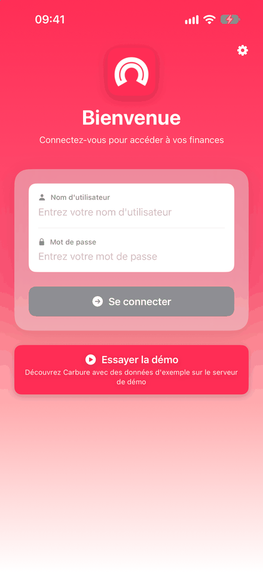
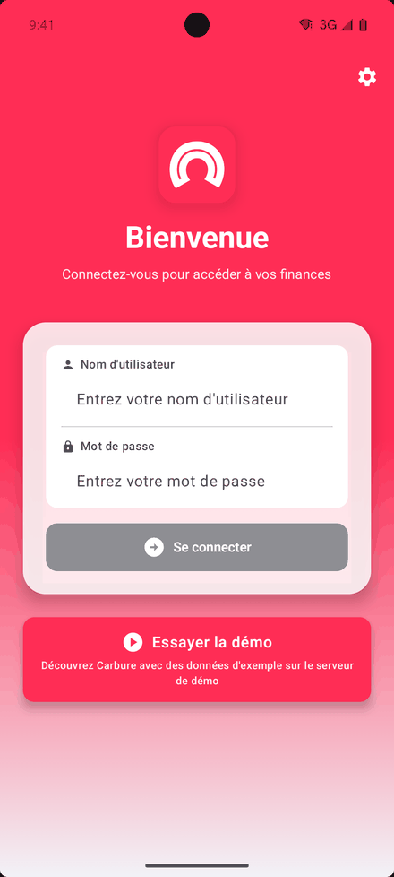
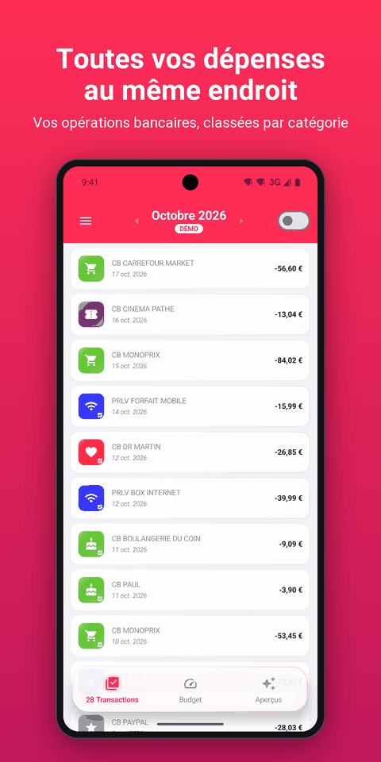
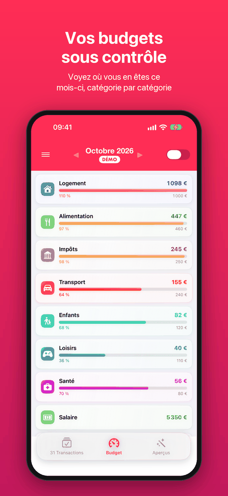
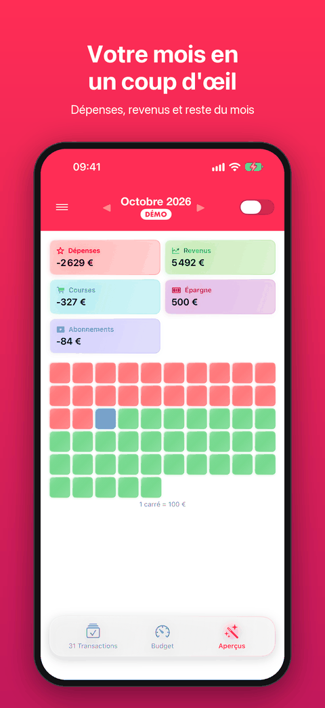
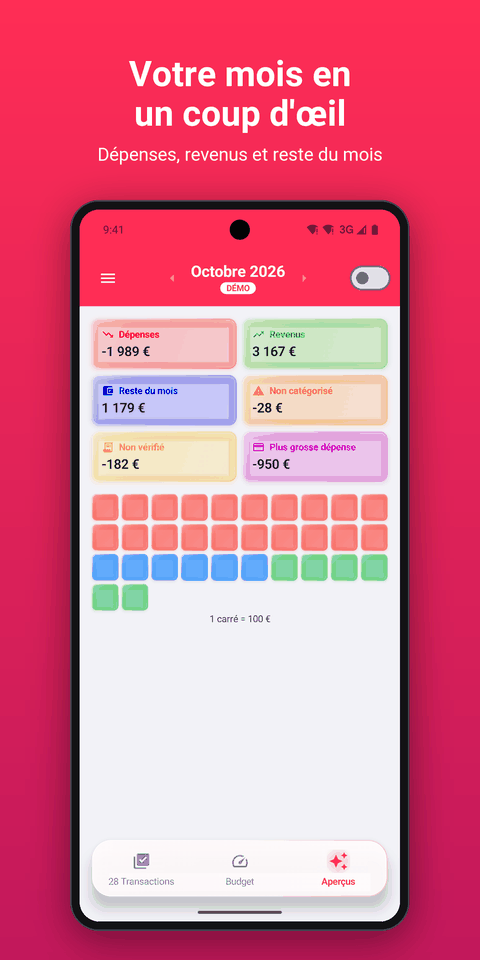
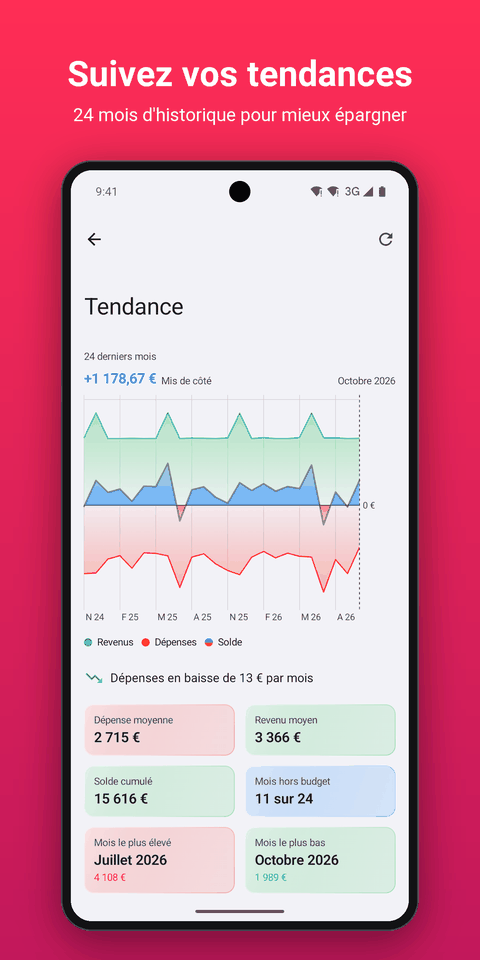
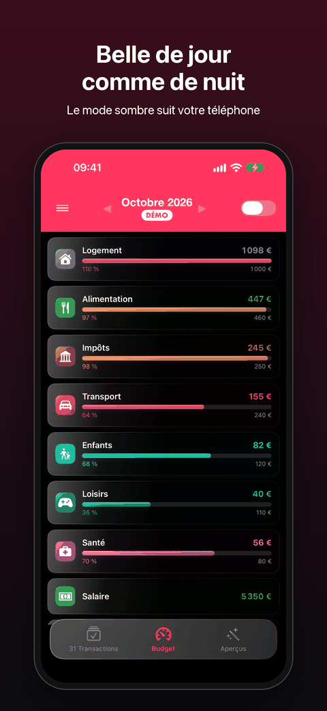
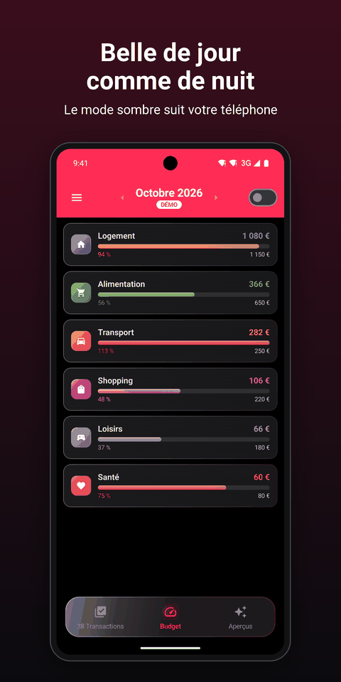

# Mobile apps

Carbure is available as a **native app** for **iPhone** (SwiftUI) and for **Android**
(Jetpack Compose). Both offer the same screens and connect to **your** Carbure server,
through the same [API](api.md) as the web portal: no data goes through a third-party
service, except push notifications (see [below](#notifications-push)).

{ loading=lazy }
{ loading=lazy }
{ loading=lazy }
{ .mobile-screens }

The apps are made for **day-to-day tracking**: viewing, checking, categorizing, adjusting
a budget, starting a sync. Administration (bank accounts, rules, categories, insights,
users, settings) and statement import remain in the [web portal](portail.md).

| | iPhone | Android |
|---|---|---|
| Minimum system | iOS 26 | Android 8.0 |
| Languages | French, English (the phone's language) | French, English (the phone's language) |
| Passwordless login | Face ID / Touch ID | fingerprint or face (strong biometrics) |
| Push notifications | Apple (APNs) | Google (Firebase Cloud Messaging) |
| Theme | system, light or dark | system, light or dark |

## Download { #telecharger }

[App Store (iPhone)](https://apps.apple.com/fr/app/carbure/id6824057363){ .md-button .md-button--primary }
[Google Play (Android)](https://play.google.com/store/apps/details?id=org.carbure.app){ .md-button .md-button--primary }

- **Free**, no ads nor subscription; **no data collected** (see
  [Privacy](confidentialite.md)).
- Available **in France** for now.
- **Requirement**: a Carbure server [installed](installation.md) and reachable from the
  phone, or the [online demo](https://demo.carbure.org/) to try it.
- The web portal [can also be installed as an app](portail.md#installer-le-portail-comme-une-application)
  on your phone.

A rating or a review on the stores helps the project a lot. For help, join the
[Discord](https://discord.gg/QsxYw4Rx9D); for a bug, open an
[issue on GitHub](https://github.com/ltoinel/Carbure/issues).

## Login { #connexion }

The login screen asks for the **username** and **password** of the Carbure account.

{ loading=lazy }
{ loading=lazy }
{ .mobile-screens }

- **Server address**: the ⚙ button at the top right shows the API address field
  (`https://<server>/api/`); it must use `http` or `https`, with no username or password
  in the URL. It is saved at login, along with the last username entered.
- **Try the demo**: logs in to the [demo server](https://demo.carbure.org/) with a shared
  account, without touching the saved server or password. A **DEMO** badge appears under
  the month.
- **Server version**: before each login, the app reads `GET /health`; if the server
  requires a more recent version of the app (`min_mobile_version`), login is refused with
  a message asking you to update the app.
- **Error messages**: wrong credentials, locked account (after 5 failures, see
  [Security](securite.md)), server not found or unreachable.
- **Registered device**: at login, the app sends the phone's name and platform and its
  notification token; the device appears in **My profile → My devices** in the portal,
  where it can be deleted.
- **Session**: the session token stays in memory; you have to log in again (with your
  password or biometrics) each time the app is launched.

### Two-factor authentication { #double-authentification }

When [two-factor authentication](securite.md#double-authentification-totp) is required, a
second screen asks for the **6-digit code** from the authenticator app, or a **recovery
code** (`xxxxx-xxxxx`). If the user does not have an authenticator app yet, the app shows
the key to add, with the **Add to an authenticator app** (`otpauth://` link) and **Copy
the key** buttons, then, once the first code is accepted, the **10 recovery codes** to
copy and keep before opening the session. The code is no longer requested afterwards from
that phone.

### Face ID and fingerprint { #face-id-et-empreinte }

In **Settings → Security**, **biometric login** (Face ID or Touch ID on iPhone, fingerprint
or face on Android) saves the username and password at the next login:

- on iPhone, in the **Keychain**, limited to this device;
- on Android, encrypted with a **Keystore** key that requires biometrics on every use; a
  new face or fingerprint enrolled on the phone erases them.

The login screen then offers biometrics automatically. The password is only sent to the
server for which it was entered; disabling the option, changing server or a rejected
password erases it. Logging out keeps it.

### Login link { #lien-de-connexion }

A `https://carbure.org/app/?server=<API URL>&user=<username>` link, opened on
the phone (or scanned as a QR code with the camera), opens the app and pre-fills the
server and the username, after confirmation: the app warns that the password will be sent
to this server and that the current session will be closed.

The portal shows this QR code in **My profile → My devices** (**Connect the mobile
app**): it holds the address of the API, the one of the `public_url` setting when it is
set (otherwise the address the portal is opened with), with no username nor password. A
`localhost` or `127.0.0.1` address, which a phone cannot reach, is flagged.

## Loading { #chargement }

After login, the app loads the current month (categories, budgets, transactions,
insights), showing each step; if it fails, **Retry** restarts the loading.

## Main screen { #ecran-principal }

- **Header**: the menu (☰), the displayed **month** with its previous / next arrows, and
  a switch that **hides checked transactions** (in all lists and the counter) to keep only
  those to review.
- **Tab bar**: **Transactions** (with their count), **Budget** and **Insights**. Changing
  the month reloads all three.

### Transactions { #transactions }

The list of the month's transactions: category icon and color, a check mark if the
transaction is checked, label, date and amount (green for a credit, red for an expense
over 100 €).

{ loading=lazy }
{ .mobile-screens }

A transaction opens its **details** (category, amount, label, date, card) with two
actions:

- **Categorize**: choose the category in the tree (a parent category opens its
  subcategories); the transaction is also checked.
- **Point**: marks the transaction as checked.

As in the portal, these actions are shared by the household (see
[Features](fonctionnalites.md#transactions)).

### Budget { #budget }

The categories of the month, those with a budget first: amount spent and, if there is a
budget, a progress bar with the percentage (orange from 80 %, red above 100 %).

A category opens its **details**: a **ring** showing the budget used, then its
**sub-budgets** (if it has subcategories) or its **transactions** of the month. The ⚙
button **changes the budget amount** for that month (whole amount in euros).

{ loading=lazy }
{ .mobile-screens }

### Insights { #apercus }

The month's [insights](insights.md) defined on the server (expenses, income, remaining,
savings…), as tiles, and a **square chart** of the month: each square is worth 100 €
(the scale adapts), with what was spent in red, the remaining planned budget in blue and
the rest of the income in green.

{ loading=lazy }
{ loading=lazy }
{ .mobile-screens }

## Menu { #menu }

### Trends { #tendances }

The **last 24 months**: income above the axis, expenses below and the balance curve (blue
when the month allowed you to put money aside, orange when it went over).

- Tapping or dragging on the chart shows the balance of a month.
- The legend hides or shows each series.
- Below the chart: the change in expenses (recent half of the period compared with the
  older one), average expenses and income, the cumulative balance, the number of months
  over budget, and the months with the highest and lowest expenses.

{ loading=lazy }
{ .mobile-screens }

### Sync { #synchronisation }

Starts the [bank sync](fonctionnalites.md#deroulement-dune-synchronisation) of all
accounts and shows its **live log**, colored by level (info, success, warning, error).
Leaving the screen interrupts it.

!!! warning "Approval by the bank"
    When the bank asks for approval (code, SMS), the app shows it in the log but does not
    let you respond: approve it from the [portal](portail.md#authentification-forte-2fa).

### Settings { #reglages }

- **Server**: the server address; changing it logs you out and forgets the saved
  password. **Reset to Default** restores the default address.
- **Appearance**: **System**, **Light** or **Dark**, applied immediately and saved in the
  profile: the same theme is used in the portal and on the other devices.
- **Security**: [biometric login](#face-id-et-empreinte).
- **Notifications**: **Test Push Notification** sends a test notification to each device
  of the account and shows the result.

{ loading=lazy }
{ loading=lazy }
{ .mobile-screens }

**About** shows the app version; **Logout** closes the session after confirmation.

## Push notifications { #notifications-push }

On first launch, the app asks for permission to show notifications (on Android from
version 13). It then receives the server's notifications, including when it is open:

- sync result of each account;
- large expense, above the user's threshold;
- transaction matching a "Send a notification" rule;
- monthly budget reached.

The content, recipients, language and choice of channels (push, email) are described in
[Features](fonctionnalites.md#notifications); they are set in **My profile →
Notifications** in the portal. On iPhone, the app **badge** shows the number of
transactions to review.

Notifications go through the **Carbure Push** relay, which the administrator enables for
the instance (see [Configuration](configuration.md#push)), then through Apple (APNs) or
Google (Firebase Cloud Messaging). Without this registration, the apps work but do not
receive push notifications.

## Privacy { #confidentialite }

The apps only connect to the server you specify (and to the demo server if you try it),
with no ads or audience measurement. Bank data stays in memory and disappears when the
app is closed; only the server address, the last username, the theme and, if you enable
it, the password protected by biometrics are kept on the phone. Details:
[Privacy policy](confidentialite.md).

## Limitations { #limites }

- No **offline mode**: the server must be reachable.
- No **search** or editing of transactions beyond checking and category; a checked
  transaction cannot be set back to "not checked".
- No **deletion** of budgets, and no administration (accounts, rules, categories,
  insights, users): these screens are in the portal.
- Amounts in **euros**, like the server.
