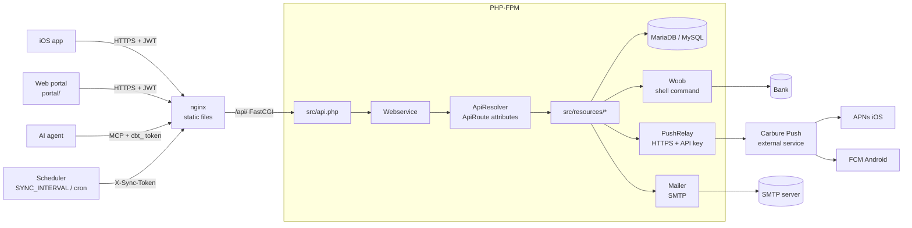
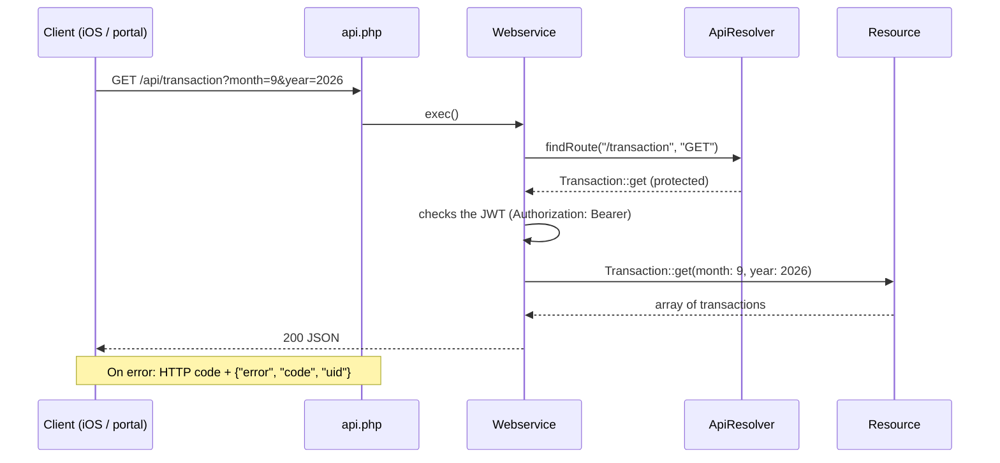
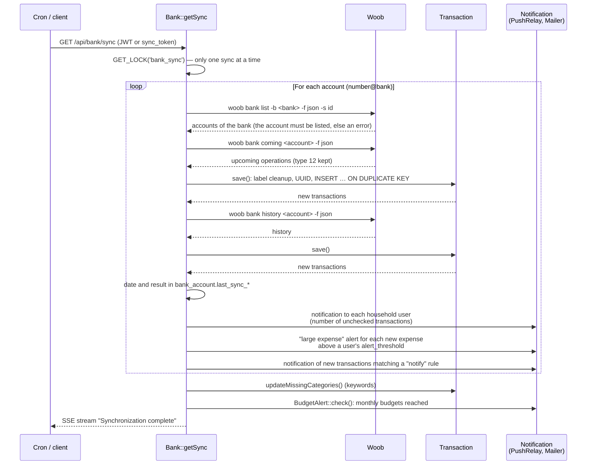
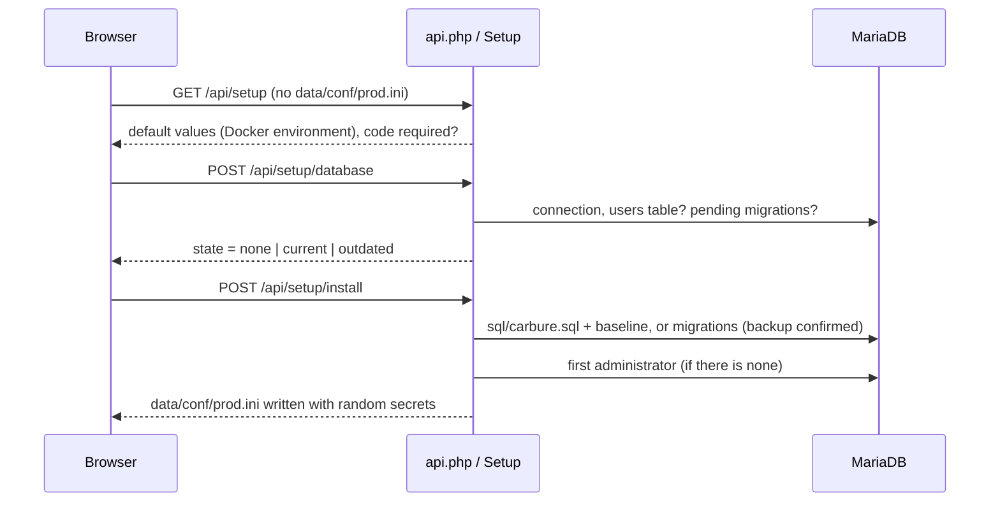

# Architecture

## Overview { #vue-densemble }

| Layer | Role |
|---|---|
| nginx | Serves the portal (`/portal/`) and Swagger UI (`/swagger/`) with their security headers, forwards `/api/` to PHP-FPM (unbuffered, for SSE streams); any other path returns `404` |
| `src/api.php` | Entry point: without a configuration, it only serves the setup wizard (`Setup`); otherwise any URL without a dot is handled as an API call; converts errors into a JSON response with an HTTP code |
| `Webservice` | Reads the JSON body and the query string, sets the headers (security, JSON or SSE), checks access (JWT), calls the resource |
| `ApiResolver` | Discovers routes by reflection on the `#[ApiRoute(path, method, public, stream, raw, admin)]` attribute, with an APCu cache invalidated when a resource file changes; `Webservice` checks the JWT and, for `admin: true`, the administrator profile before calling the method |
| `src/resources/` | Business logic (`Carbure\Resources` namespace, classes loaded on demand): `User`, `Bank`, `Transaction`, `Budget`, `BudgetAlert` (budget alerts), `Category`, `Insight`, `Notification` (channels chosen by each user), `Device`, `ApiToken`, `Mcp`, `OAuth` (AI agents), `Settings` (Settings, Sync), `System` |
| `Setup`, `Installer` | Setup wizard (`/api/setup`): database, schema, first administrator, `data/conf/prod.ini` |
| `Migrator` | Schema versioning (`schema_migrations` table) and application of migrations |
| `Setting` | Settings changed from the portal (`settings` table) |
| `Db` | Single `mysqli` connection, prepared statements |
| `Woob` | Runs woob (`proc_open`), sending SSE *heartbeats* while waiting |
| `PushRelay` | Client of the external **Carbure Push** service (private repository `ltoinel/Carbure-push`), which holds the Apple (APNs) and Firebase (FCM) credentials: instance registration (proof of work, `push_api_key` API key), sending notifications with the platform of each token (`ios`, `android`), dead tokens reported then deleted; without a key, no push |
| `Mailer` | Built-in SMTP client (no dependency): sends email notifications |
| `Messages` | Notification texts (push and email) in the recipient's language |
| `BankFile`, `import/` | Reading imported statements (OFX/QFX, QIF, CAMT.053, CSV with one profile per bank) |
| `WoobRepository` | Repository of woob bank modules: fingerprint of its key, approval by an administrator |
| `Logger` | Buffered logs in `data/logs/carbure_YYYYMMDD.log`, one JSON entry per line: ISO 8601 time, level, request identifier (`uid`), client IP, user, method and path, message and context; one closing line per request (status, duration); purged after `log_retention_days` days |

## Handling a request { #traitement-dune-requete }

Parameters are passed **by name**: the `month` key of the request feeds the `$month`
parameter of the method. An unknown parameter causes a 400 error.

## Bank sync { #synchronisation-bancaire }

- `?account=<number>@<bank>` limits the sync to one account (sync button of the
  Accounts tab).
- Imported transactions are attached to the first user who added the account
  (`MIN(user_id)` in `bank_account`), without restricting their visibility.
- The **label** is converted to uppercase then cleaned by the `regex_label` regular
  expressions of the configuration.
- The **UUID** of a transaction is `md5(actual date + label + amount)` (label truncated to
  24 characters for card payments): it makes it possible to deduplicate transactions
  between two syncs and to turn a "pending" operation into a debited one. Identical
  transactions received together (same actual date, label and amount: two coffees on the
  same day) are told apart by their rank: the first keeps this UUID, the following ones
  get `md5(uuid + "#n")` (`Transaction::prepareAll()`).
- Type 1 transfers (salary) dated after the 25th are attached to the following month.
- **Categorization** searches for the keywords of `bank_transaction_category_keyword` in
  the label of uncategorized transactions of the last month (or of the whole history with
  `POST /category/keyword/apply`).
- Each notification goes through `Notification::notify()`, which sends it on the channels
  chosen by the recipient for that type (`sync`, `rule`, `expense`, `budget`): push
  (`Apns`) and/or email (`Mailer`, if an SMTP server is configured). The failure of one
  channel prevents neither the other nor the sync.
- A transaction is **new** when its UUID did not exist (the `INSERT` creates a row). Only
  new expenses trigger the threshold alert: a re-sync or an operation going from
  "pending" to "debited" does not alert again.

## Web portal { #portail-web }

The portal (`portal/`) is a Vue 3 application with no build step: `index.html` loads Vue,
`i18n.js` (loading of the `i18n/<langue>.json` texts before display) and the `app.js`
module. State and methods are split into *mixins* (`portal/modules/`), HTTP calls are
centralized in `portal/services/apiService.js`. See [Web portal](portail.md).

## Installation and schema updates { #installation-et-mises-a-jour-du-schema }

- The schema is **versioned**: `Migrator` lists the `sql/migrations/*.sql` files, the
  `schema_migrations` table (created if needed) records those applied, and the schema
  version is the last one. A fresh installation creates the schema from
  `sql/carbure.sql` and records all migrations as applied (*baseline*).
- A migration can declare `-- applied-if: <query>`: if the query returns a non-zero
  number (migration already applied by hand), it is only recorded.
- Pending migrations are applied when the Docker container starts (`tools/migrate.php`,
  the container stops if one fails), in the wizard for an existing database, or by an
  administrator from the portal banner (`POST /api/system/migrate`).

## MCP server { #serveur-mcp }

`POST /api/mcp` (`Mcp::handle`) is a public route as far as the router is concerned,
declared `raw`: the method returns the JSON-RPC body itself. It checks that the server is
enabled (`Setting` `mcp_enabled`), the `Origin` header, then authenticates the access
token (`ApiToken::authenticate`, SHA-256 hash, expiration) or a JWT, and runs the
read-only tools by reusing the resources (`Transaction`, `Budget`, `Category`) with the
identity of the token's user. See [AI agents (MCP)](mcp.md).

## Docker image { #image-docker }

| Item | Role |
|---|---|
| `docker/Dockerfile` | `php:8.5-fpm-alpine` + nginx (multi-stage image: woob is built separately, with no compiler in the final image), `mysqli` and APCu extensions, woob and `curl_cffi` in `/opt/woob`, `HEALTHCHECK` on `/api/health` |
| `docker/nginx.conf` | nginx site (portal, Swagger, API, security headers) |
| `docker/php.ini`, `docker/php-fpm.conf` | PHP and PHP-FPM settings |
| `docker/demo/Dockerfile`, `docker/demo/entrypoint.sh` | Demo image (`ltoinel/carbure:demo`): the usual image with MariaDB; on each start, the database is recreated, a configuration with random secrets (`demo=true`), data from `tests/e2e/server/seed.php --demo` with the `demo` / `carbure` account and a random `admin` password shown in the logs, then the usual entrypoint; `docker stop` shuts down nginx, PHP-FPM and MariaDB cleanly |
| `docker/entrypoint.sh` | Prepares `/data`, waits for the database and applies migrations if Carbure is installed, starts the periodic sync (`SYNC_INTERVAL`), then PHP-FPM and nginx |
| `/data` volume (the project's `data/` folder) | `conf/prod.ini`, `conf/setup.code`, `logs/`, `cache/`, woob configuration (`woob/`) |
