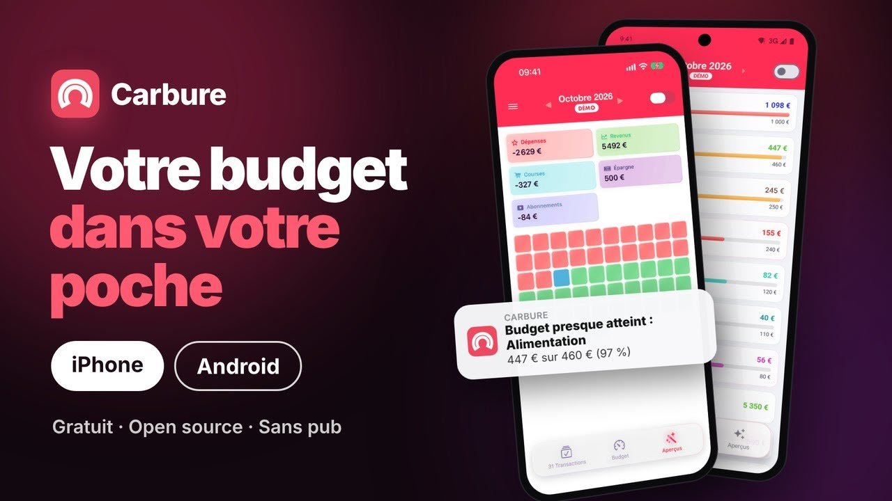
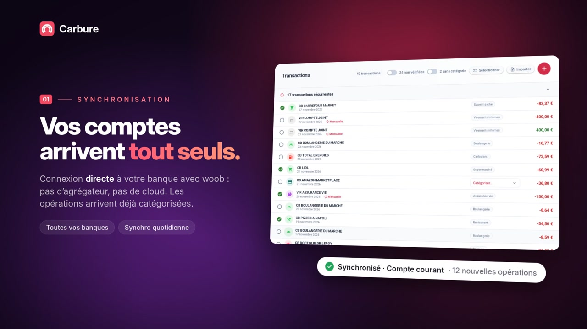
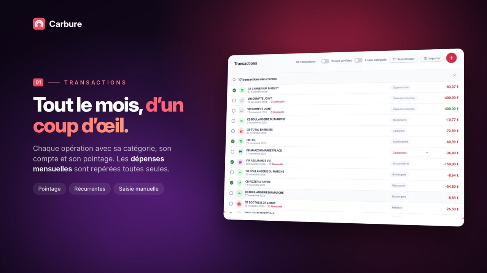
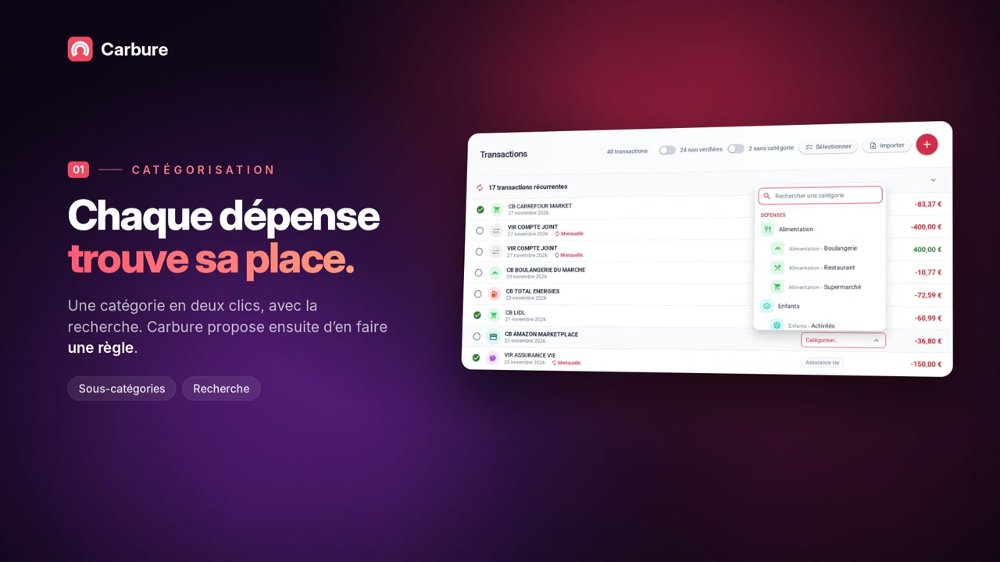
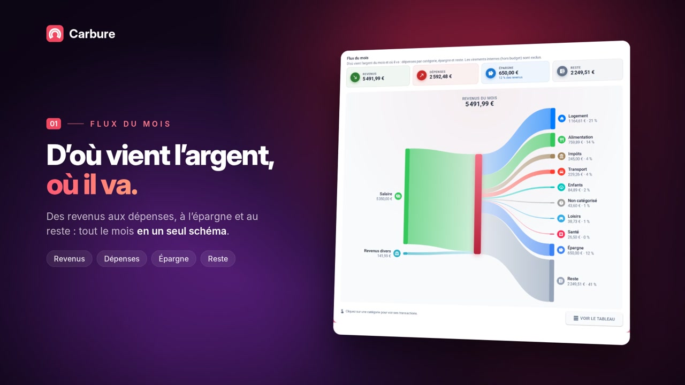
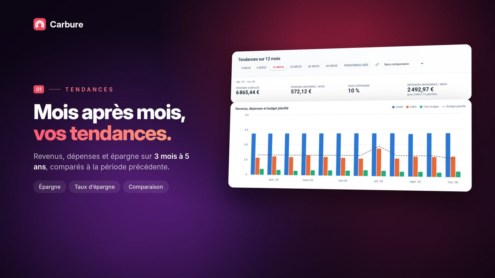
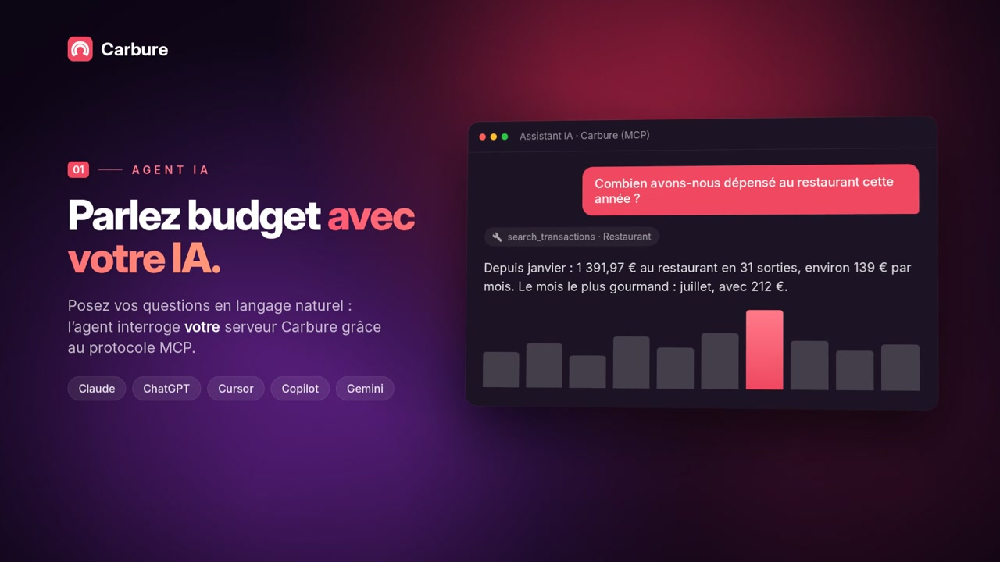
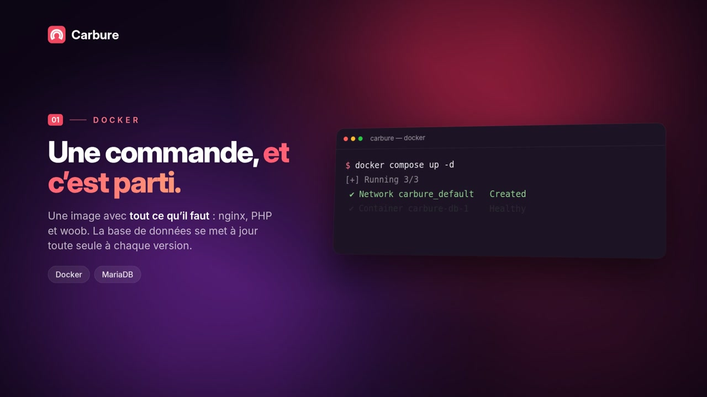
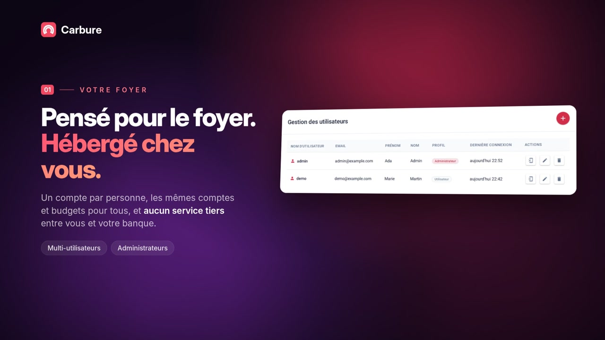

# Support

Carbure is an open source project maintained by volunteers: help comes from the community.
Before asking a question, the [FAQ](faq.md) and the documentation often cover the
essentials: [Installation](installation.md), [Configuration](configuration.md),
[Synology NAS](synology.md), [Web portal](portail.md) and
[Mobile apps](applications-mobiles.md).

## Discord: help and discussion { #discord-entraide-et-echanges }

The Carbure Discord server is the place to get help: installation, configuration or usage
questions, sharing your setup, ideas and upcoming features. The answers to the questions
that come up often join the [FAQ](faq.md).

[Join the Discord server](https://discord.gg/QsxYw4Rx9D){ .md-button .md-button--primary }

Never post your credentials, your tokens (`sync_token`, API key, MCP token), your
configuration files or your bank statements there: mask them in the screenshots and logs
you share.

## Videos { #videos }

The videos of the [Carbure YouTube channel](https://www.youtube.com/@carbure-org),
starting with the teaser, show Carbure in action (in French): a good starting point to
discover it.

<figure markdown>

[{ width="1280" height="720" loading=lazy }](https://www.youtube.com/watch?v=PUCd27oJkig){ .teaser data-youtube="PUCd27oJkig" title="Carbure: the household budget, open source and self-hosted (teaser) (YouTube, in French)" }

<figcaption><strong>Carbure: the household budget, open source and self-hosted (teaser)</strong> Carbure in one minute.</figcaption>
</figure>
<figure markdown>

[{ width="1280" height="720" loading=lazy }](https://www.youtube.com/watch?v=YqSUd7L9fPg){ .teaser data-youtube="YqSUd7L9fPg" title="Carbure on iPhone and Android: your budget in your pocket (YouTube, in French)" }

<figcaption><strong>Carbure on iPhone and Android: your budget in your pocket</strong> The iPhone and Android apps.</figcaption>
</figure>
<figure markdown>

[{ width="1280" height="720" loading=lazy }](https://www.youtube.com/watch?v=WctTx_2k4Cc){ .teaser data-youtube="WctTx_2k4Cc" title="Carbure: your bank accounts synchronized at home (YouTube, in French)" }

<figcaption><strong>Carbure: your bank accounts synchronized at home</strong> Sync with woob, connecting a bank, strong authentication and statement import.</figcaption>
</figure>
<figure markdown>

[{ width="1280" height="720" loading=lazy }](https://www.youtube.com/watch?v=JRdQoLUGIKg){ .teaser data-youtube="JRdQoLUGIKg" title="Carbure: all your transactions, finally readable (YouTube, in French)" }

<figcaption><strong>Carbure: all your transactions, finally readable</strong> The list of the month, search across the whole history and the detail of a transaction.</figcaption>
</figure>
<figure markdown>

[{ width="1280" height="720" loading=lazy }](https://www.youtube.com/watch?v=GLg3n4zoRgI){ .teaser data-youtube="GLg3n4zoRgI" title="Carbure: categorization that works for you (YouTube, in French)" }

<figcaption><strong>Carbure: categorization that works for you</strong> Categorizing in two clicks, creating a rule and managing the household categories.</figcaption>
</figure>
<figure markdown>

[{ width="1280" height="720" loading=lazy }](https://www.youtube.com/watch?v=KAwQ9K_AqSo){ .teaser data-youtube="KAwQ9K_AqSo" title="Carbure: a clear budget, every month (YouTube, in French)" }

<figcaption><strong>Carbure: a clear budget, every month</strong> The money flow of the month, budgets per category and alerts before overspending.</figcaption>
</figure>
<figure markdown>

[{ width="1280" height="720" loading=lazy }](https://www.youtube.com/watch?v=7RzZ9iXamX0){ .teaser data-youtube="7RzZ9iXamX0" title="Carbure: understanding your budget, month after month (YouTube, in French)" }

<figcaption><strong>Carbure: understanding your budget, month after month</strong> Trends over several months, the detail per category and insights.</figcaption>
</figure>
<figure markdown>

[{ width="1280" height="720" loading=lazy }](https://www.youtube.com/watch?v=iInIXN2Lxr8){ .teaser data-youtube="iInIXN2Lxr8" title="Carbure: talk budget with your AI assistant (MCP) (YouTube, in French)" }

<figcaption><strong>Carbure: talk budget with your AI assistant (MCP)</strong> A question in natural language, connecting an agent and read-only access.</figcaption>
</figure>
<figure markdown>

[{ width="1280" height="720" loading=lazy }](https://www.youtube.com/watch?v=5hURMoSPuIg){ .teaser data-youtube="5hURMoSPuIg" title="Installing Carbure in five minutes (Docker, Synology, YunoHost) (YouTube, in French)" }

<figcaption><strong>Installing Carbure in five minutes (Docker, Synology, YunoHost)</strong> Docker, the setup wizard, then Synology, YunoHost or the demo.</figcaption>
</figure>
<figure markdown>

[{ width="1280" height="720" loading=lazy }](https://www.youtube.com/watch?v=NzkeusnHGnI){ .teaser data-youtube="NzkeusnHGnI" title="Carbure: your finances stay at home (YouTube, in French)" }

<figcaption><strong>Carbure: your finances stay at home</strong> The household hosted at home, two-factor authentication and open source code.</figcaption>
</figure>

[Watch the videos on YouTube](https://www.youtube.com/@carbure-org){ .md-button }

## Report a bug { #signaler-un-bug }

[Open an issue](https://github.com/ltoinel/Carbure/issues/new/choose) with the
**Bug report** form. For a quick diagnosis, include:

- the Carbure **version** (portal footer, or Docker image tag) and your deployment
  (Docker, Synology NAS, manual installation);
- what happened, the error message shown and the steps to reproduce it;
- for a synchronization, the bank and its woob module;
- the relevant lines of the **Logs** page of the administration (without personal data).

For the mobile app, also specify the device, the system version and the app version.

## Report a vulnerability { #signaler-une-vulnerabilite }

**Do not open a public issue.** Report it privately on GitHub:
[Report a vulnerability](https://github.com/ltoinel/Carbure/security/advisories/new)
(see the [security policy](https://github.com/ltoinel/Carbure/blob/main/SECURITY.md)).

## Contact { #contact }

For the Carbure Push notification service or the
[privacy policy](confidentialite.md):
[contact@carbure.org](mailto:contact@carbure.org).
