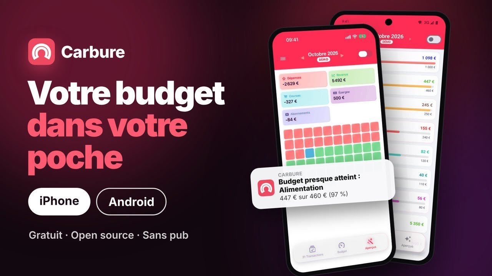
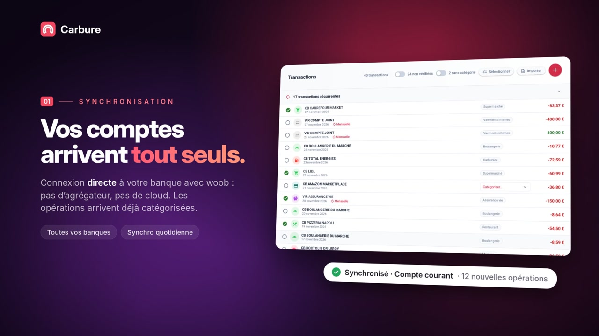
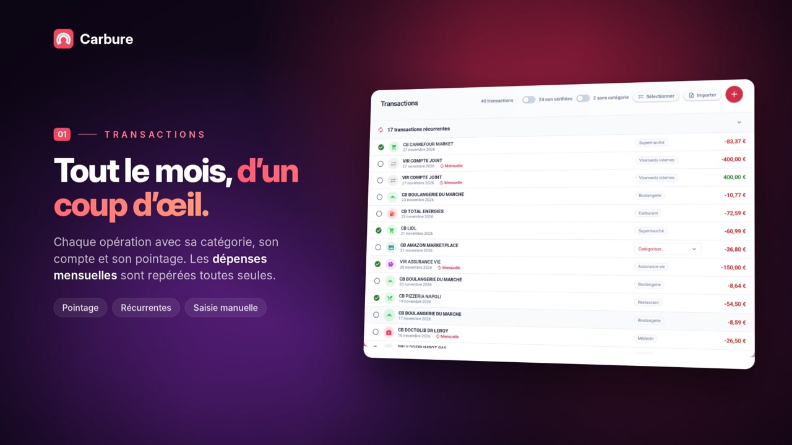
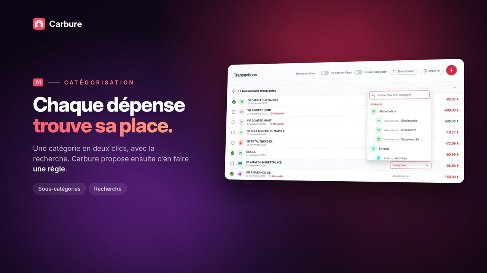
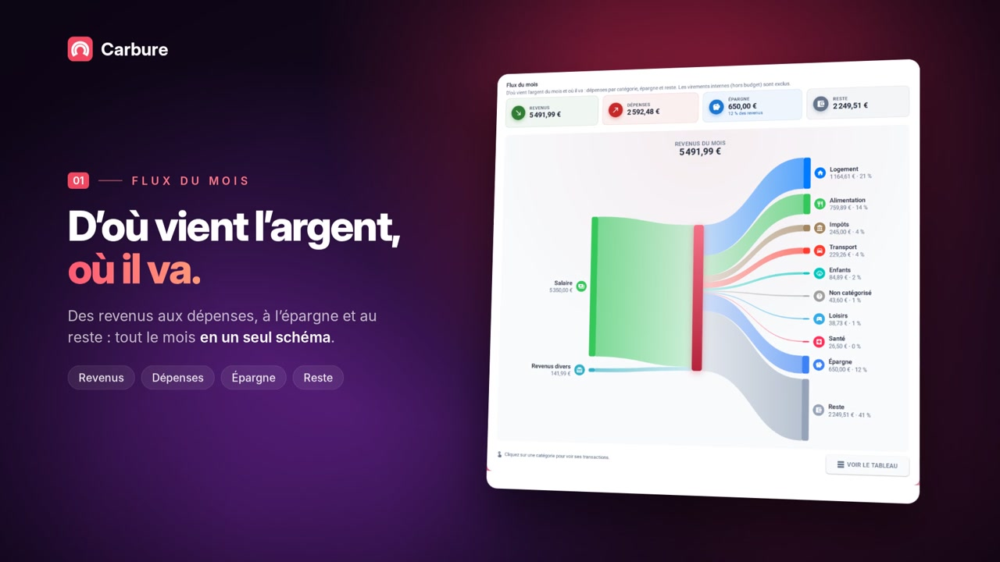
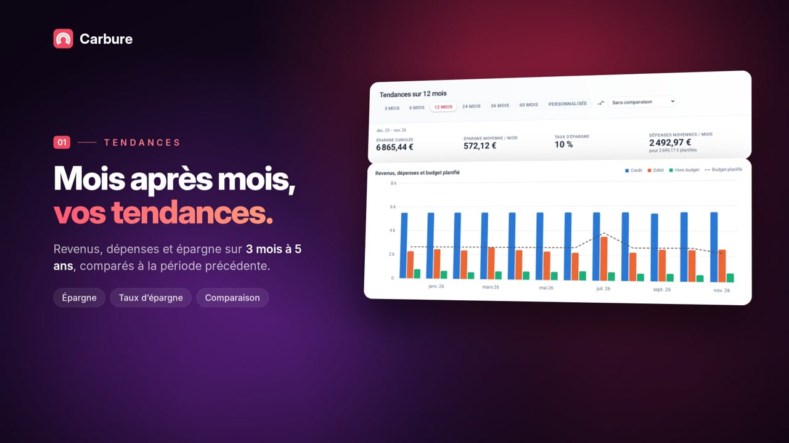
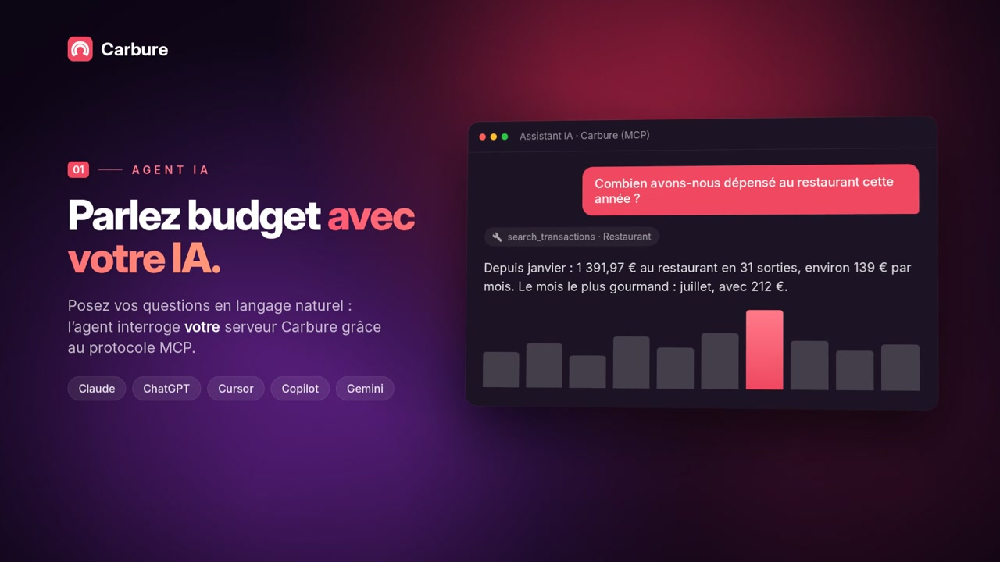
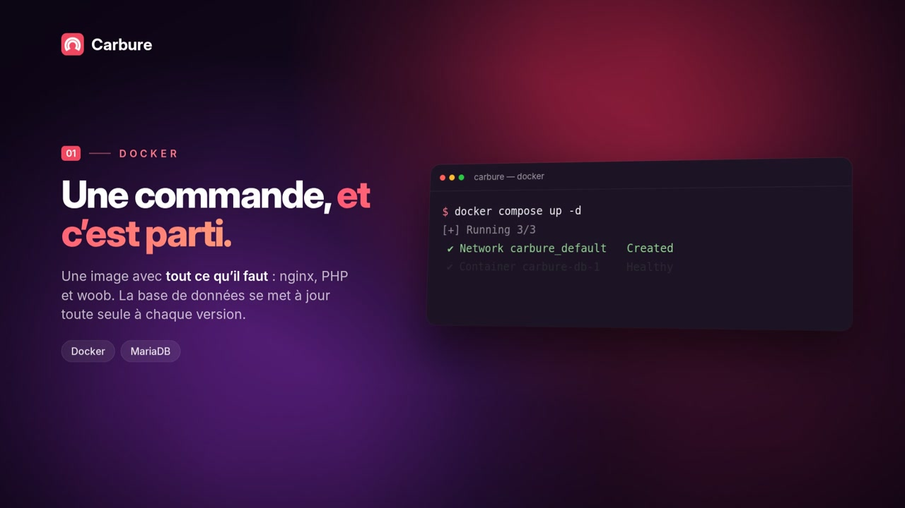
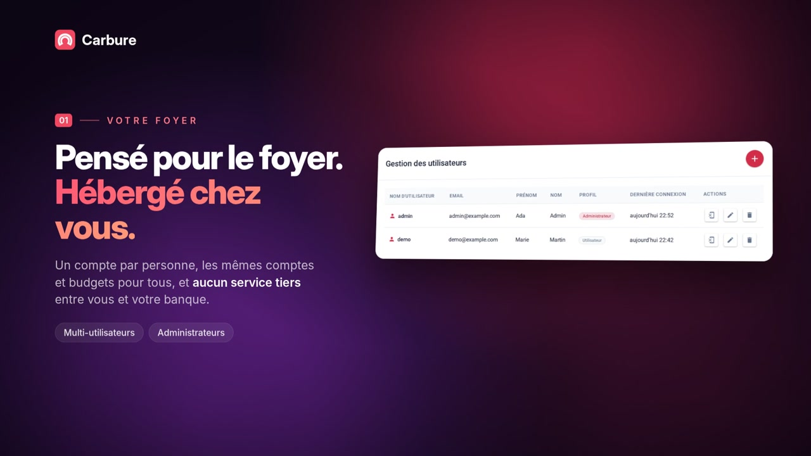

# Assistance

Carbure est un projet open source maintenu bénévolement : l'aide passe par la communauté.
Avant de poser une question, la [FAQ](faq.md) et la documentation répondent souvent à
l'essentiel : [Installation](installation.md), [Configuration](configuration.md),
[NAS Synology](synology.md), [Portail web](portail.md) et
[Applications mobiles](applications-mobiles.md).

## Discord : entraide et échanges

Le serveur Discord de Carbure est l'endroit où obtenir de l'aide : questions
d'installation, de configuration ou d'usage, partage de votre installation, idées et
prochaines fonctionnalités. Les réponses aux questions qui reviennent souvent rejoignent
la [FAQ](faq.md).

[Rejoindre le serveur Discord](https://discord.gg/QsxYw4Rx9D){ .md-button .md-button--primary }

N'y publiez jamais vos identifiants, vos jetons (`sync_token`, clé d'API, jeton MCP), vos
fichiers de configuration ni vos relevés bancaires : masquez-les dans les captures et les
journaux que vous partagez.

## Vidéos

Les vidéos de la [chaîne YouTube de Carbure](https://www.youtube.com/@carbure-org), à
commencer par le teaser, montrent Carbure en action : un bon point de départ pour le
découvrir.

<figure markdown>

[{ width="1280" height="720" loading=lazy }](https://www.youtube.com/watch?v=PUCd27oJkig){ .teaser data-youtube="PUCd27oJkig" title="Carbure : le budget du foyer, open source et auto-hébergé (teaser) (YouTube)" }

<figcaption><strong>Carbure : le budget du foyer, open source et auto-hébergé (teaser)</strong> Carbure en une minute.</figcaption>
</figure>
<figure markdown>

[{ width="1280" height="720" loading=lazy }](https://www.youtube.com/watch?v=YqSUd7L9fPg){ .teaser data-youtube="YqSUd7L9fPg" title="Carbure sur iPhone et Android : votre budget, dans votre poche (YouTube)" }

<figcaption><strong>Carbure sur iPhone et Android : votre budget, dans votre poche</strong> Les applications iPhone et Android.</figcaption>
</figure>
<figure markdown>

[{ width="1280" height="720" loading=lazy }](https://www.youtube.com/watch?v=WctTx_2k4Cc){ .teaser data-youtube="WctTx_2k4Cc" title="Carbure : vos comptes bancaires synchronisés chez vous (YouTube)" }

<figcaption><strong>Carbure : vos comptes bancaires synchronisés chez vous</strong> Synchronisation avec woob, connexion à une banque, authentification forte et import de relevés.</figcaption>
</figure>
<figure markdown>

[{ width="1280" height="720" loading=lazy }](https://www.youtube.com/watch?v=JRdQoLUGIKg){ .teaser data-youtube="JRdQoLUGIKg" title="Carbure : toutes vos transactions, enfin lisibles (YouTube)" }

<figcaption><strong>Carbure : toutes vos transactions, enfin lisibles</strong> La liste du mois, la recherche dans tout l'historique et le détail d'une opération.</figcaption>
</figure>
<figure markdown>

[{ width="1280" height="720" loading=lazy }](https://www.youtube.com/watch?v=GLg3n4zoRgI){ .teaser data-youtube="GLg3n4zoRgI" title="Carbure : la catégorisation qui travaille pour vous (YouTube)" }

<figcaption><strong>Carbure : la catégorisation qui travaille pour vous</strong> Catégoriser en deux clics, créer une règle et gérer les catégories du foyer.</figcaption>
</figure>
<figure markdown>

[{ width="1280" height="720" loading=lazy }](https://www.youtube.com/watch?v=KAwQ9K_AqSo){ .teaser data-youtube="KAwQ9K_AqSo" title="Carbure : un budget clair, chaque mois (YouTube)" }

<figcaption><strong>Carbure : un budget clair, chaque mois</strong> Le flux du mois, les budgets par catégorie et les alertes avant le dépassement.</figcaption>
</figure>
<figure markdown>

[{ width="1280" height="720" loading=lazy }](https://www.youtube.com/watch?v=7RzZ9iXamX0){ .teaser data-youtube="7RzZ9iXamX0" title="Carbure : comprendre votre budget, mois après mois (YouTube)" }

<figcaption><strong>Carbure : comprendre votre budget, mois après mois</strong> Les tendances sur plusieurs mois, le détail par catégorie et les insights.</figcaption>
</figure>
<figure markdown>

[{ width="1280" height="720" loading=lazy }](https://www.youtube.com/watch?v=iInIXN2Lxr8){ .teaser data-youtube="iInIXN2Lxr8" title="Carbure : parlez budget avec votre assistant IA (MCP) (YouTube)" }

<figcaption><strong>Carbure : parlez budget avec votre assistant IA (MCP)</strong> Une question en langage naturel, la connexion d'un agent et l'accès en lecture seule.</figcaption>
</figure>
<figure markdown>

[{ width="1280" height="720" loading=lazy }](https://www.youtube.com/watch?v=5hURMoSPuIg){ .teaser data-youtube="5hURMoSPuIg" title="Installer Carbure en cinq minutes (Docker, Synology, YunoHost) (YouTube)" }

<figcaption><strong>Installer Carbure en cinq minutes (Docker, Synology, YunoHost)</strong> Docker, l'assistant d'installation, puis Synology, YunoHost ou la démo.</figcaption>
</figure>
<figure markdown>

[{ width="1280" height="720" loading=lazy }](https://www.youtube.com/watch?v=NzkeusnHGnI){ .teaser data-youtube="NzkeusnHGnI" title="Carbure : vos finances restent chez vous (YouTube)" }

<figcaption><strong>Carbure : vos finances restent chez vous</strong> Le foyer hébergé chez vous, la double authentification et le code ouvert.</figcaption>
</figure>

[Voir les vidéos sur YouTube](https://www.youtube.com/@carbure-org){ .md-button }

## Signaler un bug

[Ouvrez une issue](https://github.com/ltoinel/Carbure/issues/new/choose) avec le
formulaire **Bug report**. Pour un diagnostic rapide, indiquez :

- la **version** de Carbure (pied de page du portail, ou tag de l'image Docker) et votre
  déploiement (Docker, NAS Synology, installation manuelle) ;
- ce qui s'est passé, le message d'erreur affiché et les étapes pour le reproduire ;
- pour une synchronisation, la banque et son module woob ;
- les lignes utiles de la page **Logs** de l'administration (sans données personnelles).

Pour l'application mobile, précisez aussi l'appareil, la version du système et celle de
l'application.

## Signaler une vulnérabilité

**N'ouvrez pas d'issue publique.** Signalez-la en privé sur GitHub :
[Report a vulnerability](https://github.com/ltoinel/Carbure/security/advisories/new)
(voir la [politique de sécurité](https://github.com/ltoinel/Carbure/blob/main/SECURITY.md)).

## Contact

Pour le service de notifications Carbure Push ou la
[politique de confidentialité](confidentialite.md) :
[contact@carbure.org](mailto:contact@carbure.org).
