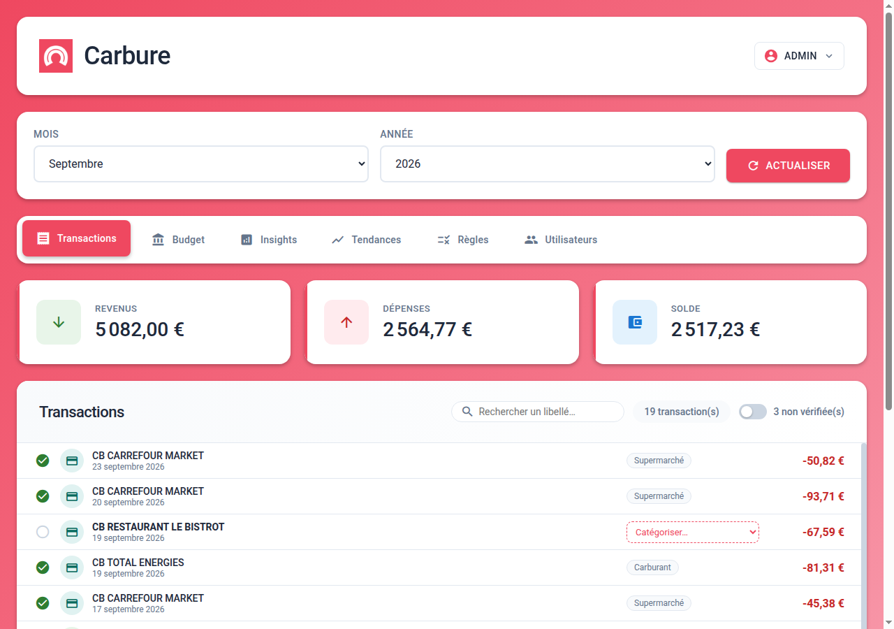
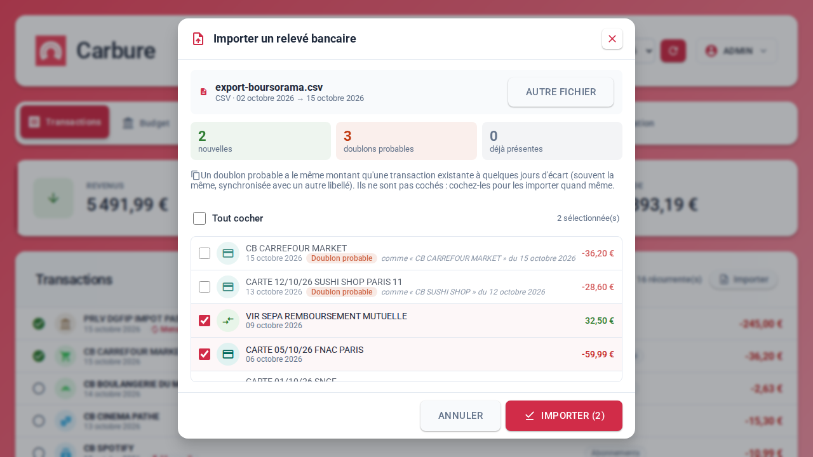
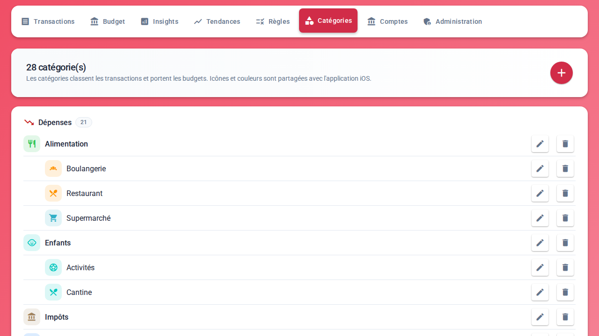
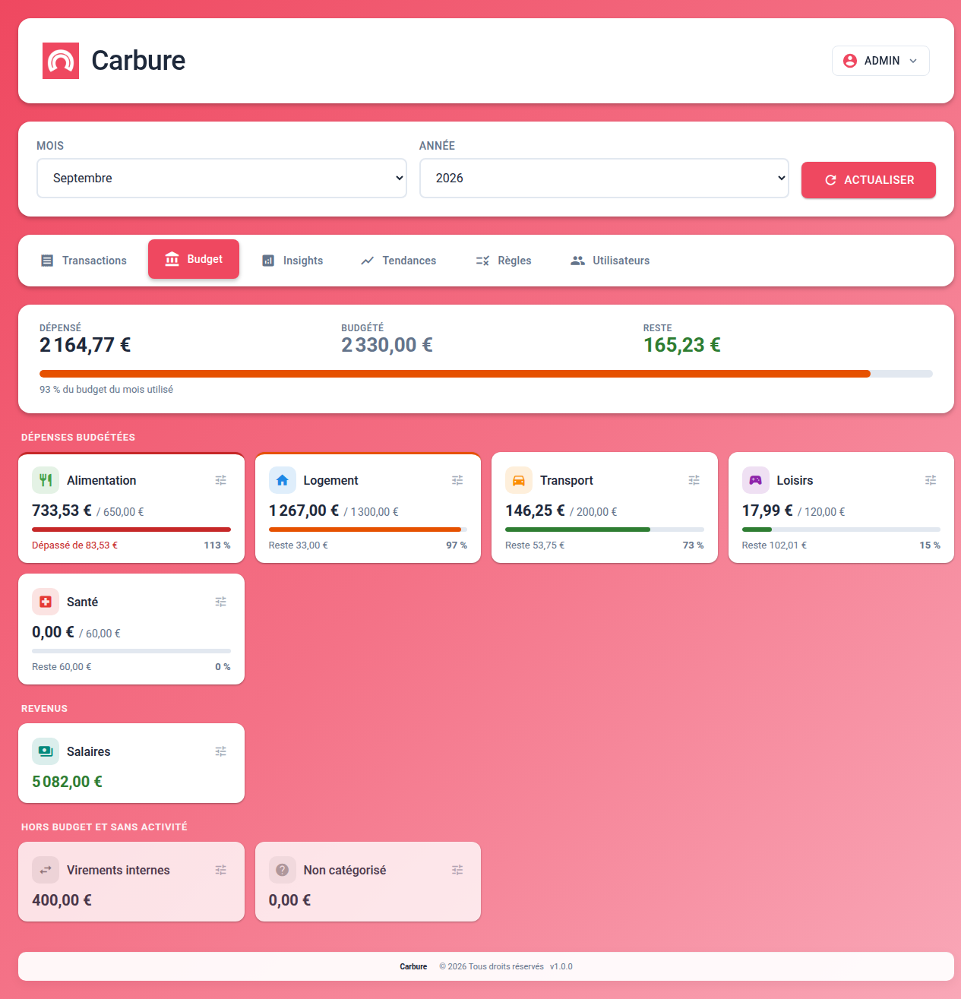
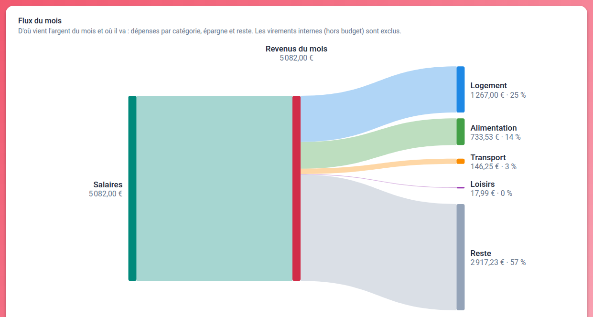
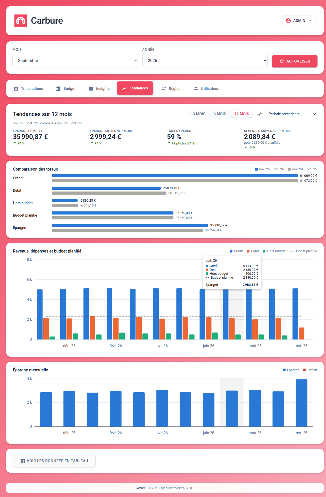
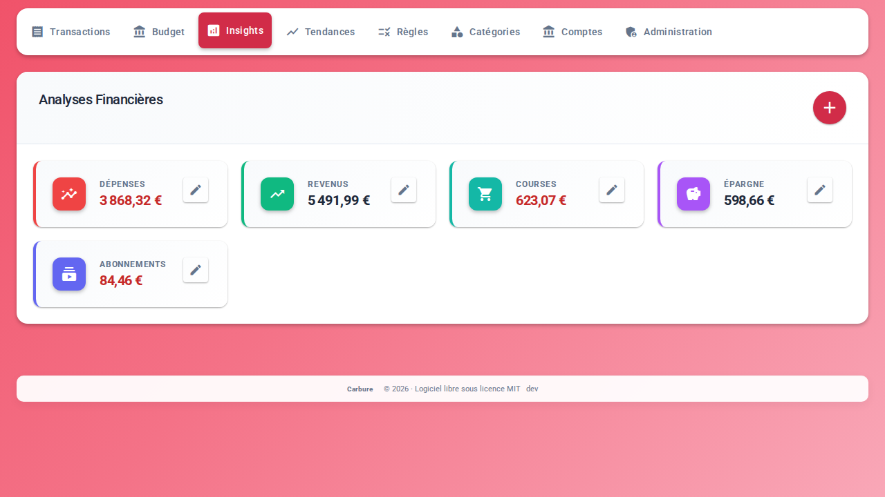
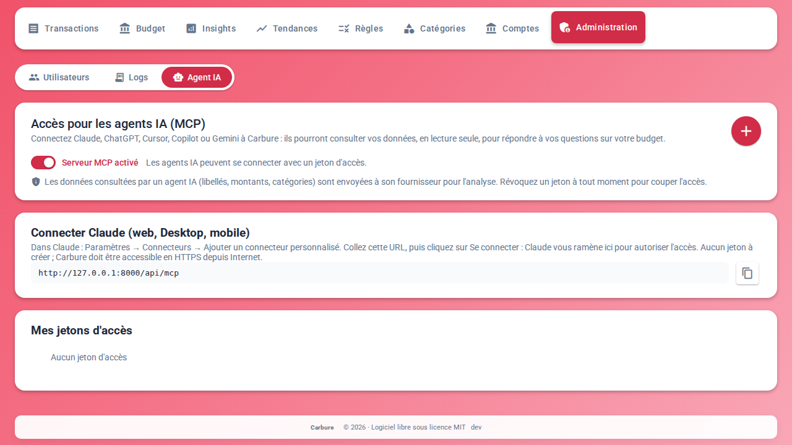

# Fonctionnalités

Cette page décrit **ce que fait Carbure** et **selon quelles règles** : d'où viennent les
transactions, comment elles sont classées, comment sont calculés les budgets, le flux du mois
et les tendances, qui reçoit quelle notification et ce que chacun peut faire. Pour
l'utilisation écran par écran, voir [Portail web](portail.md) et
[Applications mobiles](applications-mobiles.md).



## Le foyer

Carbure gère **un foyer** : une installation, des comptes bancaires communs et des personnes
qui consultent les mêmes données.

- **Données partagées** : comptes bancaires, transactions, catégories, règles, budgets et
  insights sont communs à tous les utilisateurs. Une transaction appartient techniquement au
  premier utilisateur qui suit le compte, mais tous la voient et la pointent.
- **Données personnelles** : chaque utilisateur a son identifiant, son mot de passe, sa
  langue (français, anglais, espagnol, italien, allemand ou portugais), son thème d'affichage, ses seuils d'alerte, les canaux de ses
  notifications (push, email), ses appareils mobiles (iOS, Android), ses navigateurs web,
  ses navigateurs de confiance et ses jetons d'accès pour les agents IA.
- **Deux profils** :

| | Utilisateur | Administrateur |
|---|---|---|
| Consulter transactions, budgets, flux, insights, tendances | ✅ | ✅ |
| Pointer et catégoriser les transactions | ✅ | ✅ |
| Modifier les montants des budgets | ✅ | ✅ |
| Gérer son profil, ses appareils, ses jetons d'accès | ✅ | ✅ |
| Créer et modifier les règles de catégorisation | ➖ | ✅ |
| Créer et modifier les catégories | ➖ | ✅ |
| Suivre des comptes bancaires, configurer les banques, synchroniser depuis le portail, mettre à jour les modules woob | ➖ | ✅ |
| Créer et modifier les insights (requêtes SQL) | ➖ | ✅ |
| Activer le serveur MCP pour les agents IA | ➖ | ✅ |
| Gérer les utilisateurs, les paramètres du serveur (dont les emails), consulter les logs, mettre à jour la base | ➖ | ✅ |

Le dernier administrateur ne peut pas perdre son rôle.

## Comptes bancaires et synchronisation

### Connexion aux banques

Carbure se connecte **directement** à chaque banque avec [woob](https://woob.tech/), un
logiciel libre qui interroge le site de la banque comme vous le feriez : pas d'agrégateur
bancaire tiers, pas de cloud. Les modules woob couvrent surtout les **banques françaises**.

- **Configurer une banque** : un administrateur choisit la banque parmi celles que woob
  supporte ; le portail affiche les champs que demande son module (numéro client, code
  secret, type de compte…). Ces identifiants sont confiés à woob, qui les garde dans son
  propre fichier, lisible par lui seul ; **Carbure ne les enregistre pas en base et ne les
  écrit pas dans les logs**.
- **Suivre des comptes** : d'abord **connecter la banque**, puis, pour cette connexion,
  **ajouter des comptes** parmi ceux que woob liste (`woob bank list -b <banque>`, avec leur
  libellé et leur solde) : on coche ceux à suivre et ils sont ajoutés d'un coup. Seul un
  compte trouvé par woob peut être suivi.
- **Plusieurs connexions** à une même banque (compte joint, professionnel…), chacune avec
  ses identifiants ; une connexion et un compte suivi peuvent recevoir un **nom lisible**
  (« Compte joint »). **Supprimer une connexion** fait oublier ses identifiants à woob et ne
  suit plus ses comptes ; leurs transactions sont conservées.
- **Modules bancaires** : quand le site d'une banque change, woob publie un correctif de son
  module ; un administrateur met à jour les modules depuis l'onglet Comptes (aussi proposé
  sous le journal d'une synchronisation en échec), après avoir approuvé la clé du dépôt de
  woob la première fois (voir [Sécurité](securite.md)).
- Les **comptes suivis** sont communs au foyer : chacun indique qui l'a ajouté, la date et le
  résultat de sa dernière synchronisation (Synchronisé, Échec avec le message, ou Jamais
  synchronisé). Ne plus suivre un compte conserve ses transactions déjà importées.

### Déroulement d'une synchronisation

Pour chaque compte suivi :

1. **Opérations à venir**, puis **historique** : woob renvoie les dernières opérations
   (100 par défaut, réglage `woob_transactions`). Un échec des opérations à venir
   n'empêche pas l'historique : le compte reste synchronisé, avec l'échec noté dans son
   résultat et dans le journal.
2. **Nettoyage du libellé** : passage en majuscules, suppression des préfixes et suffixes
   techniques de la banque (« FACTURE CARTE DU 040126 » devient « CB », numéro de carte retiré,
   références de mandat des prélèvements…), selon les expressions `regex_label` de la
   configuration.
3. **Dédoublonnage** : chaque opération reçoit une empreinte (date réelle, libellé nettoyé,
   montant) ; une opération déjà connue n'est jamais importée deux fois, même synchronisée
   plusieurs fois ou par deux utilisateurs. Des opérations **identiques reçues ensemble**
   (deux cafés le même jour, au même prix) sont bien gardées toutes les deux : elles sont
   distinguées par leur rang.
4. **Mois de rattachement** : un **virement reçu daté du 25 ou après** est rattaché au
   **1er du mois suivant** (un salaire versé le 28 compte pour le mois qu'il finance) ; la
   date réelle reste visible dans le détail de la transaction. Le jour se règle dans
   **Administration → Paramètres** (`next_month_day`, de 1 à 31, 0 pour ne jamais déplacer
   un virement, voir [Configuration](configuration.md#global)).
5. **Notifications** : voir [Notifications](#notifications).

Puis, une fois tous les comptes traités, les **règles de catégorisation** classent les
transactions du dernier mois restées sans catégorie.

- **Quand** : chaque jour avec Docker (`SYNC_INTERVAL`), par une tâche planifiée (cron avec
  le `sync_token` : l'onglet **Administration → Synchro** donne la commande `curl` et
  la ligne crontab toutes prêtes), ou à la demande depuis l'onglet Comptes, pour tous les
  comptes ou un seul.
- **Sans synchronisation** (banque non couverte par woob, reprise de l'historique) : les
  relevés téléchargés depuis la banque s'**importent** depuis l'onglet Transactions (voir
  plus bas).
- **Suivi en direct** : étapes par compte (à venir, historique, notifications), nombre
  d'opérations reçues et nouvelles, journal détaillé (avec les logs de débogage de woob si
  `woob_debug` est activé) ; en cas d'erreur woob, lien vers les tickets du module concerné.
- **Une seule à la fois** : une synchronisation lancée pendant une autre est refusée
  (« déjà en cours »).

## Transactions

- **Liste du mois** choisi, la plus récente en premier : icône et couleur de la catégorie
  (ou du type d'opération si elle n'est pas catégorisée), libellé, date, catégorie et montant.
- **Revenus, dépenses et solde** du mois en tête de page.
- **Pointage** : chaque transaction est « vérifiée » ou non, en un clic. Les transactions non
  vérifiées sont en gras ; un interrupteur n'affiche qu'elles, avec leur nombre. Catégoriser
  une transaction la marque aussi comme vérifiée. Le nombre de transactions à vérifier est
  repris par les notifications et le badge de l'app iPhone.
- **Choix du mois** dans l'en-tête, limité aux mois qui ont des transactions.
- **Recherche** sur tous les mois, à partir de deux caractères, avec le total des
  transactions trouvées.
- **Détail** : montant, libellé complet, date et date réelle, type (carte, virement,
  prélèvement…), carte, banque d'origine, date d'import ; la catégorie et le pointage s'y
  modifient. **Transactions similaires** y lance la recherche sur le nom du commerçant
  (« PRLV SEPA EDF MDT/123 » cherche « EDF »).
- **Supprimer** une transaction (depuis son détail, après confirmation) : elle disparaît
  pour tout le foyer et n'est plus réimportée, ni par la synchronisation ni par l'import
  d'un relevé.
- **Catégoriser à la main** une transaction sans catégorie : un sélecteur avec recherche,
  icônes et couleurs. Pour un administrateur, Carbure propose ensuite de **créer la règle**
  correspondante, pour que les prochaines soient classées toutes seules.
- **Transactions récurrentes** repérées toutes seules et **import de relevés bancaires** :
  voir ci-dessous.

### Import de relevés bancaires

Pour une banque que woob ne couvre pas, ou pour reprendre l'historique d'avant Carbure :

1. Téléchargez le relevé sur le site de la banque, dans l'un des formats proposés :
   **OFX/QFX**, **QIF**, **CSV** ou **CAMT.053** (XML ISO 20022).
2. Dans l'onglet **Transactions**, cliquez sur **Importer** et déposez le fichier (1 Mo au
   plus).
3. L'**aperçu** classe chaque ligne : **nouvelle** (cochée), **déjà connue** (même empreinte
   qu'une transaction existante, ignorée) ou **doublon probable** (même montant à 3 jours
   près, souvent la même opération déjà synchronisée avec un autre libellé : décochée par
   défaut, à vous de trancher).
4. Validez : les transactions cochées sont enregistrées (le détail indique « relevé
   importé » comme origine), puis les **règles** les catégorisent ; la liste s'ouvre sur le
   dernier mois importé.



Un CSV exporté par l'une des banques ci-dessous est lu avec le **profil de sa banque**
(ses colonnes, son encodage, ses lignes avant l'en-tête) : l'aperçu l'indique, par exemple
« Format reconnu : Boursorama / BoursoBank ». Pour une autre banque, l'aperçu affiche
« Format générique (colonnes devinées) » : les colonnes sont reconnues d'après leur en-tête
(date, libellé, montant, ou débit et crédit), y compris les formats français (`;`,
`1 234,56`, encodage Windows-1252) et les lignes sur le compte avant l'en-tête ; vérifiez
alors l'aperçu avant de valider. Les lignes non passées des néobanques (en attente,
annulées, refusées) et les montants nuls (autorisations de carte) sont ignorés ; les frais
donnés à part (Revolut) sont déduits. Le libellé est nettoyé comme à la synchronisation. Le
contenu du fichier n'est jamais écrit dans les logs.

Exports CSV reconnus (formats relevés dans des projets open source qui les importent, puis
testés sur un fichier anonymisé de même structure ; un profil par banque, voir
[Ajouter une banque à l'import](developpement.md#ajouter-une-banque-a-limport)) :

| Banque | Fichier à choisir | Particularités lues |
|---|---|---|
| Boursorama / BoursoBank | export CSV des mouvements | colonne `amount` signée |
| Crédit Agricole | export CSV | lignes du compte avant l'en-tête, débit et crédit |
| La Banque Postale | « Téléchargement des opérations », CSV | lignes du compte, `Montant(EUROS)`, Windows-1252 |
| Société Générale | « Télécharger les opérations », CSV | ligne du compte, libellé et détail de l'écriture |
| Crédit Mutuel / CIC | export CSV | débit négatif et crédit, ISO-8859-15 |
| Caisse d'Épargne / Banque Populaire | export CSV | libellé de l'opération et informations complémentaires |
| BNP Paribas / Hello bank! | export CSV | lignes de résumé avant l'en-tête, dates `jj-mm-aaaa` |
| Fortuneo | `HistoriqueOperations….csv` | débit et crédit, ISO-8859-1 |
| N26 | export CSV (ancien et nouveau format) | nom du bénéficiaire et référence de paiement |
| Revolut | relevé « Excel » (un CSV) | dates avec l'heure, frais, état des opérations |
| Qonto | export CSV (anglais ou français) | statut, nom de la contrepartie et référence |

Pour une autre banque, ou si l'export CSV n'est pas reconnu, choisissez **OFX** (souvent
appelé « Money » ou « Quicken ») : c'est le format le plus homogène d'une banque à l'autre.
LCL, Shine, Lydia/Sumeria, BforBank et Monabanq n'ont pas pu être vérifiés faute d'exemple
public de leurs exports.

### Transactions récurrentes

Carbure **repère tout seul** les opérations qui reviennent chaque mois : salaire, loyer,
abonnements, factures, remboursements…

- **Badge « Mensuelle »** sur ces transactions dans la liste du mois.
- Un **interrupteur** n'affiche qu'elles, et liste celles **attendues ce mois-ci** qui ne sont
  pas encore arrivées, avec leur jour habituel et leur montant (« ≈ » s'il varie) ; pour un
  mois passé, celles qui ont **manqué** (« Absentes ce mois-ci »). Pratique pour vérifier que
  le salaire est tombé ou qu'un prélèvement n'a pas été oublié.

**Règles de détection**, sur les 6 derniers mois :

- les transactions sont regroupées par **sens** (débit ou crédit) et par **libellé sans ses
  chiffres** (références, dates, numéros de facture) ;
- une série est récurrente si elle apparaît dans **3 mois au moins**, **environ une fois par
  mois** (1,5 fois au plus), **vers le même jour** (3 fois sur 4 à 5 jours près), et si elle
  est **encore active** (vue ce mois-ci ou le mois précédent) ;
- un **paiement par carte** doit en plus garder le même montant à 20 % près (un abonnement,
  pas le restaurant du coin) ; un prélèvement ou un virement peut varier (électricité, eau).

## Catégories

Réservées aux administrateurs : menu **Administration** → **Catégories**. L'API refuse
la création, la modification et la suppression d'une catégorie aux autres utilisateurs
(`403`) ; tous lisent la liste (transactions, budgets, application iOS).



- **Deux niveaux** : des catégories (Alimentation) et leurs sous-catégories (Supermarché,
  Restaurant). Les transactions d'une sous-catégorie comptent aussi pour son parent.
- **Trois types**, qui pilotent les calculs :

| Type | Sens | Exemples |
|---|---|---|
| Dépense | Argent dépensé, suivi par les budgets | Alimentation, Logement |
| Revenu | Argent reçu | Salaire, Allocations |
| Hors budget | Mouvements qui ne sont ni des dépenses ni des revenus : virements entre ses propres comptes, épargne | Virements internes, Épargne |

- **Icône et couleur**, choisies parmi celles que les apps mobiles savent afficher : la même
  catégorie a le même aspect partout (transactions, budgets, flux, sélecteurs).
- La catégorie **« Non catégorisé »** reçoit tout ce qu'aucune règle ne reconnaît ; elle ne
  peut être ni modifiée ni supprimée.
- **Supprimer** une catégorie renvoie ses transactions vers « Non catégorisé » et supprime
  ses budgets et ses règles ; une catégorie qui a des sous-catégories ne peut pas être
  supprimée.

## Règles de catégorisation

Une règle associe un **mot-clé** à une catégorie : toute transaction dont le libellé
**contient** ce mot-clé reçoit la catégorie (« CARREFOUR » → Supermarché).

- Le mot-clé est enregistré en majuscules, comme les libellés ; il est unique.
- Quand plusieurs mots-clés se trouvent dans un même libellé, **la règle créée en premier**
  l'emporte.
- **Créer ou modifier une règle l'applique tout de suite à tout l'historique**, y compris
  aux transactions déjà catégorisées à la main ; la fenêtre de la règle indique combien de
  transactions contiennent le mot-clé et combien sont déjà dans la catégorie.
- À chaque synchronisation, les règles classent les nouvelles transactions sans catégorie.
- **Resynchroniser** applique toutes les règles à toute la base et indique le nombre de
  transactions recatégorisées.
- **Envoyer une notification** sur une règle : chaque nouvelle transaction qui
  correspond est signalée à tout le foyer, en push ou par email selon les préférences de
  chacun (voir [Notifications](#notifications) ; une cloche marque ces règles). Utile pour
  un loyer, un remboursement ou un abonnement à surveiller.

## Budgets



Un budget est un **montant par catégorie et par mois**.

- **Consommé** : la somme des transactions du mois de la catégorie et de ses
  sous-catégories, en valeur absolue. **Avancement** : consommé ÷ budget.
- **Sous-catégories** : budgétez les sous-catégories, et la catégorie parente vaut **leur
  somme** (« Σ » devant le montant) ; ou fixez à la catégorie parente **son propre montant**,
  qui remplace la somme. Remettre son montant à zéro revient à la somme.
- **Couleur des cartes** : le fond se remplit à mesure que le budget est consommé ; il reste
  **vert jusqu'à 105 %** du budget et passe au **rouge au-delà**. Chaque carte indique le
  reste ou le dépassement.
- **Synthèse du mois** : total dépensé, total budgété et reste (ou dépassement) des dépenses
  budgétées, avec une jauge.
- **Trois sections** : les dépenses budgétées ; les revenus ; le hors budget et les
  catégories sans budget ni dépense du mois.
- **Explorer** : un clic sur une carte affiche les transactions du mois de la catégorie, et
  ses sous-catégories avec leur propre budget.
- Les montants se règlent mois par mois depuis la carte (bouton de réglage), par tous les
  utilisateurs.
- **Recopie du mois précédent** : le bouton au-dessus de la synthèse reprend les budgets
  du mois précédent, en complétant seulement les catégories sans budget ou en écrasant
  le mois affiché.

## Flux du mois



Un diagramme (Sankey) montre **d'où vient l'argent du mois et où il part** :

- à gauche, les **revenus** par catégorie ;
- au centre, le total des revenus du mois ;
- à droite, les **dépenses** par catégorie principale (les huit plus importantes, les autres
  regroupées), l'**épargne** et ce qui **reste** (ou le **déficit** quand les dépenses
  dépassent les revenus).

Au-dessus, quatre **chiffres clés** : revenus, dépenses, épargne (avec la part des revenus
épargnée) et reste. Chaque flux prend la couleur de sa catégorie ; un **clic sur une
catégorie** (ou sur son flux, aussi au clavier) la met en avant et affiche ses
**transactions** sous le diagramme, avec leur total — « Autres » liste celles des
catégories regroupées.

Les virements internes (catégories hors budget) sont écartés, sauf l'épargne ; les
transactions non catégorisées restent visibles. Les mêmes flux existent en tableau.

## Tendances



Sur **3, 6 ou 12 mois** jusqu'au mois courant, éventuellement **comparés** à la période
précédente ou à la même période l'an dernier :

| Mesure | Calcul |
|---|---|
| Débit | Dépenses du mois, hors catégories hors budget |
| Crédit | Revenus du mois, hors catégories hors budget |
| Hors budget | Solde des catégories hors budget |
| Budget planifié | Somme des budgets des catégories principales (leur montant, ou la somme de leurs sous-catégories) |
| Épargne | Montant net versé sur la catégorie d'épargne et ses sous-catégories (versements moins retraits) |
| Taux d'épargne | Épargne ÷ revenus |

La catégorie d'épargne est « Épargne » (casse et accents ignorés), ou celle du réglage
`savings_category`. Les chiffres clés (épargne cumulée et moyenne, taux d'épargne, dépenses
moyennes face au budget planifié) indiquent l'écart avec la période comparée. Chaque graphique
existe aussi en tableau.

## Insights



Des **indicateurs du mois** que le foyer définit lui-même : courses, carburant, abonnements,
revenus, épargne… Chaque insight a un nom, une couleur, une icône et une **requête SQL** qui
renvoie un montant pour le mois affiché.

- Un administrateur les crée dans le portail ; la requête est vérifiée pendant la saisie et
  son résultat pour le mois affiché s'affiche.
- La requête s'exécute **en lecture seule** : une seule instruction `SELECT`, sans écriture,
  sans accès aux comptes utilisateurs ni aux jetons (voir [Sécurité](securite.md)).
- L'historique de chaque insight mois par mois est disponible par l'API, pour les apps mobiles.

Des **recettes prêtes à l'emploi** (une catégorie et ses sous-catégories, abonnements,
comparaison avec l'an dernier, taux d'épargne, matelas de sécurité, budget restant,
doublons…) sont rassemblées dans [Recettes d'insights](insights.md), avec la requête et la
lecture du résultat de chacune.

### Matelas de sécurité

Le pack de départ comprend l'insight **Matelas de sécurité** : les dépenses des **6 mois
complets précédant le mois affiché** (débits, hors catégories « hors budget » comme
l'épargne), en montant positif. C'est l'ordre de grandeur de l'épargne de précaution à
garder de côté pour faire face à 6 mois de dépenses ; le mois en cours n'est pas compté,
pour que la valeur ne bouge pas au fil du mois. Sur une instance existante, un
administrateur l'ajoute depuis l'écran **Insights** avec cette requête :

```sql
SELECT -SUM(amount) AS amount FROM bank_transaction WHERE amount < 0 AND category NOT IN (SELECT id FROM bank_transaction_category WHERE type = 'HORS-BUDGET' AND id <> 0) AND date >= MAKEDATE({year}, 1) + INTERVAL {month} - 7 MONTH AND date < MAKEDATE({year}, 1) + INTERVAL {month} - 1 MONTH
```

## Notifications

Les notifications sont envoyées en **push** sur les [**apps iPhone et
Android**](applications-mobiles.md) (Apple Push Notification service, Firebase Cloud
Messaging) et, si un administrateur a configuré un serveur SMTP, par **email** à l'adresse du
profil. Les notifications push passent par le relais **Carbure Push**, auquel un
administrateur inscrit l'instance après avoir accepté son consentement (voir
[Configuration](configuration.md#push)) :

!!! info "Applications mobiles"
    Les applications Carbure sont disponibles sur l'[App Store](https://apps.apple.com/fr/app/carbure/id6824057363)
    (iPhone) et sur [Google Play](https://play.google.com/store/apps/details?id=org.carbure.app) (Android).

| Quand | Qui la reçoit | Contenu |
|---|---|---|
| Après la synchronisation de chaque compte | Tout le foyer | Réussite ou échec, et nombre de transactions à vérifier |
| Une nouvelle dépense dépasse le seuil d'alerte | Chaque utilisateur dont le seuil est dépassé | « Dépense importante à vérifier », libellé et montant |
| Une nouvelle transaction correspond à une règle « Envoyer une notification » | Tout le foyer | Le mot-clé, le libellé et le montant (une seule notification par transaction) |
| Les dépenses du mois d'une catégorie budgétée atteignent le seuil des budgets | Chaque utilisateur qui a activé ces alertes | « Budget dépassé : Courses », « 312,40 € sur 300,00 € (104 %) » |

Le **badge** de l'app indique le nombre de transactions à vérifier. Le seuil d'alerte se
règle dans **Mon profil → Notifications**, sous « Dépense importante » (vide = pas d'alerte).

Chaque notification est rédigée dans la **langue du profil** de son destinataire (français,
anglais, espagnol, italien, allemand ou portugais ; toute autre valeur donne le français),
en push comme par email : titre, texte, sujet et signature de l'email. Les montants et les
dates suivent cette langue (`-1 234,56 €` et `15/10/2026` en français et en portugais,
`-1,234.56 €` et `Oct 15, 2026` en anglais, `-1.234,56 €` et `15/10/2026` en espagnol et
en italien, `-1.234,56 €` et `15.10.2026` en allemand) ;
l'erreur d'une synchronisation en échec est reprise telle que la banque (woob) la renvoie.
Les textes du serveur sont regroupés dans `src/lib/Messages.php`.

Chaque utilisateur choisit, dans **Mon profil → Notifications**, les canaux de chaque type
de notification (résultat d'une synchronisation, règle « Notifier », dépense importante,
budget dépassé) : push, email, les deux ou aucun. Par défaut, tout est envoyé en push et
rien par email, sauf les alertes de budget, désactivées tant que l'utilisateur ne les
active pas.
L'email n'est proposé que si un serveur SMTP est configuré (**Administration →
Paramètres**, section `[smtp]`) et que le profil a une adresse email ; l'échec d'un canal
n'empêche ni l'autre ni la synchronisation.

### Alertes de budget

- **Quand** : après chaque synchronisation et chaque import d'un relevé, pour le **mois en
  cours** uniquement (l'import d'un relevé des mois passés n'alerte pas sur des budgets
  anciens).
- **Quoi** : les dépenses du mois de chaque catégorie de dépenses qui a un budget,
  sous-catégories comprises, calculées comme l'écran **Budgets** ; une sous-catégorie qui a
  son propre budget est vérifiée aussi.
- **Budget surveillé** : tous les budgets (par défaut) ou l'un d'eux, choisi par chacun
  dans **Mon profil → Notifications** parmi les budgets du mois de l'onglet **Budget** ;
  la suppression de la catégorie revient à tous les budgets.
- **Seuil** : choisi par chacun dans **Mon profil → Notifications**, en pourcentage du
  budget, de 50 à 200 % (100 % par défaut ; 80 % pour être prévenu avant). Sous 100 %, le
  titre devient « Budget presque atteint ».
- **Une fois** par catégorie, mois et utilisateur, pas à chaque synchronisation. Si le budget
  est ensuite relevé et de nouveau atteint, l'alerte repart pour le nouveau montant.

## Agents IA



Un **serveur MCP** intégré permet à un agent IA de répondre à des questions sur le budget du
foyer : « Combien avons-nous dépensé en restaurants cette année ? », « Quelles catégories
dépassent leur budget ce mois-ci ? », « Comment évolue notre épargne ? ».

- **Lecture seule** : l'agent peut lister les catégories, les transactions d'un mois,
  rechercher des transactions, totaliser les dépenses par catégorie sur une période, lire le
  budget d'un mois, les tendances et les règles ; il ne peut rien modifier.
- **Désactivé par défaut** : un administrateur l'active.
- **Claude (web, Desktop, mobile)** se connecte avec la seule URL du serveur : Claude ouvre
  le portail, vous vous connectez et **autorisez** l'accès (OAuth).
- **Claude Code, ChatGPT, Cursor, Copilot, Gemini** se connectent avec un **jeton d'accès**
  créé dans l'onglet Agent IA (30 jours, 90 jours, un an ou sans expiration), avec la
  configuration prête à copier pour chaque agent.
- Chaque accès apparaît dans **Mes jetons d'accès** (création, dernière utilisation,
  expiration) et se **révoque** d'un clic.

!!! warning "Confidentialité"
    Les données qu'un agent consulte (libellés, montants, catégories) sont envoyées à son
    fournisseur pour être analysées. Détails : [Agents IA (MCP)](mcp.md).

## Profil et sécurité des comptes

- **Mon profil**, en quatre sous-onglets : **Profil** (e-mail, prénom, nom, mot de passe,
  langue appliquée à chaque connexion sur tous les navigateurs, thème), **Double
  authentification** (application d'authentification, codes de secours),
  **Notifications** (canaux push de l'app mobile et email, seuil d'alerte, budget surveillé
  et son seuil) et **Mes appareils** (applications mobiles iOS et Android, supprimables ;
  navigateurs web des connexions au portail, celui en cours signalé, supprimables ;
  navigateurs web de confiance, révocables).
- **Mots de passe** chiffrés (bcrypt) ; session valable 30 jours.
- **Blocage** : après 5 échecs de connexion d'affilée, le compte est bloqué 24 heures ; un
  administrateur peut le débloquer.
- **Double authentification** : l'administrateur peut imposer à la connexion le code
  d'une application d'authentification (Google Authenticator…), configurée par QR code
  à la première connexion ou depuis le profil, avec 10 codes de secours. Le code n'est
  pas demandé depuis un appareil mobile (iOS, Android) déjà enregistré, ni dans un navigateur auquel
  l'utilisateur a fait confiance pendant 6 mois. Un administrateur la réinitialise pour
  un utilisateur qui a perdu son téléphone (voir [Sécurité](securite.md#double-authentification-totp)).

## Affichage et accessibilité

- **Thème clair ou sombre** : par défaut, celui du système ; l'icône de l'en-tête passe d'un
  clic à l'autre thème, et le choix est enregistré dans le profil (retrouvé sur un autre
  navigateur).
- **Préférences du système** respectées : contraste augmenté (macOS, iOS) et couleurs forcées
  (contraste élevé de Windows), animations réduites.
- **Accessibilité** au niveau AA des WCAG, vérifiée par des tests automatiques sur chaque
  écran, en thème clair et en thème sombre.
- **Application installée** : le portail s'installe comme une application (Chrome, Edge,
  Safari, Android), en HTTPS, sans mode hors ligne.

Détails : [Portail web](portail.md#accessibilite).

## Administration

Les onglets **Règles** et **Comptes**, et le menu **Administration**
(**Utilisateurs**, **Catégories**, **Logs**, **Paramètres**, **Synchro**, **Push mobile**, **Agent IA**, **Sauvegarde**, **API**) sont réservés aux administrateurs ; les autres
utilisateurs ouvrent **Agent IA** depuis leur menu.

- **Utilisateurs** : création, modification (dont le profil), suppression, dernière
  connexion, déblocage d'un compte bloqué. Un utilisateur propriétaire de transactions ne
  peut pas être supprimé.
- **Logs** : les journaux du serveur, filtrés par niveau ou par texte ; un clic sur
  l'identifiant d'une requête affiche toutes ses lignes. Les secrets (mots de passe, jetons)
  y sont masqués.
- **Paramètres** : le fichier de configuration du serveur, section par section, les secrets
  masqués. Les réglages sans risque (niveau de log, catégorie d'épargne, adresse publique,
  options de woob, notifications push mobiles, serveur SMTP des emails, avec un **email de test**)
  se modifient dans le portail, chaque valeur étant vérifiée ; la base, les secrets, la commande woob et le nettoyage des libellés restent en
  lecture seule.
- **Synchro** : la commande `curl` (pour tous les comptes ou un seul) et la ligne crontab qui
  lancent la synchronisation, avec le jeton masqué jusqu'à « Afficher » ; l'onglet crée ou
  renouvelle ce jeton.
- **Sauvegarde** : export des données choisies (catégories, règles, budgets, insights,
  transactions, transactions supprimées) dans un ZIP, un fichier JSON par type ; import d'un
  ZIP (en choisissant ses fichiers) ou d'un seul fichier, qui **supprime et remplace** les
  données de chaque type importé, après confirmation, tout ou rien. Ni utilisateurs, ni mots
  de passe, ni jetons, ni connexions bancaires dans une sauvegarde.
- **API** : la documentation de l'API (Swagger UI) dans le portail ; « Try it out » appelle
  l'API avec la session de l'administrateur.
- **Mise à jour de la base** : quand une nouvelle version modifie la base, un bandeau le
  signale et l'applique en un clic (automatique avec Docker).
- **Clé des sessions** : un bandeau signale une clé trop faible et la renouvelle en un clic
  (tout le monde se reconnecte).

## Installation et mises à jour

- **Assistant d'installation** dans le navigateur : connexion à la base, création des
  tables (ou mise à jour d'une base existante), compte administrateur, langue. Sur une base
  neuve, il propose un **pack de départ** : une trentaine de catégories, une centaine de
  règles (enseignes, fournisseurs d'énergie, opérateurs…) et des insights (dépenses,
  revenus, reste du mois, épargne, matelas de sécurité, dépassement du budget, frais
  bancaires…). Exposé sur
  Internet, il demande en plus un code d'installation.
- **Image Docker** tout compris (nginx, PHP, woob), avec MariaDB : voir
  [Installation](installation.md) et le [tutoriel Synology](synology.md).
- **Mises à jour** : chaque nouvelle version apporte ses migrations de base, appliquées au
  démarrage du conteneur ou depuis le bandeau du portail.

## Limites connues

- **Une seule devise** par instance (réglage `currency`, l'euro par défaut), seulement
  affichée : pas de conversion ni de plusieurs devises ; les apps mobiles affichent
  toujours des euros.
- Les banques couvertes sont celles de **woob**, surtout françaises.
- Les opérations récurrentes sont **détectées**, pas **planifiées** : pas d'échéancier de
  factures ni de prévision du solde.
- Pas d'**objectifs d'épargne**.
- Les [apps iPhone et Android](applications-mobiles.md) servent au suivi au quotidien ;
  l'administration et l'import de relevés se font dans le portail web, qui s'utilise dans
  le navigateur ou s'installe comme une application
  ([en HTTPS](portail.md#installer-le-portail-comme-une-application)). Ni les apps ni le
  portail n'ont de mode hors ligne.

Voir aussi le [comparatif](comparatif.md) avec Firefly III, Actual Budget et Kresus.
