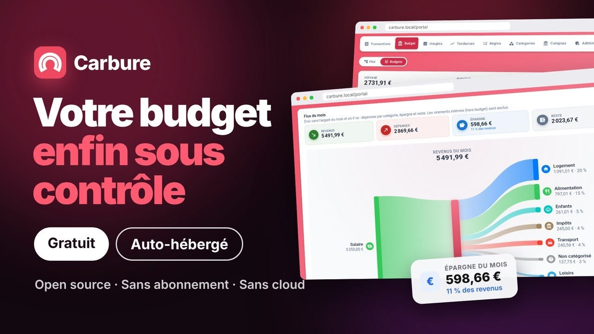

# Carbure, le budget du foyer auto-hébergé

*Reprenez le contrôle de votre budget.*

**Carbure** est un portail web de suivi du budget et des transactions bancaires du foyer,
gratuit, [open source](https://github.com/ltoinel/Carbure) et auto-hébergé : sur un
serveur, un NAS Synology ou n'importe quelle machine avec Docker, les données restent chez
vous. Les opérations sont récupérées automatiquement auprès des banques françaises grâce à
[woob](https://woob.tech/), nettoyées et catégorisées par mots-clés, puis consultées :

- dans le **portail web** (`portal/`, Vue 3) : transactions, pointage, recherche,
  transactions récurrentes, import de relevés, budgets, insights, tendances, et pour les administrateurs règles, catégories, comptes
  et utilisateurs ;
- dans les [**applications iPhone et Android**](applications-mobiles.md) Carbure :
  transactions, pointage, budgets, aperçus, tendances et synchronisation, connexion par
  Face ID ou empreinte, et notifications push (par le service Carbure Push) après chaque
  synchronisation, pour les dépenses importantes et les budgets atteints — bientôt
  disponibles sur l'App Store et Google Play ; en attendant, le portail s'installe comme
  une application sur ordinateur ou téléphone ;
- par un **agent IA** (Claude, ChatGPT, Cursor, Copilot, Gemini…) grâce au serveur MCP
  intégré, en lecture seule.

Tous s'appuient sur la même **API REST PHP** (`src/`).

<a class="teaser" href="https://www.youtube.com/watch?v=PUCd27oJkig" data-youtube="PUCd27oJkig" title="Teaser de Carbure (1 min) sur YouTube">
  
  
</a>

*Carbure en une minute : synchronisation, catégorisation, budgets, flux du mois, tendances,
insights, notifications, agent IA et foyer.*

{ loading=lazy }
{ loading=lazy }
{ loading=lazy }
{ .mobile-screens }

*Les [applications iPhone et Android](applications-mobiles.md) : transactions, budgets et
aperçus du mois.*

## Fonctionnalités

| Domaine | Ce que fait Carbure |
|---|---|
| Installation | Assistant dans le navigateur (base de données, schéma, administrateur), image Docker nginx + PHP-FPM avec woob, mises à jour de la base automatiques ou en un clic |
| Synchronisation | Opérations à venir et historique via woob, de tous les comptes ou d'un seul, progression en temps réel (SSE), date et résultat de la dernière synchronisation de chaque compte, synchronisation quotidienne planifiable, validation de l'authentification forte depuis le portail |
| Import de relevés | Fichiers des banques (OFX/QFX, QIF, CSV, CAMT.053), aperçu des nouvelles transactions, de celles déjà connues et des doublons probables avant d'importer, catégorisation par les règles |
| Comptes | Banques connectées (plusieurs identifiants d'une même banque, nom lisible, suppression) et leurs comptes suivis, choisis parmi ceux que woob trouve et nommables ; mise à jour des modules bancaires de woob depuis le portail |
| Transactions | Liste mensuelle, sélecteur des mois avec transactions, recherche par libellé avec total, transactions similaires, pointage (vérifiée / non vérifiée), catégorisation manuelle avec proposition de règle, banque et compte d'origine, suppression définitive |
| Transactions récurrentes | Détection automatique des opérations mensuelles (salaire, loyer, abonnements, factures), badge « Mensuelle », liste de celles attendues ce mois-ci |
| Budgets | Flux du mois (diagramme de Sankey revenus → dépenses, épargne, reste), synthèse du mois, budget par catégorie avec reste ou dépassement, catégorie parente égale à la somme de ses sous-catégories ou à son propre montant, transactions d'une catégorie, recopie des budgets du mois précédent |
| Tendances | Débit, crédit, hors budget, budget planifié et épargne (catégorie « Epargne ») sur 3, 6 ou 12 mois, comparaison avec une autre période |
| Catégorisation | Catégories hiérarchiques (icône, couleur), règles par mots-clés appliquées à chaque synchronisation ou à la demande, notification sur une règle |
| Insights | Indicateurs mensuels définis par une requête SQL encadrée, historique annuel |
| Applications mobiles | Apps natives iPhone et Android : transactions du mois, pointage et catégorisation, budgets (modifiables), aperçus, tendances sur 24 mois, synchronisation, Face ID / empreinte, double authentification, thème synchronisé avec le profil |
| Notifications | Push sur les apps iPhone et Android (service Carbure Push : APNs, FCM) et email (SMTP), au choix de chaque utilisateur et pour chaque type : résultat d'une synchronisation, nouvelle dépense au-dessus de son seuil, transaction d'une règle surveillée, budget du mois atteint |
| Agents IA | Serveur MCP en lecture seule, activable par un administrateur ; Claude (web, Desktop, mobile) connecté par OAuth sans jeton, les autres agents avec un jeton d'accès à durée de validité |
| Utilisateurs | Profils utilisateur et administrateur, langue (fr, en, es, it, de, pt), thème, seuils d'alerte, canaux des notifications, appareils, dernière connexion, blocage après 5 échecs de connexion |
| Affichage | Thème clair ou sombre (suit le système, ou choisi d'un clic), contraste augmenté et couleurs forcées du système, accessibilité WCAG AA, portail installable comme une application |
| Administration | Utilisateurs, paramètres du serveur (dont l'envoi des emails, avec un email de test), logs filtrables, commande de synchronisation planifiée, mise à jour de la base en un clic |

## Par où commencer ?

- Découvrir tout ce que fait Carbure : [Fonctionnalités](fonctionnalites.md)
- Installer Carbure : [Installation](installation.md) ou le [tutoriel NAS Synology](synology.md)
- Utiliser le portail : [Portail web](portail.md)
- Connecter un agent IA : [Agents IA (MCP)](mcp.md)
- Comparer avec Firefly III, Actual Budget et Kresus : [Comparatif](comparatif.md)
- Comprendre le fonctionnement : [Architecture](architecture.md)
- Intégrer un client : [Référence de l'API](api.md)
- Contribuer : [Développement](developpement.md)
- Poser une question, partager une idée ou une astuce : [serveur Discord](https://discord.gg/QsxYw4Rx9D)

!!! info "Modèle « foyer »"
    Tous les utilisateurs d'une installation partagent les mêmes comptes bancaires,
    transactions, budgets et catégories. Les comptes utilisateurs servent à
    l'authentification, aux notifications, aux préférences (langue, thème, seuils
    d'alerte, canaux des notifications, appareils, jetons d'accès) et au profil
    (utilisateur ou administrateur).
