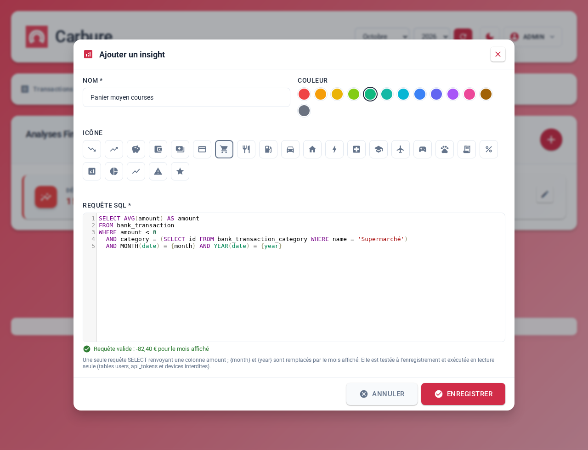

# Insight recipes

An **insight** is a card on the Insights screen: a name, a color, an icon and an
**SQL query** that returns **an amount for the month displayed** (see
[Features](fonctionnalites.md#insights) and [Web portal](portail.md#insights)). This
page gathers **recipes** ready to copy into the add-insight window
(administrators): for each one, what it shows, the query and how to read the result.

All the queries on this page are checked by Carbure's tests: they follow
the rules below and run against a test database, with the expected result.



## Query rules { #regles-dune-requete }

The server rejects a query that does not follow them (the add window says so while
you type):

- **a single `SELECT` statement**, of **500 characters at most** (spaces and line
  breaks included), with no `;` in the middle, no comment (`--`, `#`, `/* */`) and no
  backslash (`\`); `WITH` is not accepted, a subquery in the `FROM` is;
- it returns a **column named `amount`** (`… AS amount`): only the **first row**
  is read;
- `{month}` and `{year}` are replaced by the **month** (1 to 12) and the **year** displayed,
  as numbers;
- **forbidden words**, even inside a quoted string: writes (`INSERT`, `UPDATE`,
  `DELETE`, `CREATE`, `DROP`…), `SET`, `DO`, `INTO`, `LOAD`, `SLEEP`, `BENCHMARK`, `SHOW`,
  `CALL`, `LOCK`, `USER`, `PASSWORD`… (full list in `src/resources/Insight.php`);
  the `user` column of transactions therefore cannot be read;
- **only the budget tables can be read**: `bank_transaction`,
  `bank_transaction_category`, `bank_transaction_category_keyword` (categorization
  rules), `budget`, `bank_account` and `bank_backend` (bank connections), with no
  database name in front (`carbure.bank_transaction` is rejected). Any other table is rejected:
  users, two-factor authentication, tokens, devices, OAuth, settings, insights,
  migrations… as well as the system schemas (`mysql`, `information_schema`,
  `performance_schema`, `sys`). The name of a rejected table is forbidden anywhere in the
  query, even inside a quoted string;
- the query runs in a **read-only transaction**, in **5 seconds at most**:
  beyond that, the server interrupts it (the add window says so, the card shows
  0,00 €). It runs every time the Insights tab is displayed, and twelve times for
  a year's history: avoid Cartesian products.

The **name** has 1 to **20 characters**; the **color** is one of 13 colors:
`red`, `orange`, `amber`, `lime`, `green`, `teal`, `cyan`, `blue`, `indigo`, `purple`,
`pink`, `brown`, `gray`. The icon (optional) is a Material icon chosen in the
add window.

## Displaying the result { #affichage-du-resultat }

The card **always shows the absolute value of the amount, with two decimals and the
`€` symbol**, in **red if the amount is negative**. There is no other format:

- a **percentage** or a **count** (of transactions, of months…) is also shown with `€`:
  a savings rate of 32.5% appears as "32,50 €". The recipes concerned say so
  in their name (`%`, "Nb") to remove any ambiguity;
- the **sign** only shows through the color: an expense (negative amount) is red, an
  income or a favorable difference is not. The recipes follow the transaction
  convention: **negative = money going out**;
- a query that returns nothing (`NULL`, for example no transaction that month) or that
  fails shows **0,00 €**;
- the month-by-month history (`GET /budget/insights/history`, used by the iPhone app)
  runs the same query for each month of the year.

## Data landmarks { #reperes-sur-les-donnees }

The useful tables (see [Data model](modele-donnees.md)):

| Table | Useful columns |
|---|---|
| `bank_transaction` | `date` (debit date, the one of the month displayed), `rdate` (actual transaction date: day of a card payment), `type`, `label`, `category`, `amount` (negative = debit), `pointed` (1 = checked), `bank_name`, `account_number` |
| `bank_transaction_category` | `id`, `name`, `parent_category` (0 = main category), `type`: `DEBIT`, `CREDIT` or `HORS-BUDGET` |
| `budget` | `category`, `amount` (planned positive amount), `date` (first day of the month) |
| `bank_account` | `bank_name`, `account_number`, `label` (name given to the account) |

**Transaction types** (`bank_transaction.type`, woob codes, also inferred from the label
for an imported statement):

| Code | Type | Code | Type |
|---|---|---|---|
| 0 | Unknown | 6 | ATM withdrawal |
| 1 | Transfer | 7 | Card |
| 2 | Direct debit | 8 | Expense (loan repayment) |
| 3 | Check | 9 | Commissions, bank fees |
| 4 | Check deposit | 12 | Deferred debit card |
| 5 | Refund | | |

A few expressions come up again and again in the recipes:

- **budget expenses**: `amount < 0 AND category NOT IN (SELECT id FROM bank_transaction_category WHERE type = 'HORS-BUDGET' AND id <> 0)`
  excludes off-budget categories (savings, internal transfers) but keeps
  uncategorized transactions (category 0);
- **first day of the month displayed**: `MAKEDATE({year}, 1) + INTERVAL {month} - 1 MONTH`;
  `- 2 MONTH` gives the previous month, `MONTH` the next month. A
  `date >= … AND date < …` filter covers a period of several months, even one spanning two
  years;
- **a category by its name** rather than by its number (which changes from one instance to
  another): `(SELECT id FROM bank_transaction_category WHERE name = 'Courses')`. The
  comparison ignores case and accents. The names used here are those of the French
  starter pack: adapt them to yours.

## Spending { #depenses }

### A category and its subcategories { #une-categorie-et-ses-sous-categories }

The spending of a main category, subcategories included (here "Alimentation", food:
groceries, bakery, restaurants). Replace the name to track housing,
transport, leisure…

```sql
SELECT SUM(t.amount) AS amount
FROM bank_transaction t
JOIN bank_transaction_category c ON c.id = t.category
WHERE 'Alimentation' IN (c.name, (SELECT p.name FROM bank_transaction_category p WHERE p.id = c.parent_category))
  AND MONTH(t.date) = {month} AND YEAR(t.date) = {year}
```

- **Name**: `Alimentation` — color `green`, icon `restaurant`
- **Reading**: negative (red), in euros; refunds in the category are
  deducted.

### Average grocery basket { #panier-moyen-des-courses }

The average amount of a trip to the checkout: useful to see the effect of inflation or of
switching stores, regardless of the number of trips.

```sql
SELECT AVG(amount) AS amount
FROM bank_transaction
WHERE amount < 0
  AND category = (SELECT id FROM bank_transaction_category WHERE name = 'Courses')
  AND MONTH(date) = {month} AND YEAR(date) = {year}
```

- **Name**: `Panier moyen courses` — color `green`, icon `shopping_cart`
- **Reading**: negative, in euros per purchase.

### A merchant { #une-enseigne }

Everything paid to a merchant, whatever its category, by a word in the
label (here Amazon). `LIKE` ignores case; `%` stands for any sequence of
characters.

```sql
SELECT SUM(amount) AS amount
FROM bank_transaction
WHERE label LIKE '%AMAZON%'
  AND MONTH(date) = {month} AND YEAR(date) = {year}
```

- **Name**: `Amazon` — color `orange`, icon `shopping_cart`
- **Reading**: negative, in euros, net of the merchant's refunds.

### Food delivery { #livraison-de-repas }

Several merchants for the same use, here home delivery: an item that grows
fast without you noticing.

```sql
SELECT SUM(amount) AS amount
FROM bank_transaction
WHERE (label LIKE '%UBER EATS%' OR label LIKE '%DELIVEROO%')
  AND MONTH(date) = {month} AND YEAR(date) = {year}
```

- **Name**: `Livraison repas` — color `pink`, icon `restaurant`
- **Reading**: negative, in euros.

### Recurring direct debits { #prelevements-recurrents }

The month's direct debits whose same label was already debited the previous month:
subscriptions, energy, insurance, phone. This is the household's "fixed cost", worth reviewing
from time to time.

```sql
SELECT SUM(t.amount) AS amount
FROM bank_transaction t
WHERE t.type = 2 AND t.amount < 0
  AND MONTH(t.date) = {month} AND YEAR(t.date) = {year}
  AND EXISTS (SELECT 1 FROM bank_transaction p WHERE p.type = 2 AND p.label = t.label
    AND p.date >= MAKEDATE({year}, 1) + INTERVAL {month} - 2 MONTH
    AND p.date < MAKEDATE({year}, 1) + INTERVAL {month} - 1 MONTH)
```

- **Name**: `Prélèv. récurrents` — color `indigo`, icon `receipt_long`
- **Reading**: negative, in euros. A direct debit whose label changes every month (invoice
  number, date) is not recognized as recurring.

### Weekend spending { #depenses-du-week-end }

Expenses made on a Saturday or a Sunday, based on the actual transaction date
(`rdate`): outings, Saturday groceries, impulse purchases.

```sql
SELECT SUM(amount) AS amount
FROM bank_transaction
WHERE amount < 0
  AND category NOT IN (SELECT id FROM bank_transaction_category WHERE type = 'HORS-BUDGET' AND id <> 0)
  AND DAYOFWEEK(rdate) IN (1, 7)
  AND MONTH(date) = {month} AND YEAR(date) = {year}
```

- **Name**: `Dépenses week-end` — color `cyan`, icon `sports_esports`
- **Reading**: negative, in euros (`DAYOFWEEK`: 1 = Sunday, 7 = Saturday).

### Share of weekend spending { #part-des-depenses-du-week-end }

The same thing as a **percentage** of the month's spending: a weekend counts for 2 days out of
7, about 29%; a share well above that points to expensive weekends.

```sql
SELECT 100 * SUM(IF(DAYOFWEEK(rdate) IN (1, 7), amount, 0)) / SUM(amount) AS amount
FROM bank_transaction
WHERE amount < 0
  AND category NOT IN (SELECT id FROM bank_transaction_category WHERE type = 'HORS-BUDGET' AND id <> 0)
  AND MONTH(date) = {month} AND YEAR(date) = {year}
```

- **Name**: `Part week-end %` — color `cyan`, icon `percent`
- **Reading**: positive, as a **percentage** (shown as "27,55 €" for 27.55%).

### Share paid by card { #part-payee-par-carte }

The percentage of spending paid by card (immediate or deferred debit), the rest being
direct debits, transfers or withdrawals: "everyday" spending versus fixed costs.

```sql
SELECT 100 * SUM(IF(type IN (7, 12), amount, 0)) / SUM(amount) AS amount
FROM bank_transaction
WHERE amount < 0
  AND category NOT IN (SELECT id FROM bank_transaction_category WHERE type = 'HORS-BUDGET' AND id <> 0)
  AND MONTH(date) = {month} AND YEAR(date) = {year}
```

- **Name**: `Part carte %` — color `blue`, icon `credit_card`
- **Reading**: positive, as a **percentage**.

### Number of withdrawals { #nombre-de-retraits }

The number of cash withdrawals in the month (the starter pack already gives the amount):
many small withdrawals mean as many expenses that Carbure will not be able to categorize.

```sql
SELECT COUNT(*) AS amount
FROM bank_transaction
WHERE type = 6
  AND MONTH(date) = {month} AND YEAR(date) = {year}
```

- **Name**: `Nb retraits` — color `gray`, icon `account_balance_wallet`
- **Reading**: positive, a **count** (shown as "3,00 €" for 3 withdrawals).

### Biggest item of the month { #plus-gros-poste-du-mois }

The amount of the month's most expensive category (or subcategory), excluding
uncategorized. An insight only returns a number: the item's name can be read in the
Budget tab.

```sql
SELECT MIN(total) AS amount
FROM (SELECT SUM(amount) AS total FROM bank_transaction
  WHERE category <> 0
    AND category NOT IN (SELECT id FROM bank_transaction_category WHERE type = 'HORS-BUDGET')
    AND MONTH(date) = {month} AND YEAR(date) = {year}
  GROUP BY category) x
```

- **Name**: `Plus gros poste` — color `red`, icon `pie_chart`
- **Reading**: negative, in euros.

### Spending of one account { #depenses-dun-compte }

The spending of a single account, designated by the name given to it in the Accounts tab
(here "Compte joint", joint account): useful when the household has a shared account and personal accounts.

```sql
SELECT SUM(amount) AS amount
FROM bank_transaction
WHERE amount < 0
  AND account_number IN (SELECT account_number FROM bank_account WHERE label = 'Compte joint')
  AND MONTH(date) = {month} AND YEAR(date) = {year}
```

- **Name**: `Compte joint` — color `teal`, icon `home`
- **Reading**: negative, in euros, savings and transfers included (add the budget
  expenses filter to exclude them).

## Comparisons { #comparaisons }

### Change from the previous month { #variation-par-rapport-au-mois-precedent }

The change in spending as a **percentage** (the starter pack gives the difference in euros):
+10% means 10% more spending than the previous month.

```sql
SELECT 100 * (SUM(IF(MONTH(date) = {month}, amount, 0)) / SUM(IF(MONTH(date) = {month}, 0, amount)) - 1) AS amount
FROM bank_transaction
WHERE amount < 0
  AND category NOT IN (SELECT id FROM bank_transaction_category WHERE type = 'HORS-BUDGET' AND id <> 0)
  AND date >= MAKEDATE({year}, 1) + INTERVAL {month} - 2 MONTH
  AND date < MAKEDATE({year}, 1) + INTERVAL {month} MONTH
```

- **Name**: `Variation vs M-1 %` — color `cyan`, icon `analytics`
- **Reading**: as a **percentage**; positive (normal color) = more spending, negative (red) =
  less spending. Note that the color is inverted here relative to the "good /
  bad" meaning.

### Difference from the same month last year { #ecart-avec-le-meme-mois-lan-dernier }

The month's spending minus that of the same month of the previous year: the right comparison
for seasonal expenses (heating, back to school, vacations).

```sql
SELECT SUM(IF(YEAR(date) = {year}, amount, -amount)) AS amount
FROM bank_transaction
WHERE amount < 0
  AND category NOT IN (SELECT id FROM bank_transaction_category WHERE type = 'HORS-BUDGET' AND id <> 0)
  AND MONTH(date) = {month} AND YEAR(date) IN ({year}, {year} - 1)
```

- **Name**: `Écart vs N-1` — color `purple`, icon `show_chart`
- **Reading**: in euros; negative (red) = more spending than last year, positive =
  less.

### Difference from the average of the last 3 months { #ecart-avec-la-moyenne-des-3-derniers-mois }

The month's spending minus the average of the previous 3 months: less sensitive than a
comparison with a single exceptional month. For 6 months, replace `/ 3` with `/ 6` and
`- 4 MONTH` with `- 7 MONTH`.

```sql
SELECT SUM(IF(date >= MAKEDATE({year}, 1) + INTERVAL {month} - 1 MONTH, amount, -amount / 3)) AS amount
FROM bank_transaction
WHERE amount < 0
  AND category NOT IN (SELECT id FROM bank_transaction_category WHERE type = 'HORS-BUDGET' AND id <> 0)
  AND date >= MAKEDATE({year}, 1) + INTERVAL {month} - 4 MONTH
  AND date < MAKEDATE({year}, 1) + INTERVAL {month} MONTH
```

- **Name**: `Écart vs moy. 3 mois` — color `amber`, icon `analytics`
- **Reading**: in euros; negative (red) = a month with more spending than usual.

### Year to date { #cumul-depuis-janvier }

The year's spending up to and including the month displayed: to compare with an annual budget.

```sql
SELECT SUM(amount) AS amount
FROM bank_transaction
WHERE amount < 0
  AND category NOT IN (SELECT id FROM bank_transaction_category WHERE type = 'HORS-BUDGET' AND id <> 0)
  AND YEAR(date) = {year} AND MONTH(date) <= {month}
```

- **Name**: `Cumul depuis janvier` — color `red`, icon `trending_down`
- **Reading**: negative, in euros.

### 12-month monthly average { #moyenne-mensuelle-sur-12-mois }

The average spending per month over the 12 months ending with the month displayed: the household's
standard of living, smoothed of exceptional expenses.

```sql
SELECT SUM(amount) / 12 AS amount
FROM bank_transaction
WHERE amount < 0
  AND category NOT IN (SELECT id FROM bank_transaction_category WHERE type = 'HORS-BUDGET' AND id <> 0)
  AND date >= MAKEDATE({year}, 1) + INTERVAL {month} - 12 MONTH
  AND date < MAKEDATE({year}, 1) + INTERVAL {month} MONTH
```

- **Name**: `Moyenne 12 mois` — color `teal`, icon `show_chart`
- **Reading**: negative, in euros per month. During the first year of use, months
  without data count as zero and bring the average down.

## Savings and safety cushion { #epargne-et-matelas-de-securite }

### Savings rate { #taux-depargne }

The share of the month's income that was not spent: (income + expenses) / income, excluding
off-budget categories. A common benchmark is to aim for 10 to 20%.

```sql
SELECT 100 * SUM(amount) / SUM(IF(amount > 0, amount, 0)) AS amount
FROM bank_transaction
WHERE category NOT IN (SELECT id FROM bank_transaction_category WHERE type = 'HORS-BUDGET' AND id <> 0)
  AND MONTH(date) = {month} AND YEAR(date) = {year}
```

- **Name**: `Taux d'épargne %` — color `purple`, icon `savings`
- **Reading**: as a **percentage**; negative (red) = a month spent beyond income.
  Empty (0,00) with no income that month.

### Savings deposited { #epargne-versee }

The month's deposits into savings: the "Épargne" (savings) category and its subcategories
(savings accounts, life insurance). The starter pack offers the same thing by category numbers.

```sql
SELECT -SUM(t.amount) AS amount
FROM bank_transaction t
JOIN bank_transaction_category c ON c.id = t.category
WHERE 'Épargne' IN (c.name, (SELECT p.name FROM bank_transaction_category p WHERE p.id = c.parent_category))
  AND MONTH(t.date) = {month} AND YEAR(t.date) = {year}
```

- **Name**: `Épargne versée` — color `purple`, icon `savings`
- **Reading**: **positive** = money set aside (the sign is inverted by the `-SUM`);
  negative (red) = more withdrawals than deposits.

### Safety cushion (6 months) { #matelas-de-securite-6-mois }

The spending of the 6 full months preceding the month displayed, as a positive amount: the order of
magnitude of the emergency savings to keep available. The current month is not counted,
so that the value does not move as the month goes by.

```sql
SELECT -SUM(amount) AS amount
FROM bank_transaction
WHERE amount < 0
  AND category NOT IN (SELECT id FROM bank_transaction_category WHERE type = 'HORS-BUDGET' AND id <> 0)
  AND date >= MAKEDATE({year}, 1) + INTERVAL {month} - 7 MONTH
  AND date < MAKEDATE({year}, 1) + INTERVAL {month} - 1 MONTH
```

- **Name**: `Matelas 6 mois` — color `lime`, icon `savings`
- **Reading**: positive, in euros.

### Months of spending covered { #mois-de-depenses-couverts }

How many months of spending the savings deposited **since the start of the data** would cover, at
the average pace of the last 6 full months. Carbure does not know the **balance** of the savings
accounts (nor the interest, nor savings made before the first sync): it is
a trend indicator, not a net worth.

```sql
SELECT SUM(IF('Épargne' IN (c.name, p.name), -t.amount, 0)) / SUM(IF(t.amount < 0 AND (c.type <> 'HORS-BUDGET' OR c.id = 0)
  AND t.date >= MAKEDATE({year}, 1) + INTERVAL {month} - 7 MONTH, -t.amount / 6, 0)) AS amount
FROM bank_transaction t
JOIN bank_transaction_category c ON c.id = t.category
JOIN bank_transaction_category p ON p.id = c.parent_category
WHERE t.date < MAKEDATE({year}, 1) + INTERVAL {month} - 1 MONTH
```

- **Name**: `Matelas en mois` — color `lime`, icon `star`
- **Reading**: positive, a **number of months** ("3,60 €" = 3.6 months). A common benchmark
  is 3 to 6 months.

### Projected end-of-month spending { #depenses-projetees-en-fin-de-mois }

The month's spending extrapolated at the current pace: 600 € spent by the 10th of a
30-day month gives 1 800 €. For a past month, it is simply the month's spending.

```sql
SELECT SUM(amount) * DAY(LAST_DAY(MAKEDATE({year}, 1) + INTERVAL {month} - 1 MONTH))
  / IF(YEAR(CURDATE()) = {year} AND MONTH(CURDATE()) = {month}, DAY(CURDATE()), DAY(LAST_DAY(MAKEDATE({year}, 1) + INTERVAL {month} - 1 MONTH))) AS amount
FROM bank_transaction
WHERE amount < 0
  AND category NOT IN (SELECT id FROM bank_transaction_category WHERE type = 'HORS-BUDGET' AND id <> 0)
  AND MONTH(date) = {month} AND YEAR(date) = {year}
```

- **Name**: `Dépenses projetées` — color `orange`, icon `trending_down`
- **Reading**: negative, in euros. Fixed direct debits at the start of the month inflate the
  projection in the first days.

## Budget { #budget }

Budgets are entered in the Budget tab, per category and per month; a category's spending
includes that of its subcategories. If you set a budget on both a
category and its subcategories, their spending is counted twice in these recipes.

### Remaining budget { #budget-restant }

What is left to spend across all of the month's spending budgets (budgets minus
spending of the budgeted categories).

```sql
SELECT SUM(b.amount + (SELECT IFNULL(SUM(t.amount), 0) FROM bank_transaction t
    JOIN bank_transaction_category c ON c.id = t.category
    WHERE (c.id = b.category OR c.parent_category = b.category)
      AND MONTH(t.date) = {month} AND YEAR(t.date) = {year})) AS amount
FROM budget b
JOIN bank_transaction_category bc ON bc.id = b.category
WHERE bc.type = 'DEBIT' AND MONTH(b.date) = {month} AND YEAR(b.date) = {year}
```

- **Name**: `Budget restant` — color `blue`, icon `account_balance_wallet`
- **Reading**: in euros; positive = remaining margin, negative (red) = budgets exceeded
  overall (an overrun can be offset by a category under its budget).

### Categories over budget { #categories-hors-budget }

The number of categories whose spending for the month exceeds the budget (the starter pack gives
the total amount of overruns).

```sql
SELECT COUNT(*) AS amount
FROM budget b
WHERE MONTH(b.date) = {month} AND YEAR(b.date) = {year}
  AND b.amount + (SELECT IFNULL(SUM(t.amount), 0) FROM bank_transaction t
    JOIN bank_transaction_category c ON c.id = t.category
    WHERE (c.id = b.category OR c.parent_category = b.category)
      AND MONTH(t.date) = {month} AND YEAR(t.date) = {year}) < 0
```

- **Name**: `Catégories dépassées` — color `red`, icon `warning`
- **Reading**: positive, a **count** of categories.

### Budget used { #budget-consomme }

The percentage of all spending budgets already used: to compare with
how far into the month you are (50% on the 15th).

```sql
SELECT -100 * SUM((SELECT IFNULL(SUM(t.amount), 0) FROM bank_transaction t
    JOIN bank_transaction_category c ON c.id = t.category
    WHERE (c.id = b.category OR c.parent_category = b.category)
      AND MONTH(t.date) = {month} AND YEAR(t.date) = {year})) / SUM(b.amount) AS amount
FROM budget b
JOIN bank_transaction_category bc ON bc.id = b.category
WHERE bc.type = 'DEBIT' AND MONTH(b.date) = {month} AND YEAR(b.date) = {year}
```

- **Name**: `Budget consommé %` — color `amber`, icon `pie_chart`
- **Reading**: positive, as a **percentage**; above 100, the budgets are exceeded.

## Data quality { #qualite-des-donnees }

### Uncategorized transactions { #transactions-non-categorisees }

The number of the month's transactions without a category (the starter pack gives their amount):
each one is a categorization rule to create.

```sql
SELECT COUNT(*) AS amount
FROM bank_transaction
WHERE category = 0
  AND MONTH(date) = {month} AND YEAR(date) = {year}
```

- **Name**: `Nb non catégorisées` — color `orange`, icon `warning`
- **Reading**: positive, a **count** of transactions; the goal is 0.

### Unchecked transactions { #transactions-non-verifiees }

The number of the month's transactions that nobody has checked yet ("checked" box in
the Transactions tab).

```sql
SELECT COUNT(*) AS amount
FROM bank_transaction
WHERE pointed = 0
  AND MONTH(date) = {month} AND YEAR(date) = {year}
```

- **Name**: `Nb non vérifiées` — color `amber`, icon `receipt_long`
- **Reading**: positive, a **count** of transactions.

### Bank fees for the year { #frais-bancaires-de-lannee }

Bank fees since January (card fees, commissions, overdraft interest), by type or
by category: to compare with other banks' offers.

```sql
SELECT SUM(amount) AS amount
FROM bank_transaction
WHERE (type = 9 OR category = (SELECT id FROM bank_transaction_category WHERE name = 'Frais bancaires'))
  AND YEAR(date) = {year} AND MONTH(date) <= {month}
```

- **Name**: `Frais de l'année` — color `brown`, icon `account_balance_wallet`
- **Reading**: negative, in euros.

### Refunds received { #remboursements-recus }

The month's refunds (health, returned purchases…), by type or by category: to
check that an expected refund has arrived.

```sql
SELECT SUM(amount) AS amount
FROM bank_transaction
WHERE amount > 0
  AND (type = 5 OR category = (SELECT id FROM bank_transaction_category WHERE name = 'Remboursements'))
  AND MONTH(date) = {month} AND YEAR(date) = {year}
```

- **Name**: `Remboursements` — color `green`, icon `payments`
- **Reading**: positive, in euros.

### Possible duplicates { #doublons-possibles }

The number of pairs of the month's transactions with the same label and the same amount, less than
3 days apart: a payment debited twice, or a statement imported on top of the
sync.

```sql
SELECT COUNT(*) AS amount
FROM bank_transaction a
JOIN bank_transaction b ON b.id > a.id AND b.amount = a.amount AND b.label = a.label
  AND ABS(DATEDIFF(b.date, a.date)) <= 3
WHERE MONTH(a.date) = {month} AND YEAR(a.date) = {year}
```

- **Name**: `Doublons possibles` — color `red`, icon `warning`
- **Reading**: positive, a **count** of pairs; two genuine identical purchases (two
  baguettes on the same day) are counted too.

## What an insight cannot show { #ce-quun-insight-ne-peut-pas-montrer }

- **A text**: an insight returns a number, not the name of a merchant or a category
  (the "biggest item" gives its amount, not its name).
- **Several values**: one card, one value per month; for a breakdown,
  see the Budget and Trends tabs.
- **A percentage or a count without `€`**: the unit is always the euro when displayed
  (see [Displaying the result](#affichage-du-resultat)).
- **The spending of one person in the household**: the model is shared by the household and the word `USER`
  is forbidden; filter by account instead (see [Spending of one account](#depenses-dun-compte)).
- **Account balances**: Carbure records transactions, not balances.
