# Data model

Full schema: `sql/carbure.sql` (MariaDB/MySQL, InnoDB, `utf8mb4`). Changes to an existing
database are in `sql/migrations/` and applied by `Migrator` (see
[Migrations](#migrations)).

```mermaid
erDiagram
    users ||--o{ devices : "owns"
    users ||--o| user_mfa : "authenticates"
    users ||--o{ mfa_recovery_code : "recovery"
    users ||--o{ mfa_trusted_browser : "trusts"
    users ||--o{ user_browser : "logs in from"
    users ||--o{ api_tokens : "owns"
    users ||--o{ user_notification : "chooses"
    users ||--o{ budget_alert : "alerted"
    bank_transaction_category ||--o{ budget_alert : "alert"
    bank_transaction_category |o--o{ users : "watched budget"
    users ||--o{ bank_account : "added"
    users ||--o{ bank_transaction : "attachment"
    bank_transaction_category ||--o{ bank_transaction : "categorizes"
    bank_transaction_category ||--o{ bank_transaction_category : "parent"
    bank_transaction_category ||--o{ bank_transaction_category_keyword : "keywords"
    bank_transaction_category ||--o{ budget : "budgeted"
    bank_backend ||--o{ bank_account : "connection"
    users ||--o{ bank_transaction_deleted : "deleted"
    oauth_clients ||--o{ oauth_codes : "receives"
    oauth_clients ||--o{ api_tokens : "obtains"
    users ||--o{ oauth_codes : "authorizes"

    users {
        int id PK
        varchar username UK
        varchar password "bcrypt"
        varchar firstname
        varchar lastname
        varchar email UK
        tinyint is_admin
        varchar language "fr or en"
        varchar theme "system, light or dark"
        decimal alert_threshold "alert threshold, NULL = disabled"
        smallint budget_threshold "budget threshold in %, 100"
        tinyint budget_alert_category FK "watched budget, NULL = all"
        datetime last_login
        tinyint failed_logins
        datetime locked_until "NULL = not locked"
    }
    devices {
        int id PK
        int user_id FK
        varchar name
        varchar token UK "APNs or FCM token"
        varchar platform "ios, android"
        timestamp lastLogin
    }
    user_notification {
        int user_id PK
        varchar kind PK "sync, rule, expense, budget"
        tinyint push "1 by default"
        tinyint email "0 by default"
    }
    budget_alert {
        int user_id PK
        tinyint category PK
        date month PK "first day of the month"
        decimal budget "alerted budget"
        decimal spent
        smallint percent
        datetime sent_at
    }
    api_tokens {
        int id PK
        int user_id FK
        varchar name
        char token_hash UK "SHA-256"
        varchar token_hint
        timestamp created_at
        datetime last_used_at
        datetime expires_at "NULL = no expiration"
        varchar client_id "OAuth client, NULL = portal"
        char refresh_hash UK "SHA-256 of the refresh token"
    }
    oauth_clients {
        varchar client_id PK
        char client_secret_hash "NULL = public client"
        varchar name
        varchar redirect_uris "JSON array"
        timestamp created_at
    }
    oauth_codes {
        char code_hash PK "SHA-256"
        varchar client_id FK
        int user_id FK
        varchar redirect_uri
        varchar code_challenge "PKCE S256"
        datetime expires_at
    }
    bank_backend {
        varchar name PK "woob backend"
        varchar label "connection name"
    }
    bank_account {
        int id PK
        varchar bank_name "woob backend"
        varchar account_number
        varchar label "account name, NULL = none"
        int user_id FK "who added it"
        datetime last_sync_at
        enum last_sync_status "OK, ERROR"
        varchar last_sync_message
    }
    bank_transaction {
        bigint id PK
        varchar uuid UK "md5(rdate, label, amount)"
        timestamp imported
        date date "indexed"
        date rdate "actual date"
        tinyint type
        varchar label
        tinyint category FK
        decimal amount
        varchar card
        varchar bank_name "source bank"
        varchar account_number "source account"
        tinyint pointed "checked"
        int user FK
    }
    bank_transaction_deleted {
        varchar uuid PK "ignored on sync"
        timestamp deleted_at
        int user_id FK
    }
    bank_transaction_category {
        tinyint id PK
        varchar name UK
        tinyint parent_category FK
        enum type "DEBIT, CREDIT, HORS-BUDGET"
        varchar icon
        varchar color
    }
    bank_transaction_category_keyword {
        int id PK
        varchar keyword UK
        tinyint category FK
        tinyint notify "household notification"
    }
    budget {
        bigint id PK
        tinyint category FK
        decimal amount
        date date "1st of the month"
    }
    budget_insight {
        int id PK
        varchar name
        varchar color
        varchar icon
        varchar sql "query with {month} and {year}"
    }
    settings {
        varchar name PK
        varchar value
    }
    schema_migrations {
        varchar version PK
        timestamp applied_at
    }
```

## Tables { #tables }

| Table | Role |
|---|---|
| `users` | Accounts. `is_admin` grants the administrator profile; `language` the portal language; `theme` its theme (`system`: the system one, `light`, `dark`); `alert_threshold` the amount from which a new expense triggers a notification (`NULL` = disabled); `budget_threshold` the percentage of a category's monthly budget from which its expenses trigger an alert (50 to 200, 100 by default); `budget_alert_category` the category whose budget is watched by these alerts (`NULL` = all budgets, reset to `NULL` when the category is deleted); `last_login` the last successful login; `failed_logins` the consecutive failed logins and `locked_until` the end of the lockout (24 h after 5 failures). |
| `devices` | Mobile devices (APNs token for `ios`, FCM for `android`, `platform` = `ios` by default), registered at login. Deleted with the user, or when the push notification service reports their token as unregistered. | A device already registered for a user exempts them from two-factor authentication.
| `user_mfa` | Two-factor authentication of a user: TOTP `secret` (base32), `enabled` (0 until enrollment is confirmed by a first code), `last_step` the last accepted time step (a code can be used only once). Deleted with the user. |
| `mfa_recovery_code` | Two-factor authentication recovery codes: only the SHA-256 hash (`code_hash`) is stored, the row is deleted when used. Deleted with the user. |
| `mfa_trusted_browser` | Trusted browsers (6 months): SHA-256 hash of the cookie token (`token_hash`), `label` (User-Agent), `created_at`, `expires_at`, `last_used_at`. Deleted with the user, when their password changes or when their two-factor authentication is disabled or reset. |
| `user_browser` | Web browsers of the portal logins: SHA-256 hash of the token of the `carbure_browser` cookie (`token_hash`, unique per user: several users of the household share the cookie of a browser), `label` (User-Agent), `created_at`, `last_login`. Forgotten after 6 months without a login or when the user asks, deleted with the user. Neither notifications nor exemption from two-factor authentication. |
| `user_notification` | Channels chosen by a user for a notification type (`kind`: `sync`, `rule`, `expense`, `budget`): `push` to their devices, `email` to the address in their profile. With no row for a type: push yes, email no, except `budget` (neither). Deleted with the user. |
| `budget_alert` | Budget alerts sent: one per user, category and month (`month`, first day), with the budget (`budget`), the expenses (`spent`) and the percentage (`percent`) at the time of the alert. A new alert is sent only if the month's budget exceeds the one already alerted. Deleted with the user or the category. |
| `api_tokens` | Access tokens of AI agents (MCP server): only the SHA-256 hash (`token_hash`) is stored, `token_hint` (start of the token) is used to recognize it; `expires_at` `NULL` = no expiration. A token obtained through OAuth carries its `client_id` and the hash of its refresh token (`refresh_hash`); `client_id` `NULL` = created in the portal. Deleted with the user. |
| `oauth_clients` | AI agents registered through OAuth (RFC 7591): `client_id`, secret hash (`NULL` for a public client, PKCE only), name and allowed redirect URIs (JSON array). |
| `oauth_codes` | Pending OAuth authorization codes (SHA-256 hash, PKCE `S256` challenge, 5 minutes, single use); deleted with their client or their user. |
| `bank_backend` | Name given to a bank connection (woob backend, e.g. `bnp_2` → "Joint account"), displayed instead of the bank name; with no row, the bank name is displayed. The credentials stay with woob. |
| `bank_account` | Bank accounts followed by the household: `account_number@bank_name` forms the `bankId` passed to woob; `label` is the name given to the account ("Joint account", `NULL` = "BANK ···1234"). `user_id` is the user who added the account ("Added by"); `last_sync_at`, `last_sync_status`, `last_sync_message` describe the last sync. Uniqueness on `(account_number, bank_name, user_id)`; the API also rejects an account already followed by the household. |
| `bank_transaction` | Transactions. The unique `uuid` is used for deduplication; `bank_name` and `account_number` indicate the source synced account (or the account read from an imported statement, `bank_name` `NULL`), `NULL` for transactions saved before they were added; `user` = first user who added the account (`MIN(user_id)`), with no effect on visibility; deleting the user is forbidden as long as they have transactions (`ON DELETE RESTRICT`); `transaction_date` index on `date`. |
| `bank_transaction_deleted` | Transactions deleted by a user (`uuid`, `deleted_at`, `user_id` set to `NULL` if the user is deleted): sync and statement import ignore these UUIDs, so a deleted transaction does not come back. |
| `bank_transaction_category` | Hierarchical categories (`parent_category`, `0` = root). Category `0` "Uncategorized" (`HORS-BUDGET`) is created by the installation and protected. |
| `bank_transaction_category_keyword` | Rules: keywords (in uppercase) searched for in labels to categorize automatically; `notify` = each new matching transaction is reported to the household. |
| `budget` | Budget of a category for a month (unique per category and date), as `DECIMAL(10,2)`. |
| `budget_insight` | Insights: SQL query returning an `amount` column, with the `{month}` and `{year}` placeholders replaced by integers; `icon` (Material icon, optional) and `color` (13 colors). |
| `settings` | Settings changed from the portal (`mcp_enabled`). |
| `schema_migrations` | Applied migrations and their date; created by `sql/carbure.sql` (version `2026-10-13_base`) or by `Migrator`. The schema version is the last recorded migration. |

## Migrations { #migrations }

The version 1.0 migrations (`2026-10-03_audit` to `2026-10-13_rule_notify`: administrator
rights, alerts, `utf8mb4`, sync status, API tokens, settings, last login, lockout, rule
notifications) are built into `sql/carbure.sql` and have been removed from the repository.
A database created from `sql/carbure.sql` has version `2026-10-13_base`.

The following migrations are in `sql/migrations/`, each with its
`-- applied-if: <query>` line, which makes it possible to recognize a migration that has
already been applied (by hand, or by `sql/carbure.sql`). See
[Development](developpement.md#migrations-de-base).

| Migration | Change |
|---|---|
| `2026-10-14_oauth` | OAuth for AI agents: `oauth_clients` and `oauth_codes` tables, `client_id` and `refresh_hash` columns of `api_tokens` |
| `2026-10-15_transaction_bank` | Source bank and account of a transaction (`bank_transaction.bank_name`, `account_number`) |
| `2026-10-16_bank_account_label` | Name given to a followed account (`bank_account.label`) |
| `2026-10-17_bank_backend_label` | Name given to a bank connection (`bank_backend` table) |
| `2026-10-18_transaction_deleted` | Deleted transactions, no longer re-imported (`bank_transaction_deleted` table) |
| `2026-10-19_user_theme` | Portal theme (`users.theme`) |
| `2026-10-20_user_notification` | Channels of each notification (`user_notification` table) |
| `2026-10-21_user_budget_threshold` | Budget alert threshold (`users.budget_threshold`) |
| `2026-10-22_budget_alert` | Budget alerts sent (`budget_alert` table) |
| `2026-10-23_user_budget_alert_category` | Budget watched by budget alerts (`users.budget_alert_category`, `NULL` = all) |

## "Household" model { #modele-foyer }

All data (accounts, transactions, budgets, categories, insights) is shared by the users.
`bank_account.user_id` and `bank_transaction.user` indicate who added the synced account,
without restricting visibility. Only devices, access tokens and preferences (language,
theme, alert thresholds, notification channels, budget alerts sent) are specific to each
user.

## Known limitations { #limites-connues }

- `budget_insight` stores SQL executed by the server: it is restricted (administrators
  only, forbidden keywords, budget tables only, read-only transaction limited to 5
  seconds), but indicators defined in the code would be safer. An insight query written
  with `MONTH(date)` / `YEAR(date)` does not use the date index: prefer a range.
