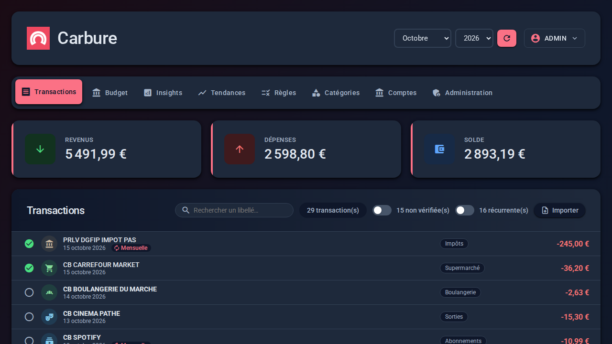
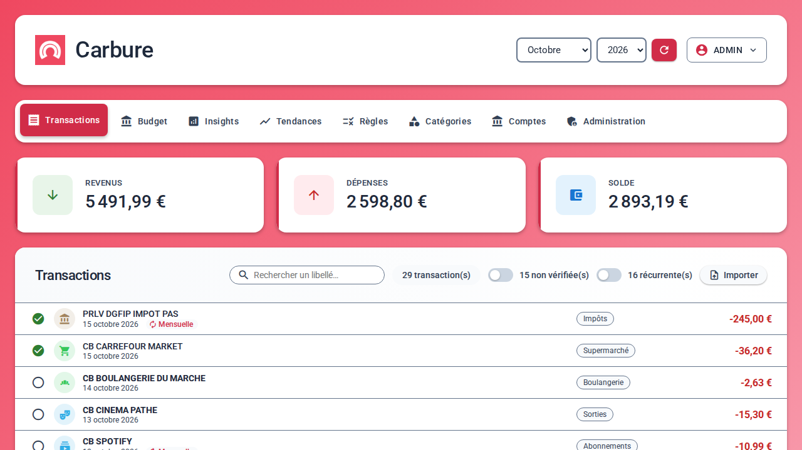
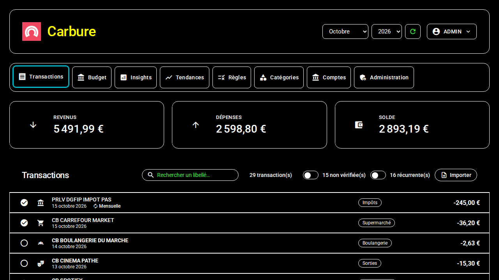

# Web portal

The portal (`portal/`) is a Vue 3 application served as static files, under
`https://<server>/portal/` (the root address redirects to it). It uses the same API as
the [mobile apps](applications-mobiles.md). This page describes the screens; the operating rules (calculations, rules,
notifications, permissions) are in [Features](fonctionnalites.md).

## Installation { #installation }

As long as Carbure is not installed, the portal shows the **setup wizard**,
in three steps:

1. **Database**: server, port, database name, user and password, already
   filled in with Docker (leave the password empty: the one from `docker/docker-compose.yml` is
   used). From the Internet, a **Setup code** is also requested (container
   logs or the `data/conf/setup.code` file).
2. **Installation**: the wizard says what it is going to do — create the tables of an empty
   database, keep an up-to-date Carbure database, or update an existing Carbure database
   (after ticking "I have a backup of my database"). It asks for the
   login, the password (8 characters minimum), the email and the language of the
   **Administrator account** if none exists yet. On an empty database, it also offers,
   under **Getting started**, common categories with their rules and insights
   (two boxes ticked by default; names in the chosen language; everything can still be changed).
3. **Done**: log in with this account.

If the browser still holds the session of a previous installation at the same address (Carbure
reinstalled from scratch), it is closed and the wizard is shown.

## Login and profiles { #connexion-et-profils }

The login screen asks for the login and the password: the API is the one of the server
serving the portal (`/api`, next to `/portal/`). The JWT is kept in the browser
(`localStorage`) until logout or until the session expires (30 days). After **5 failed logins** in a row, the
account is locked for 24 hours; an administrator can unlock it.

When **two-factor authentication** is required (or enabled by the user), a
second screen then asks for the **6-digit code** of the authenticator
app, or a recovery code. At the first login, it shows the
**QR code** to scan and the key as text, then, once the first code is accepted, the
**10 recovery codes** (to copy and keep) before opening the session. The
**Trust this browser for 6 months** box avoids asking for the code again in this
browser; **Back** returns to the password. A wrong code counts as a failed
login.

There are two profiles:

| Profile | Tabs |
|---|---|
| **User** | Transactions, Budget, Insights, Trends; **AI agent** and **My profile** in the user menu |
| **Administrator** | In addition: Rules, Accounts, and the **Administration** menu (Users, Categories, Sync, Mobile push, AI agent, Logs, Settings, Backup, API); adding and editing insights; enabling the MCP server; database update |

The administration pages (Rules, Categories, Accounts, Users) and the
Insights and AI agent tabs share the same layout: a header with the title and the help, and
a round **+** button that opens the form in a modal window, which is also used for
editing.

## Installing the portal as an app { #installer-le-portail-comme-une-application }

The portal can be installed as an **app**: it then opens in its own
window, without address bar or tabs, with the Carbure icon in the Dock, the
taskbar or the home screen.

| Browser | Installation |
|---|---|
| **Chrome, Edge** (Windows, macOS, Linux) | install icon on the right of the address bar, or **⋮** menu → **Install Carbure** (Edge: **Apps** → **Install this site as an app**) |
| **Safari** (macOS Sonoma and later) | **File** menu → **Add to Dock** |
| **Safari** (iPhone, iPad) | **Share** button → **Add to Home Screen** |
| **Chrome** (Android) | **⋮** menu → **Add to Home screen** (or **Install app**) |

- **HTTPS required**: browsers only offer installation for a site served over
  HTTPS (reverse proxy in front of the container, see [Installation](installation.md)), except
  on `localhost`.
- The app window is the portal itself: same login (the session is
  shared with the browser), same theme, logout and login again inside the window. The
  color of its title bar follows the light or dark theme. External links (Carbure
  website, woob tickets) open in the browser.
- **No offline mode**: the portal has no *service worker*; nothing is
  cached (neither the banking data nor the session token), the server is needed to
  use it.
- The manifest (`portal/manifest.webmanifest`) uses relative addresses: it
  also works when Carbure is served under a sub-path. Its icons
  (`portal/icons/`) are generated from `portal/icon.png`.

## Header { #en-tete }

- The **Carbure** title goes back home: transactions of the current month.
- At the top right, the button shows the **login** of the logged-in user; its menu
  gives access to **My profile**, to **AI agent** (non-administrator users) and to
  **Log out**. Just before it, the **theme** icon switches to the light or dark theme (see
  [Themes](#themes-et-preferences-du-systeme)).
- In the top bar, the **month** and **year** selector and the round
  **Refresh** button (icon only) apply to the Transactions, Budget and Insights tabs.
  They only offer the months that have transactions, plus the current month; another
  year selects its last available month. The Trends and Rules tabs have their
  own settings.

!!! note "Database update"
    When a new version of Carbure changes the database (pending migrations), a
    **A database update is available** banner is shown to
    administrators. After backing up the database, the **Update** button applies
    the migrations (`POST /system/migrate`); the data is kept. With Docker,
    they are applied anyway at each container start.

!!! note "New release of Carbure"
    When a new release of Carbure is published, a **Carbure X.Y.Z is available** banner is
    shown to administrators, with the installed version, the **See what's new** link (the
    release notes on GitHub) and the **Hide until the next version** button (remembered in
    this browser). The server checks at most once a day (`update_check` setting, see
    [Configuration](configuration.md#global)); to upgrade, see
    [Installation](installation.md#mettre-a-jour).

## Transactions { #transactions }

- Statistics of the month: income, expenses, balance.
- Compact list of the transactions with the icon and color of their category (those of the
  operation type if they are not categorized), label, date and amount.
- **Checking**: the round button on the left of each transaction marks it as checked
  (green tick) or unchecked. Unchecked transactions are in bold.
- **Filter**: next to the number of transactions, a switch limits the list to
  unchecked transactions (with their number).
- **Recurring transactions**: those found every month (salary, rent,
  subscriptions, bills, `GET /transaction/recurring`) carry the "Monthly" badge. A
  second switch shows only them and lists those that have not arrived yet
  ("Expected this month", with their usual day and amount, "≈" if it varies;
  "Missing this month" for a past month). It does not appear during a search.
- **Search**: the search field (2 characters minimum) queries
  `GET /transaction/search` across all months and shows the **total** of the transactions
  found; the filter also applies to the results. The cross clears the search.
- **Manual categorization**: a transaction without a category offers a
  "Categorize…" picker (icons, colors, search); the transaction is also checked. For an administrator, a banner
  then offers to **Create a rule** to classify this label automatically: it opens
  the Rules tab with the label and the category pre-filled, the keyword can be
  shortened (dates, card numbers…).
- **Transaction details**: a click (or Enter) on the label opens a window with
  the amount, the full label, the dates, the type, the card, the bank (synchronized account
  or imported statement) and the import date; the
  category can be changed there with the visual picker and the transaction can be checked. The trash
  button deletes the transaction, after confirmation: it is no longer imported again, neither by
  the synchronization nor by a statement import (marked "Deleted" in the preview).
  The **Similar transactions** button closes the window and starts a search with the
  label stripped of the operation type (CB, PRLV SEPA, VIR…) and of what follows the
  merchant (card number, date, mandate reference): "PRLV SEPA EDF MDT/123"
  searches for "EDF". The search is then cleared with the cross, like a typed search.
- **Import a statement**: the "Import" button opens a window where you drop the file
  downloaded from the online banking of the bank (OFX/QFX, QIF, CSV or CAMT.053, 1 MB at
  most; banks whose CSV export is verified: see
  [Features](fonctionnalites.md#import-de-releves-bancaires)). A preview classifies each transaction: **new** (ticked), **probable duplicate**
  (same amount as an existing transaction within 3 days, often the same one synchronized
  with another label: not ticked) or **already there** (same identifier: ignored).
  Each transaction has its box: untick those not to import (or "Check all" to
  tick or untick everything); the button shows the number of transactions imported.
  Imported transactions belong to the logged-in user and go through the
  categorization rules; the list then opens on the last imported month
  (`POST /transaction/import/preview`, `POST /transaction/import`). No synchronized account
  is needed: on an empty month (new installation), the button is offered in the
  center of the page, which makes it possible to use Carbure with statements only.

## Budget { #budget }

Two sub-tabs: **Flow** (shown by default) and **Budgets**.

- **Money flow of the month** (Flow sub-tab): key figures (income, expenses, savings and share
  of income saved, left over) then a Sankey diagram that
  shows where the money of the month comes from and where it goes — income by category → income of the month
  → expenses by main category (the 8 largest, the rest grouped under
  "Others"), savings and **Left** (or **Deficit**). Internal transfers (off-budget)
  are excluded. "Show the table" shows the same flows as a table (`GET /budget/flow`).
  A click on a category (or on its flow) shows its transactions below the diagram
  (`GET /budget/flow/transactions`); a second click hides them.
- **Summary of the month** (Budgets sub-tab): spent, budgeted, remaining (or overspent) and overall gauge of
  budgeted expenses.
- **Cards by category** with the icon and color of the category, the amount
  spent out of the budget, the remaining or overspent amount; the card background fills from
  left to right as the budget is used (green up to 105% of the budget, red
  beyond). The budget of a parent category preceded by "Σ" is the sum of its
  sub-categories.
- Separate sections: **budgeted expenses**, **income**, **off-budget and
  inactive**.
- **Click on a category**: list of its transactions of the month (sub-categories
  included) with their total and the checking; if it has sub-categories, their
  cards are shown, with a breadcrumb to go back up.
- Settings button of a card: changes the budgeted amount for the month. For a
  parent category, the **Sum of the sub-categories** box uses their sum; unticked,
  the amount typed replaces it.
- **Copy budgets from the previous month**: the button above the summary takes
  the budgets of the previous month (`POST /budget/copy`), either filling in only the
  categories without a budget or overwriting the month shown.

## Insights { #insights }

Indicators of the selected month, as cards (icon, color, amount).

An administrator adds them (**+** button) and edits them (pencil of each card;
deletion is done in the modal): a name (20 characters at most), a color among
13, an icon and an SQL query `SELECT … AS amount` where `{month}` and `{year}` are
replaced by the month shown. The editor highlights the SQL syntax and has the server check the query
while you type: error (forbidden keyword, MariaDB syntax…) or result
for the month shown. The query runs read-only and cannot read the
`users`, `api_tokens` and `devices` tables (see [Security](securite.md#insights-sql-stocke)).
Sample queries are in [Insight recipes](insights.md).

## Trends { #tendances }

- Period of **3, 6 or 12 months** ending with the current month.
- **Compare with**: no comparison, the previous period or the same period last
  year.
- **Key figures**: total savings, average savings per month, savings rate,
  average expenses per month against the planned budget; when comparing, the difference (arrow,
  color and percentage) with the reference period.
- **Totals comparison** (in comparison mode): credit, debit, off-budget, planned
  budget and savings of both periods.
- **Income, spending and planned budget**: monthly credit / debit / off-budget
  bars and a line for the planned budget, with a detailed tooltip on hover.
- **Monthly savings**: amounts moved to the **Epargne** (savings) category and its
  sub-categories, minus withdrawals (blue bars, red for a month of net withdrawal).
  The category name is set with `savings_category` (case and accents ignored). The
  savings rate is `savings / income`.
- **Table** view of the data month by month.

## Rules (administrators) { #regles-administrateurs }

Automatic categorization: a transaction whose label contains the keyword gets
the chosen category.

- **+**: adds a rule (keyword + category or sub-category) in a modal. The
  category picker shows the icon, the color and the parent of each category,
  grouped by type (expenses, income, off-budget), with a search.
- List of the rules grouped by category, filterable, with deletion.
- **Resynchronize**: applies every rule to every transaction of the database,
  including those already categorized, and shows the number of recategorized transactions. Creating or
  editing a rule also applies it immediately to the whole history (which replaces a
  category chosen by hand on a matching transaction); new transactions
  are categorized at each synchronization.
- A click on a rule opens its window: edit the keyword and the category, see how many
  transactions contain the keyword (and how many are already in the category),
  delete it (trash), and tick **Send a notification**: each new
  synchronized transaction that matches the rule sends a notification to every
  user of the household (bell on the rule), by push or by email depending on the
  **Notifications** of each one's profile.

## Categories (administrators) { #categories-administrateurs }

Tree of categories (one level of sub-categories) grouped by type (expenses,
income, off-budget). **+** adds a category, the pencil edits it (in a modal),
the trash deletes it. The icon and the color are chosen among those that
the mobile apps can display, with a preview. Deleting a category moves its
transactions to "Uncategorized" and deletes its budgets and rules; a category that has
sub-categories cannot be deleted. The "Uncategorized" category (0) is
protected.

## Accounts (administrators) { #comptes-administrateurs }

The page is organized by bank: each **connected bank** (header with its name and
its actions) shows right below it, indented, the **followed accounts** that come
from it; a bank without a followed account says so ("No followed account: add accounts of this bank."). Accounts of a bank that is no longer connected in woob,
or imported from a file, are grouped at the end under **Other accounts**.

- **Household accounts** (shared by all users): each followed account with
  "Added by" (the user who added it), the date and status of its last
  synchronization (Synchronized, Failed or Never synchronized; details on hover), and
  three actions: **Synchronize this account**, rename, stop following (the transactions
  already imported are kept). An account is shown as "BANQUE ···1234" (bank and end
  of the identifier), or under the **name** given to it (optional, e.g. "Compte
  joint"), also in the synchronization and in the transaction details.
- **Synchronize every account** (synchronization icon at the top of the page): starts
  the synchronization of every followed account, with the same live tracking as a single
  account.
- **Adding in two steps**:
    1. **Connect a bank** (modal window): choose the bank among those that
       woob supports; the form asks for the credentials expected by its woob module
       (customer number, code, account type…), which **Connect the bank** hands to woob
       (Carbure neither stores nor logs them). A bank that is already connected is still
       offered ("another login") for a second access with other credentials
       (joint account, business account…). The optional **Name of the connection** field gives it
       a readable name ("Compte joint", "BNP pro"…), shown instead of the name of the
       bank; its technical name in woob (`bnp`, `bnp_2`…) is generated automatically.
       If the bank rejects the credentials, its message is shown and the form stays
       open.
    2. **Connected banks**: each connection (woob backend) shows its name (or else
       the bank's) and its name in woob; the pencil button **renames** it (an empty
       name restores the bank's); the trash **removes** it, after confirmation
       in a portal window: woob forgets its credentials and its followed accounts are no longer
       followed (their transactions are kept). The window stays open, its button
       showing "Removing…", until woob has removed the connection;
       an error is shown there, and the removal can then be retried or canceled. Its **Add accounts** button opens the list of the accounts that woob finds for it
       (`woob bank list -b <bank>`: label, balance); you tick those to follow and
       **Follow the selected accounts** adds them all at once, named after their woob
       label. Accounts already followed are ticked and grayed out. After a connection, this list
       opens directly.
- **Update the bank modules** (administrator): updates the woob modules
  of the banks (`woob config update`), for example after a broken module was fixed,
  with the live woob log. The first time, the window shows the woob repository
  and the fingerprint of its key, to compare with the one published by the woob maintainers before
  **Trust and update**; the following times, the update starts
  directly (see [Security](securite.md)). As long as the repository is not trusted, a
  bank whose module is not installed yet cannot be connected: the connection
  window says so.

  Only an account listed by woob can be followed: there is no manual entry of the
  identifier anymore. Editing an account only changes its name.
- **Synchronization**: live progress, OK/KO status of each step per account
  (pending operations, history, notifications), number of transactions received and
  new, detailed log. A failure of the pending operations is shown on their step
  without failing the account: the history is synchronized anyway. With the `woob_debug` setting, the log also shows,
  live, the woob debug logs (requests to the bank, trace of the Python error),
  to an administrator only. The system command run for each step (`Woob command …`)
  always appears there. When woob fails, a link opens the search for woob tickets
  on the module concerned. After a failed synchronization, whatever the error, the
  **Update the bank modules** button is also offered below the log (an
  outdated woob module is the most frequent cause). If no account could be synchronized, categorization
  is skipped: only the error is notified. During a synchronization, the tab icon spins.

The synchronization of every account is scheduled on the server side (`SYNC_INTERVAL` with
Docker, or a cron job).

### Strong authentication (2FA) { #authentification-forte-2fa }

Some banks (Crédit Mutuel, CIC…) regularly ask to approve the connection
in their app. The scheduled synchronization never triggers this approval:
it first retries the account after `woob_2fa_wait` seconds (`woob_2fa_retries` times:
the approval may have been done on the phone in the meantime), then, if the bank still
asks for it, it fails, the account switches to **Strong authentication needed** and every user
receives the "Strong authentication needed" notification on the mobile app. The
**Approve the strong authentication** button (on the account row or below the error) restarts the
synchronization of this account in interactive mode: woob triggers the request, its message
is shown ("approve in your app…") and the synchronization waits for the approval
on the phone. The session obtained stays valid for several weeks (often 90 days,
PSD2 rule); scheduled synchronizations work again until then.

Authentications that ask you to **type a code** (SMS) are not supported yet.

## AI agent { #agent-ia }

Connection of an AI agent (Claude, ChatGPT, Cursor, Copilot, Gemini…) to the Carbure MCP
server, read-only. See [AI agents (MCP)](mcp.md). The tab is in the
**Administration** menu for an administrator, in the user menu otherwise.

- **MCP server enabled**: switch reserved to administrators (disabled by
  default); users only see its state.
- **Connect Claude (web, Desktop, mobile)**: the URL of the MCP server to paste into Claude
  (Settings → Connectors → Add custom connector), without a token: Claude
  brings you back to the portal, which asks you to **Allow** the access.
- **+**: creates an access token (name and validity: 30 days, 90 days, 1 year
  or no expiration), only possible when the server is enabled. The token and the
  ready-to-copy configuration for each agent are shown only once.
- **My access tokens**: creation date, last use, expiration (or
  "Expired"); the trash revokes a token.

## Users (Administration menu) { #utilisateurs-menu-administration }

List of the users with their **profile** (User or Administrator) and their
**last login**; an account locked after too many failed logins shows
"Locked until …" and an **Unlock** button. **+** creates a user; the pencil
edits it (including its profile); the trash deletes it. The **Reset two-factor
authentication** button (after confirmation) removes the app, the recovery codes and
the trusted browsers of a user who lost their phone. The last administrator cannot
lose their role, and a user who owns transactions cannot be
deleted.

## Logs (Administration menu) { #logs-menu-administration }

The entries of the server log files (`data/logs/carbure_YYYYMMDD.log`), newest
first: choice of the file, minimum level (DEBUG, INFO, WARN, ERROR) and text
search. Each entry shows the IP address of the client and the logged-in user; a click on
the identifier of a request shows all its entries, up to the final line (HTTP status
and duration). Only the end of a large file (2 MB) is read; session tokens and AI
agent tokens are masked. The retention period of the files is recalled at the top of the page.

## Settings (Administration menu) { #parametres-menu-administration }

The configuration file (`data/conf/prod.ini`) section by section,
with a description of each setting. Secrets (`db_password`, `jwtsecret`,
`password_salt`, `sync_token`…) are never shown. Only the risk-free settings
can be edited — `log_level`, `log_retention_days`, `savings_category`, `public_url`, `mfa_required` (two-factor authentication required), `woob_transactions`,
`woob_logging`, `woob_debug`, `woob_auto_update`, the push notification service
(`push_api_key`, with the instance key shown on request) and the SMTP server for emails — with
lists, switches and fields checked by the server; the others carry a
padlock. Changed settings are highlighted; the bottom bar saves or
discards them. The previous file is kept as `prod.ini.bak` (`GET`/`PUT /system/config`).

The SMTP password (`smtp_password`) is never shown: you type a new one to
replace it. In the **Emails (SMTP)** section, **Send a test email** sends an
email with the saved configuration, to your address or to the one typed, and shows the
result or the server's answer in case of failure (`POST /system/smtp-test`).

## Sync (Administration menu) { #synchro-menu-administration }

The `curl` command that starts the synchronization of every account (or of a single one) and the
matching crontab line, to copy for a scheduled task (cron, Synology scheduled
task). The `sync_token` is masked in it until **Show**; the copy button always copies
the full command. **Create a token** / **Renew** writes a new one into
the configuration (`GET /system/sync`, `POST /system/sync-token`).

## Mobile push (Administration menu) { #push-mobile-menu-administration }

The push notification service of the mobile apps (Carbure Push,
`https://api.carbure.org`), in three blocks:

- **Service status**: the relay (operational with its version, in error or unreachable)
  and the API key of the instance (valid, with its identifier, its devices and its
  notifications of the day against its limits; rejected if it was revoked; missing). The
  **Check** button queries the relay again (`GET /system/push-status`, which
  calls `GET /v1/health` and `GET /v1/keys/current`).
- **Registration**: the API key of the instance, reduced to its public identifier
  (`cpk_<id>_••••`) and shown in full with **Show the API key**, the
  **Copy** button; **Register the instance** (or **Renew the key**), after consent,
  which is recalled with its date.
- **Test notification**, sent to the administrator's devices.

The `push_api_key` field stays in **Settings** (to paste a key), with a link to
this tab; see [Configuration](configuration.md#push).

## Backup (Administration menu) { #sauvegarde-menu-administration }

- **Export the data**: you tick the data to back up (categories, categorization
  rules, budgets, insights, transactions, deleted transactions), each with its
  number of rows, then **Export** downloads `carbure-backup-YYYY-MM-DD.zip`. The ZIP
  contains one JSON file per kind of data and a `manifest.json` (format version,
  Carbure and schema version, date, number of rows). Users, passwords,
  tokens, devices, settings, bank connections and bank accounts are never included.
- **Import a backup**: you drop a ZIP exported by Carbure, or a single one of its
  JSON files. For a ZIP, its files are listed with their number of rows and you tick
  those to import (an unrecognized file is flagged and cannot be ticked).
  **Import and replace** asks for confirmation: **the import deletes all the
  data of each imported kind and replaces it** with the data of the file; kinds not
  imported are kept.
- The server checks the whole file before deleting anything, then replaces the
  data in a single transaction: in case of error, nothing is changed and the error
  is shown in the confirmation. A category still used by kept data
  (transactions, rules, budgets not imported) cannot disappear: you then import that
  data together with the categories. Identifiers (including the UUID of transactions) are
  kept; the owner of a transaction is found by their
  login, otherwise it is the administrator doing the import.

## API (Administration menu) { #api-menu-administration }

The documentation of the REST API (Swagger UI from `/swagger/`, described by
`swagger/swagger.php`) shown in the portal, in its light or dark theme.
Swagger UI reuses the session of the logged-in administrator: **Try it out** calls
the API (`/api/...`) with their token in the `Authorization` header, never in the URL; the
requests really run (a `POST`/`PUT`/`DELETE` route changes the data).
**Open Swagger UI** opens it in a new tab.
If a reverse proxy forbids showing `/swagger/` in a frame (header
`X-Frame-Options: DENY` or `frame-ancestors 'none'`), the tab says so instead of an empty
frame: allow `X-Frame-Options: SAMEORIGIN` / `frame-ancestors 'self'`, or use
**Open Swagger UI**.

## My profile { #mon-profil }

Four sub-tabs, like the administration: **Profile**, **Two-factor authentication**,
**Notifications** and **My devices** (opened on **Profile** from the user menu).

- **Profile**: change of the email, first name, last name and password (leave
  empty to keep it). The login cannot be changed. **Language** (Français,
  English, Español, Italiano, Deutsch, Português; each written in its own language): saved on the account and applied at each login, on every
  browser. **Theme** (*Same as the system*, *Light*, *Dark*), like the choice made with
  the header icon (see [Themes](#themes-et-preferences-du-systeme)).
- **Notifications**: a table of notification type × channel (**Mobile app push**, on
  the iOS or Android app through the Carbure Push relay, and email)
  for synchronization, "Notify" rules, large expenses and exceeded
  budgets (disabled by default). Each box is saved right away; notifications
  are sent in the profile's **language**. The settings of an alert are below its
  label, in the table, and are saved on validation or when leaving the field (an
  invalid value is flagged below the field and is not sent):
  - **Large expense**: amount **from which** a new expense, detected
    during a synchronization, is notified (empty = disabled);
  - **Budget exceeded**: the **All the budgets** checkbox (checked by default) and the
    percentage of the budget to **Alert at** (integer from 50 to 200, 100 by default),
    disabled with the checkbox; then the **Thresholds per category**: **Add a threshold
    for a category** creates a row with the first budget of the month without a threshold
    (at the global threshold), where to choose the budget among those of the **Budget** tab,
    in its order (a sub-category is shown as "Category › Sub-category"), and its percentage;
    the bin removes the row. The threshold of a category replaces the global one for it.

  All the boxes of the push column are disabled and grayed out, with the reason below the
  table, as long as the administrator has not registered the instance with the Carbure Push service
  (no `push_api_key`). Unticked email boxes are grayed out as long as no
  SMTP server is configured or the profile has no email address (a ticked box stays
  editable, to untick it) (`GET`/`PUT /user/notifications`).
- **Two-factor authentication** (dedicated sub-tab, absent as long as the migration is not
  applied): status (enabled or not, required or not by
  the administrator). **Set up an app** shows the QR code (large, on a white
  background, fitted to the width of a phone) and the key, to
  confirm with a first code; the 10 recovery codes are then shown only
  once. Once enabled, a code from the app gives **New recovery
  codes**, and a code from the app or a recovery code can **Disable** it (after
  confirmation). Trusted browsers are in **My devices**.
- **My devices**:
  - **Connect the mobile app**: QR code
    `https://carbure.org/app/?server=<API URL>` to scan with the camera of the phone,
    which opens the app on this server (see
    [Mobile apps](applications-mobiles.md#lien-de-connexion)), the address shown and a
    **Copy the link** button; the address is the one of `public_url` when it is set
    (`GET /device/link`), otherwise the one of the portal, and a warning is shown for
    `localhost`;
  - **Mobile apps**: devices registered at login from the app, with
    their platform (icon and **iOS** or **Android** label), the date of last login,
    the model, the system version and the app version when the app sends them
    ("iPhone16,1 · iOS 26.0 · app 1.2") and the notification token, masked by default. The buttons let you show it in
    full, copy it (HTTPS required; otherwise the token is shown) or **delete** an
    old device (`GET`/`DELETE /device`);
  - **Web browsers**: browsers from which the user logged in to the portal, with a
    readable name taken from the User-Agent, the **This browser** badge for the current
    one, the dates of last and first login, and a **Remove the browser** button (after
    confirmation) that forgets it without closing its session (`GET`/`DELETE /user/browser`);
  - **Trusted browsers**: web browsers where the two-factor authentication code
    is not asked again for 6 months, with a readable name taken from the User-Agent ("Firefox
    on Windows"), the date of last use and the expiration, and their
    **Revoke** button (`GET /user/mfa`, `DELETE /user/mfa/browser`).

## Footer { #pied-de-page }

Link to the Carbure website ([carbure.org](https://carbure.org/)), license and **version**
of the instance (`v1.2.0`, or `dev` outside a release), read from `GET /api/health`.

## Accessibility { #accessibilite }

The portal targets WCAG level AA (Lighthouse "Accessibility" score of 100 on the
tabs and windows):

- sufficient contrast (brand red darkened to 5:1 on white), at rest **and on
  hover** of buttons (a button with a light background keeps its background on hover), and keyboard focus
  always visible;
- "Skip to content" link, page landmarks (banner, navigation, main content) and
  current tab announced;
- decorative icons hidden from screen readers, icon-only buttons named, fields
  associated with their label, modal windows announced as dialogs and closed with
  **Esc**;
- messages (toasts, errors) announced by screen readers, page language following
  the user's;
- charts backed by a table (Trends, Money flow of the month) and animations turned off when the
  system asks for reduced motion.

### Themes and system preferences { #themes-et-preferences-du-systeme }

The portal follows the display settings already chosen in the system, with no theme to
enable:

- **light or dark**: by default, the theme follows the system preference (and its
  changes); the profile lets you set it (**Theme**: *Same as the system*, *Light*,
  *Dark*), a choice saved on the server and found again on another browser. The theme
  is applied before the page is displayed (`portal/theme.js`), with no flash of the other
  theme;
- **theme button**: the icon on the right of the header, just before the user menu,
  switches with one click to the theme opposite to the one shown (moon `dark_mode` in light theme:
  *Switch to dark theme*; sun `light_mode` in dark theme: *Switch to light
  theme*). The choice is saved in the profile like the **Theme** selector, which
  reflects it; to follow the system again, choose *Same as the system* in the
  profile. The login screen does not have this button (it applies the theme remembered by the
  browser, otherwise the system's);
- **increased contrast** (macOS, iOS, `prefers-contrast: more`): secondary texts and
  borders darker (lighter in dark mode), thicker focus ring;
- **forced colors** (Windows high contrast mode, `forced-colors`): colors
  are the system's; buttons, tabs, fields, toggles, budget bars, cards and
  focus keep a visible border or outline.

The dark theme follows the same rules as the light theme (4.5:1 for text, 3:1
for an icon, at rest, on hover and on focus): accent colors are
lighter there and the text on them dark; category colors are lightened
(`--category-ink`) to stay readable on a dark background.

Contrast is checked by the e2e tests (`tests/e2e/specs/accessibility.spec.js`,
in light theme and in dark theme; `themes.spec.js` for increased contrast and
forced colors):
every text of every tab, menu and window, and every button at rest and on
hover must reach 4.5:1 (3:1 for an icon or large text). Colors
chosen by users (categories) and SVG charts are not measured.

## Debug mode { #mode-debug }

Adding `?debug=true` to the URL shows a panel with the last API request and enables
logs in the browser console.
