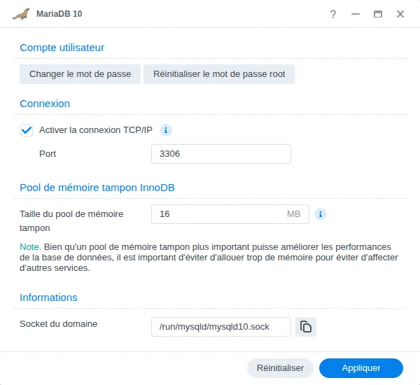
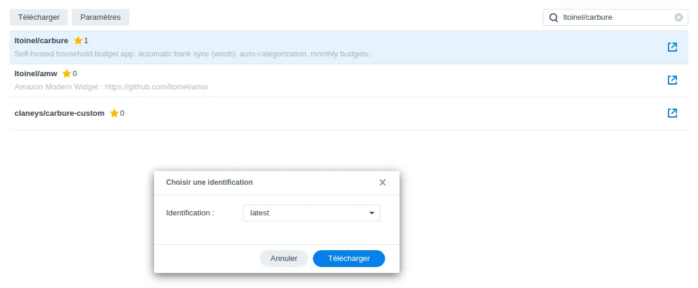
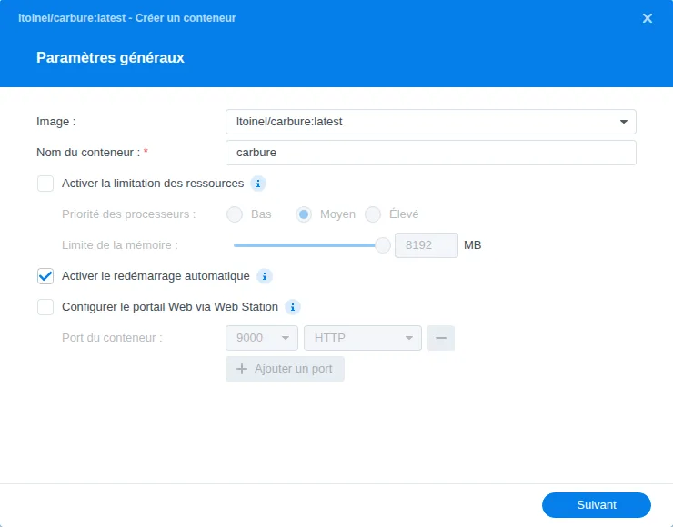
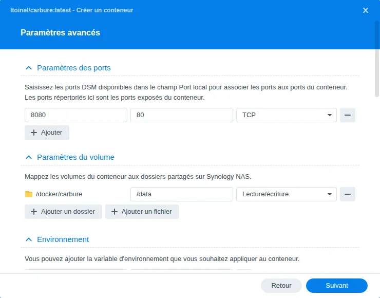
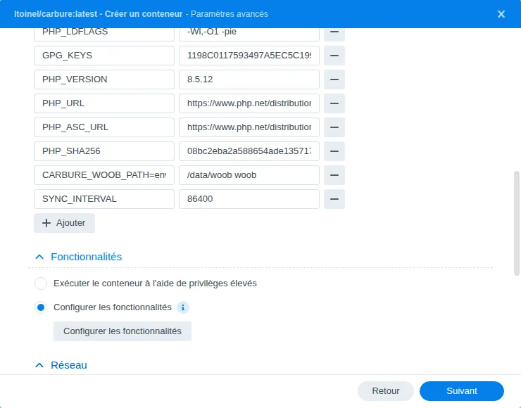
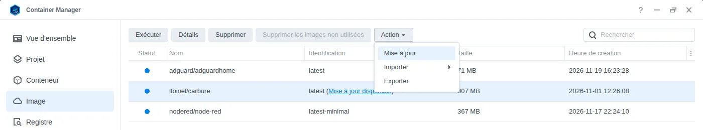
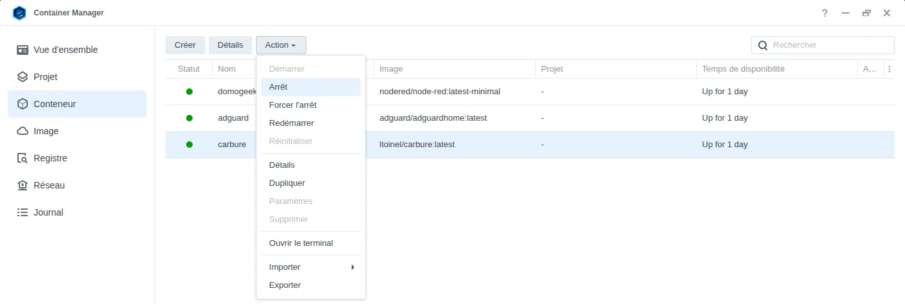

# Tutoriel : Carbure sur un NAS Synology

Ce tutoriel installe Carbure sur un NAS Synology (DSM 7.2 ou plus) avec **Container
Manager**, en utilisant la base **MariaDB 10** du NAS. Tout se fait depuis l'interface de
DSM et le navigateur, sans aucune commande. Comptez une quinzaine de minutes.

!!! info "Ce qu'il vous faut"
    - Un NAS compatible avec Container Manager (la plupart des modèles « + » et récents,
      processeur Intel/AMD ou ARM 64 bits).
    - Un compte administrateur DSM.
    - L'adresse IP de votre NAS sur le réseau local (par exemple `192.168.1.10`), visible
      dans **Panneau de configuration → Réseau → Interface réseau**.

## 1. Installer les paquets

Dans le **Centre de paquets**, installez :

- **MariaDB 10** : la base de données ;
- **Container Manager** : pour faire tourner Carbure ;
- **phpMyAdmin** : pour créer la base de Carbure (il installe aussi Web Station).

## 2. Préparer MariaDB 10

Ouvrez l'application **MariaDB 10** :

1. Dans **Connexion**, cochez **Activer la connexion TCP/IP** et notez le **Port** affiché
   (`3306` ou `3307` selon le NAS), puis **Appliquer**.
2. Si ce n'est pas déjà fait, définissez le mot de passe de l'utilisateur `root` de
   MariaDB (bouton **Changer le mot de passe** ; **Réinitialiser le mot de passe root**
   s'il est perdu).



## 3. Créer la base et l'utilisateur de Carbure

Ouvrez **phpMyAdmin** (depuis le menu principal de DSM), connectez-vous avec `root` et le
mot de passe de MariaDB, puis :

1. Onglet **Comptes d'utilisateurs** → **Ajouter un compte d'utilisateur**.
2. **Nom d'utilisateur** : `carbure`.
3. **Nom d'hôte** : choisissez **Utiliser le champ textuel** et saisissez `172.17.%` :
   Carbure se connecte depuis son conteneur, sur le réseau Docker du NAS (`bridge`), et
   ce compte ne pourra pas servir depuis une autre machine. Si l'assistant ne parvient
   pas à se connecter (étape 6), vérifiez le sous-réseau dans **Container Manager** →
   **Réseau** → `bridge`, ou utilisez **N'importe quel hôte** (`%`).
4. **Mot de passe** : choisissez-en un solide et **notez-le**.
5. Cochez **Créer une base portant le même nom et donner à cet utilisateur tous les
   privilèges sur cette base**.
6. Cliquez sur **Exécuter** en bas de la page.

Vous avez maintenant une base `carbure` et un utilisateur `carbure`. Carbure créera ses
tables lui-même à l'étape 6.

## 4. Télécharger l'image Carbure

L'image est publiée sur [Docker Hub](https://hub.docker.com/r/ltoinel/carbure) : elle se
trouve directement depuis le DSM.

1. Ouvrez **Container Manager** → **Registre**.
2. Recherchez `ltoinel/carbure` et sélectionnez **ltoinel/carbure** (d'autres images
   portent un nom proche : vérifiez l'auteur `ltoinel`).
3. Cliquez sur **Télécharger** : dans **Choisir une identification**, gardez `latest` (ou
   choisissez une version, par exemple `1.13.0`) puis **Télécharger**.



L'image apparaît dans **Image** une fois téléchargée.

## 5. Lancer le conteneur Carbure

Ouvrez **Container Manager** → **Image**, sélectionnez **ltoinel/carbure** puis
**Exécuter** : l'assistant **Créer un conteneur** s'ouvre.

**Paramètres généraux** :

- **Nom du conteneur** : remplacez le nom proposé (`ltoinel-carbure-1`) par `carbure` ;
- cochez **Activer le redémarrage automatique** : Carbure redémarre avec le NAS ;
- laissez décochés **Activer la limitation des ressources** et **Configurer le portail
  Web via Web Station**.



Cliquez sur **Suivant**. **Paramètres avancés** :

- **Paramètres des ports** : saisissez `8080` dans **Port local**, en face du **Port du
  conteneur** `80` (TCP). Supprimez la ligne du port `9000` avec le bouton **−** : c'est
  un port interne de l'image, à ne pas publier.
- **Paramètres du volume** → **Ajouter un dossier** : dépliez le dossier partagé `docker`
  (créé par Container Manager), créez-y un dossier `carbure` avec **Créer dossier**,
  sélectionnez-le puis **Sélectionnez**. Saisissez `/data` comme chemin de montage,
  en **Lecture/écriture** : la configuration, les logs et les banques de Carbure y sont
  conservés.



- **Environnement** : ne touchez pas aux variables déjà présentes, elles viennent de
  l'image. `SYNC_INTERVAL` vaut `86400` : la synchronisation bancaire a lieu une fois par
  jour (supprimez la ligne pour la désactiver, voir l'étape 7).
- **Fonctionnalités** : gardez **Configurer les fonctionnalités** ; ne choisissez pas
  **Exécuter le conteneur à l'aide de privilèges élevés**, Carbure n'en a pas besoin.
- **Réseau** : gardez `bridge` (sous-réseau `172.17.0.0/16`, celui de l'utilisateur
  `carbure` de l'étape 3).



Cliquez sur **Suivant** : le **Résumé** reprend vos choix. Laissez cochée l'option qui
exécute le conteneur à la fin de l'assistant, puis cliquez sur **Terminé** : Container
Manager démarre Carbure.

Les paramètres de la base de données ne se mettent pas dans le conteneur : vous les
saisissez dans l'assistant d'installation (étape 6), qui les enregistre dans
`docker/carbure`.

!!! tip "Port déjà utilisé ?"
    Si le port `8080` est déjà pris sur votre NAS, choisissez un autre **Port local**, par
    exemple `8095`, et utilisez ce port dans la suite.

## 6. Installer Carbure depuis le navigateur

Ouvrez `http://192.168.1.10:8080/` (l'adresse de votre NAS) : l'**assistant
d'installation** s'affiche.

1. **Base de données** : saisissez **l'adresse IP du NAS** (par exemple `192.168.1.10`,
   pas `localhost` : depuis le conteneur, `localhost` désigne le conteneur lui-même), le
   **port** de MariaDB 10 noté à l'étape 2, la base et l'utilisateur
   `carbure` et le **mot de passe** de l'étape 3, puis **Continuer**.
2. **Installation** : Carbure indique qu'il va créer ses tables. Choisissez l'identifiant et
   le mot de passe du **compte administrateur** (8 caractères minimum). Laissez cochées les
   options **Pour bien démarrer** pour avoir des catégories, des règles et des insights
   prêts à l'emploi (modifiables ensuite), puis **Installer**.
3. **Terminé** : connectez-vous avec ce compte.

Si l'assistant affiche une erreur de connexion à la base, vérifiez l'adresse IP, le port,
l'option **Activer la connexion TCP/IP** de MariaDB 10 et l'hôte (`172.17.%`) de
l'utilisateur `carbure`, puis corrigez la saisie et réessayez.

Les réglages de Carbure (niveau et conservation des logs, woob, notifications push mobiles, serveur
SMTP des emails…) se consultent et se modifient ensuite dans le portail, onglet **Administration →
Paramètres**, sans ouvrir de fichier sur le NAS : voir [Configuration](configuration.md).

## 7. Ajouter vos comptes bancaires

Dans le portail, onglet **Comptes** → **+** :

1. Choisissez votre banque dans la liste des banques supportées par
   [woob](https://woob.tech/) (par exemple BNP Paribas, Crédit Mutuel, Boursorama).
2. Saisissez les identifiants demandés et cliquez sur **Connecter la banque** : ils sont
   confiés à woob, qui les conserve dans le dossier `docker/carbure` du NAS ; Carbure
   ne les enregistre pas.
3. Cliquez sur **Suivre** pour chaque compte à synchroniser, puis **Enregistrer**.

!!! note "« Woob will not start as long as config file … is readable by group or other users »"
    woob refuse un fichier d'identifiants lisible par d'autres utilisateurs, ce qui arrive
    quand il est copié dans un dossier partagé du NAS. Carbure corrige ces droits au
    démarrage du conteneur et avant chaque appel à woob. Si le message persiste (ACL du
    dossier partagé), ouvrez **Container Manager** → **Conteneur** → `carbure` →
    **Action** → **Ouvrir le terminal** → **Créer** → `sh`, puis :
    `chmod 600 /data/woob/.config/woob/backends`

La synchronisation se lance compte par compte avec le bouton de synchronisation, et
automatiquement chaque jour grâce à `SYNC_INTERVAL`.

!!! tip "Planifier la synchronisation avec le Planificateur de tâches de DSM"
    Pour choisir l'heure de la synchronisation plutôt qu'un intervalle, laissez
    `SYNC_INTERVAL` vide et créez une tâche dans **Panneau de configuration → Planificateur
    de tâches → Créer → Tâche planifiée → Script défini par l'utilisateur** (utilisateur
    `root`, programme : tous les jours à 7h). Dans **Paramètres de tâche → Exécuter la
    commande**, collez la commande `curl` de l'onglet **Administration → Synchro** du
    portail :

    ```bash
    curl -fsS -H "X-Sync-Token: <sync_token>" http://localhost:8080/api/bank/sync > /dev/null
    ```

!!! warning "Migration : le jeton dans l'URL est obsolète"
    Une tâche planifiée créée avec l'ancienne forme
    `curl "http://localhost:8080/api/bank/sync?token=<sync_token>"` (ou `wget` avec la
    même URL) fonctionne toujours, mais elle est **obsolète** : le jeton passé dans l'URL
    finit dans les logs et un avertissement est journalisé à chaque appel. Dans le
    **Planificateur de tâches**, modifiez la tâche (**Modifier → Paramètres de tâche**) :
    retirez `?token=…` de l'URL et ajoutez `-H "X-Sync-Token: <sync_token>"` (avec `wget` :
    `--header="X-Sync-Token: <sync_token>"`), comme ci-dessus.

## 8. (Facultatif) Un accès HTTPS avec un nom de domaine

Pour utiliser l'application iOS ou accéder à Carbure depuis l'extérieur, passez par le
proxy inversé de DSM : **Panneau de configuration → Portail de connexion → Avancé → Proxy
inversé → Créer** :

- **Source** : protocole `HTTPS`, nom d'hôte `carbure.votre-domaine.fr`, port `443` ;
- **Destination** : protocole `HTTP`, nom d'hôte `localhost`, port `8080`.

Le certificat se crée dans **Panneau de configuration → Sécurité → Certificat** (Let's
Encrypt). La synchronisation est un flux continu : si elle s'interrompt après une minute
derrière le proxy, augmentez les délais d'expiration dans les paramètres avancés de la
règle.

!!! warning "Exposition sur Internet"
    Installez Carbure (étape 6) **avant** de l'ouvrir sur Internet. Derrière le proxy
    inversé de DSM, les requêtes semblent venir du NAS lui-même : l'assistant
    d'installation ne demanderait alors pas de code d'installation. Une fois Carbure
    installé, l'assistant disparaît.

## Sécuriser l'installation

Carbure contient vos comptes et, dans `docker/carbure`, les identifiants bancaires
confiés à woob et les secrets de sa configuration. Ces réglages de DSM les protègent :

- **Pare-feu** (**Panneau de configuration → Sécurité → Pare-feu** → **Activer le
  pare-feu** → **Modifier les règles**) : autorisez les ports `8080` (Carbure) et celui de
  MariaDB 10 (`3306` ou `3307`) uniquement depuis votre réseau local (par exemple `192.168.1.0/24`) et
  refusez-les depuis le reste. Sur votre box, ne redirigez que le port `443` (étape 8),
  jamais `8080` ni le port de MariaDB.
- **Dossier partagé `docker`** (**Panneau de configuration → Dossier partagé** → `docker`
  → **Modifier** → **Permissions**) : accès réservé aux administrateurs ; ne le partagez
  pas avec les autres utilisateurs du foyer, en SMB ou autrement.
- **HTTPS** : sur la règle de proxy inversé de l'étape 8, activez **HSTS** (le navigateur
  refusera ensuite de repasser en HTTP), avec un certificat Let's Encrypt.
- **Sauvegardes chiffrées** : dans la tâche **Hyper Backup** qui contient
  `docker/carbure` et MariaDB 10, activez le **chiffrement côté client**, surtout si
  la destination est dans le cloud.
- **Compte DSM** : activez la **validation en 2 étapes** et le **blocage automatique**
  (**Panneau de configuration → Sécurité → Protection**) : le NAS héberge tout le reste.
- **Mises à jour** : appliquez les mises à jour de Carbure (ci-dessous), de DSM et de
  MariaDB 10. Chaque image de Carbure est analysée (vulnérabilités connues) avant d'être
  publiée.

Voir aussi la page [Sécurité](securite.md).

## Mettre à jour Carbure

Quand une nouvelle version est publiée, **Container Manager** → **Image** l'indique sur
`ltoinel/carbure` : **latest (Mise à jour disponible)**. Le portail le signale aussi aux
administrateurs.

1. Sélectionnez `ltoinel/carbure`, puis **Action** → **Mise à jour** (ou cliquez sur le
   lien **Mise à jour disponible**).

    

2. Si le conteneur tourne encore sur l'ancienne image : **Conteneur** → `carbure` →
   **Action** → **Arrêt**, puis **Réinitialiser** (disponible une fois le conteneur
   arrêté : il est recréé avec la nouvelle image, en gardant ses ports, son dossier et
   ses variables), puis **Démarrer**.

    

Au redémarrage, Carbure met sa base de données à jour automatiquement.

Pensez à sauvegarder la base avant une mise à jour : phpMyAdmin → base `carbure` →
**Exporter** → **Exécuter**, ou une tâche **Hyper Backup** incluant MariaDB 10.

## Sauvegarder

- **Base de données** : export phpMyAdmin ou Hyper Backup (application **MariaDB 10**).
- **Configuration et banques** : le dossier `docker/carbure` (Hyper Backup ou
  copie).
